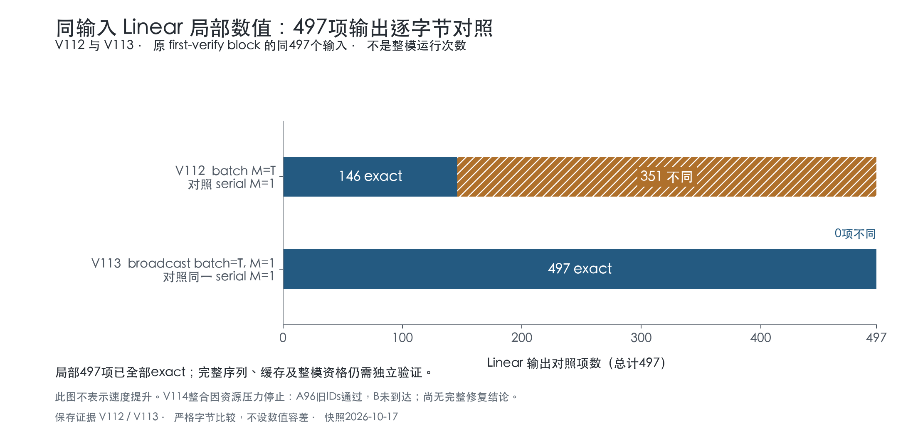

# 39：让一次 verify 保留逐行量化乘法的结果

上一章发现：verify 把几个 token 放在一起计算时，Linear 的结果可能与逐 token 计算不同。本章先修这一处，并把它放回真实 verify 检查。局部 V113 已通过；V114 首次整模尝试在加载草稿模型时因内存压力中止，新 verify 尚未执行。

[固定代码版本与三份前后diff](../code-versions/39-broadcast-m1/README.md)保存当前候选；[图、数据和进度记录](../progress/README.md)随实际检查点更新。

## 1. 我们到底在替换什么

原来的普通解码一次只有一行输入。例如输入向量有 K 个分量，Linear 输出 N 个分量：

```python
x.shape == (1, K)
y = linear(x)           # 输出 [1, N]
```

verify 一次检查 T 个位置，于是输入变成 T 行。我们希望一次调用覆盖这 T 行：

```python
x.shape == (T, K)
y = linear(x)           # 原批量写法，输出 [T, N]
```

数学上，每一行都独立计算同一个式子：

```text
y[t, n] = sum_k x[t, k] * W[n, k]
```

这里没有让不同 token 互相相乘。权重还是同一份 W；checkpoint、bits、group_size 和 scale 都没变。差异来自底层为了不同输入形状选择了不同计算方法。

## 2. 为什么同一个式子还会不同

浮点加法会舍入，改变分组可能改变最终位模式。例如在精度有限的计算中，先把很大的正负数抵消，再加一个小数，与先把小数加到大数上，结果可能不同。

矩阵乘法要累加很多乘积。为了提速，kernel 会把它们分给不同线程、分块后再合并。T 从 1 变成 5，可能改变归约方式。公式相同，不保证浮点结果逐字节相同。

这不是改了量化权重，也不是重新训练。我们要解决的是：让 verify 使用的 Linear 保留普通单 token 路径的数值结果。

## 3. 三种写法，分别表示什么

逐行参考可以明确保留原来的调用形状：

```python
reference = mx.concatenate(
    [linear(x[t:t+1]) for t in range(T)], axis=0
)
```

它调用 T 次 Linear，每次输入 [1, K]。新写法增加一个批次轴，让一次调用表达 T 个独立的 [1, K]：

```python
# x:      [T, K]       -> [T, 1, K]
# weight: [N, Kpack]   -> [1, N, Kpack]
# scales: [N, Kgroup]  -> [1, N, Kgroup]
y = mx.quantized_matmul(
    x[:, None, :],
    linear.weight[None, ...],
    linear.scales[None, ...],
    None,
    transpose=True, group_size=16, bits=4, mode="nvfp4",
)
y = y.reshape(T, N)
```

| 写法 | 批次数 | 每次矩阵有几行 M | Python 中的 QMM 调用数 |
|---|---:|---:|---:|
| 原批量 | 1 | T | 1 |
| 逐行参考 | T 次独立调用 | 1 | T |
| 广播 M1 | T | 1 | 1 |

权重的前导维度是 1，表达所有批次共享同一份 packed weight；代码没有复制 T 份权重，也没有先解量化整份 W。实际内存和收益仍须测量，不能只看这段代码就下结论。

MLX 0.32.3 官方源码表明，给 weight 保留三维形状可以避开二维 weight 的展平分支。这支持设计思路；本轮没有捕获实际 PSO，不能把源码推断写成实际 dispatch 观测。M5 E010 也是借助批次轴保留原来的 M，但它保留每条序列的 M=T；这里希望保留 M=1。

## 4. 已经实际验证了什么

V113 使用上一章真实首次 verify 的输入：先完成原 batch 轨迹，再对每个 Linear 的同一输入比较三种写法。替代输出没有传给后面的层。

- 全部 497 个 Linear、1,491 项三路对照完成。
- 广播 M1 与逐行参考：497 项全部逐字节相同。
- 原批量与逐行参考：146 项相同，351 项不同，共 1,281 个 BF16 元素不同。
- 原 V112 的全部 497 份输入及两种输出 hash 重现；keep0 恢复全部 128 个缓存组件，1,349 个 target 参数的 identity 与字节只读检查通过。



第一次运行因内存压力中止，没有比较结果。正常退出后台应用后，第二次在同一冻结源码上通过；两次记录都保留。它是电池供电的数值检查，没有性能资格。

局部通过只说明每个算子在这些输入上符合逐行参考。真正把新输出传到下一层以后，输入轨迹也会改变，所以还需要整模检查。

## 5. V114 怎样接回原框架

接入版默认关闭，只在实际 target verify 作用域启用广播 M1，包含最后的 lm_head。普通 prefill、草稿模型和草稿借用的 target head 都在作用域之外；退出或异常时恢复每个实例的标记。

```text
prefill：原路径
draft：原路径
target verify：启用广播 M1 → 构建图 → 恢复标记
接受前缀／提交缓存：原 V108 事务规则
```

新资格保留旧的 96 个输出 IDs 硬门，还增加独立普通解码 A：A 自己 prefill、自己 argmax 推进，不向 B 提供 token 或状态。每次提交按实际已计算位置比较 128 个缓存组件，以及最后已计算位置的 logits；不同就停止。最后交付的 anchor 仍未计算，不能错把它计入缓存。

首次实际运行已通过普通 A 的三请求、96 个旧 IDs，随后在草稿模型加载期间触发 pressure=2。监控器发出 SIGTERM 并回收进程；事务数为 0，还没有 B 的整模数值结果。它是资源中止，不能记为算法失败，也不能因局部通过而记为整模通过。

接下来处理加载峰值：旧加载器一次建立全部量化图，再统一求值，原 BF16 输入会一直存活。待量化输入约 3.59 GB，最终量化结果之外还需要这批临时空间。新 V116 逐项量化、求值并释放原输入，已单独实际通过全部 175 个草稿参数的严格比对；普通 A 参数只读、350 个独立输出对象也通过。这个探针没有加载27B目标，独立结果审查亦通过，接下来用新版本重跑整模资格；原 V114 保持不变。

只有整模数值资格通过以后，才进入无诊断 hook 的端到端计时；减少 Python 调用数不能代替实际提速。
