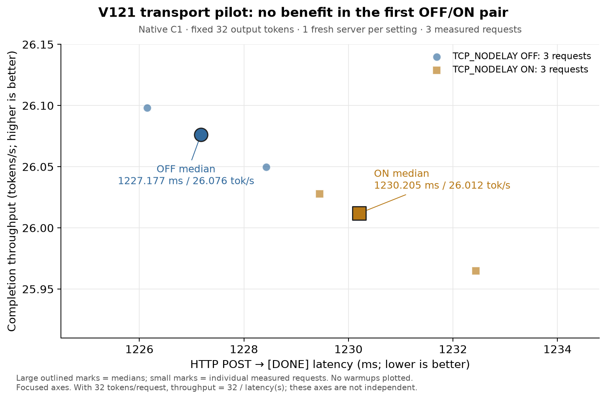

# 41 · TCP_NODELAY：首对 HTTP pilot 未见收益

在同一 native C1 服务上，仅切换 accepted socket 的 `TCP_NODELAY`，首对结果没有改善。按执行前冻结的计划提前停止，后续四臂没有运行，默认仍为 OFF。

| 配置 | POST→DONE 中位数 | 完成吞吐中位数 | 文本 TTFT 中位数 |
|---|---:|---:|---:|
| OFF | 1227.177 ms | 26.0761 token/s | 159.011 ms |
| ON | 1230.205 ms | 26.0119 token/s | 159.367 ms |

每臂一个全新 server，启动时先做一次普通 32-token warm，再做 3 次 HTTP warm、3 次正式请求。图只画六次正式请求及各臂中位数；三次重复来自同一进程，不是三次独立加载。固定每请求输出 32 token，因此纵轴是 `32 / POST→DONE秒数`，两轴不独立。ON/OFF 吞吐比为 **0.997538**，本次未采用；这不是新的三引擎 Pareto 前沿。

复用已冻结 V105 的 CAP64/direct native HTTP adapter：同一模型、greedy、19-token prompt、32-token 上限、无 draft、无 prefix cache，SSE 写入及客户端时钟不变，旧的逐 token trace 开销也两臂保留。12 次 HTTP 请求全部保留相同的原始 32 个 ID（384 token；其中 6 次正式请求共 192 token）。每臂 native 完成 186 步、6 次 reset，ICB 两 bank 各 96/90 次；启动普通 warm 另计。

改动只在 `StreamRequestHandler.setup()` 的 accepted socket 上设置并读回选项。Mac 实际 `getsockopt(TCP_NODELAY)` 返回 **OFF=0、ON=4**，按零/非零判断，不能硬写 `==1`。每条连接都检查，首条读回单独留证；异常会使 server fail closed。[helper](41-native-http-nodelay-source/socket_transport.py)、[server 差异](41-native-http-nodelay-source/server.py.diff)、[driver 差异](41-native-http-nodelay-source/driver.py.diff)保留了相对原 V105 的实现变化与[来源身份](41-native-http-nodelay-source/baseline.json)。此结果不能说明 Nagle 是此前延迟的原因，也不比较其他引擎的编译能力。

34 个计时区间外资源采样均为 AC、thermal 0、pressure 1，swap usage 与 Swapouts 保持不变。driver 按负结果返回 2；owner 与两个 server 已 wait/reap，根进程另存的 external release 确认四个 PID 和两个端口均 absent。[独立保存结果复核](41-native-http-nodelay-source/independent-review/REVIEW.md)确认相同结论；其新的 `ps` 检查受 sandbox 限制，退出结论使用已有严格 absence 与根进程 external release，不能称作复核者新增实时证明。

[冻结计划](41-native-http-nodelay-source/plan.json)、[12 组白名单原始请求](41-native-http-nodelay-source/requests-whitelisted.json)、[结果](41-native-http-nodelay-source/result.json)、[资源](41-native-http-nodelay-source/resources-whitelisted.json)、[退出证明](41-native-http-nodelay-source/external-release.json)及 [CSV](41-native-http-nodelay-source/plot-data.csv)均随文保存。白名单保留请求时钟、SSE 事件、用量、文本和 ID；未归档启动环境或认证字段。

离机复算：`python3 docs/experiments/41-native-http-nodelay-source/verify.py`。加 `--originals` 可在原实验机器校验原始文件身份。画图脚本为 [plot.py](41-native-http-nodelay-source/plot.py)，需要 Matplotlib；校验脚本仅用标准库，不加载模型或 GPU。
