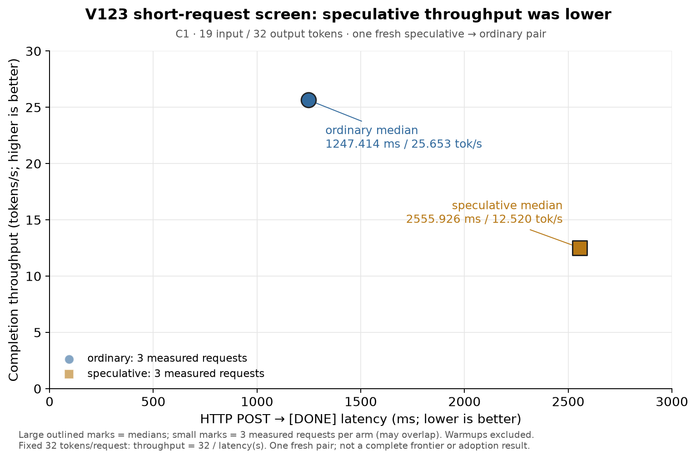

# 42 · 短请求跑通了，spec 吞吐仍约为 ordinary 的一半

V117 已通过完整模型正确性资格；V123 随后完成一次新的 **speculative → ordinary fresh 配对**。两臂 HTTP raw32 都通过，但这次 19→32 短请求中，spec 吞吐只有 ordinary 的 **48.805%**，没有性能收益。

| 配置 | POST→DONE 中位数 | 完成吞吐中位数 | 文本 TTFT 中位数 |
|---|---:|---:|---:|
| speculative | 2555.926 ms | 12.5199 token/s | 160.497 ms |
| ordinary | 1247.414 ms | 25.6531 token/s | 162.907 ms |

每臂只启动一个新服务，3 次 HTTP warm 后测 3 次正式请求；三次重复不是三次独立加载。每次固定输出 32 token，故纵轴为 `32 / POST→DONE秒数`，两轴不独立。spec 的完成延迟约为 ordinary 的 2.049 倍。图只呈现本次两臂，不与旧 native15、oMLX 或 Lithos 的轮次混合，也不更新完整 Pareto 前沿。

本次唯一新增启动行为，是两臂都在挂接 draft 之前先完成一次普通 19→32 请求，检查完整 raw32 和 runner 清理。**spec 随后才加载一次 bounded DFlash，ordinary 不加载 draft**；这次启动 warm 完全在 HTTP 时钟之外，不能替代原有的 3 次 HTTP warm。CAP64、block5、bounded loader、广播 M1 verify、34 GiB limit、显式 low64 cache 配置及资源门保持原协议。`engine_cache_limit_gb=0` 后另设 64 MiB runtime cache，不能称 allocator cache 为零。

V120/V122 的资源 STOP 保留不变。V123 此次成功越过资源门，不能据此认定启动顺序就是此前资源变化的根因，也不能把 allocator 计数当作物理内存或 shader/program cache。源码差异只记录启动 warm 与 metadata 回调，HTTP handler、worker loop 和 client 沿用父版本。[source.diff](42-startup-warm-short-request-source/source.diff) 与 [source proof](42-startup-warm-short-request-source/source-config-proof.json)保留边界；本次没有新增数值 kernel。

12 次 HTTP 请求共 384 输出 token，其中正式 6 次共 192；另有两次启动 ordinary warm 共 64 token，合计 14 请求、448 输出。全部记录 raw32 与旧 fixture 相同。38 个区间外资源采样均为 AC、thermal 0、pressure 1，swap usage 和 Swapouts 不变。两个 server 均按身份 TERM、wait/reap；根进程保存的 external release 确认 owner、两个 server 与端口均 absent。[独立复核](42-startup-warm-short-request-source/independent-review/REVIEW.md)确认相同口径；它只复核保存证据，不追加实时进程证明。

没有保存 draft/verify/accepted 数量或独占 GPU 时间，因此不猜测本次约半速的原因。本结果也不代表长输出或并发请求的表现，不作采用结论。

历史源码 README 的启动示例把 controls 先放进父 owner 环境，与 owner 的空环境 preflight 相冲突。实际根进程先用 `common.selected(env)` 移除**全部匹配键**，确认 `parent_selected=[]`，再 `os.execve` owner；由 owner 给 child 设置 50/50/20/0。原文件不改，新增 [corrected-launch.py](42-startup-warm-short-request-source/corrected-launch.py)重现这一入口修正，默认 inert；没有归档原始环境、进程 argv 或认证信息。

[12 组请求白名单](42-startup-warm-short-request-source/requests-whitelisted.json)、[资源白名单](42-startup-warm-short-request-source/resources-whitelisted.json)、[启动与结果](42-startup-warm-short-request-source/arms-selected.json)、[退出证明](42-startup-warm-short-request-source/external-release.json)、[CSV](42-startup-warm-short-request-source/plot-data.csv)随文保留。离机复算：`python3 docs/experiments/42-startup-warm-short-request-source/verify.py`；原实验机器可加 `--originals` 校验身份。重画图需 Matplotlib，[plot.py](42-startup-warm-short-request-source/plot.py)仅使用这些保存数据。
