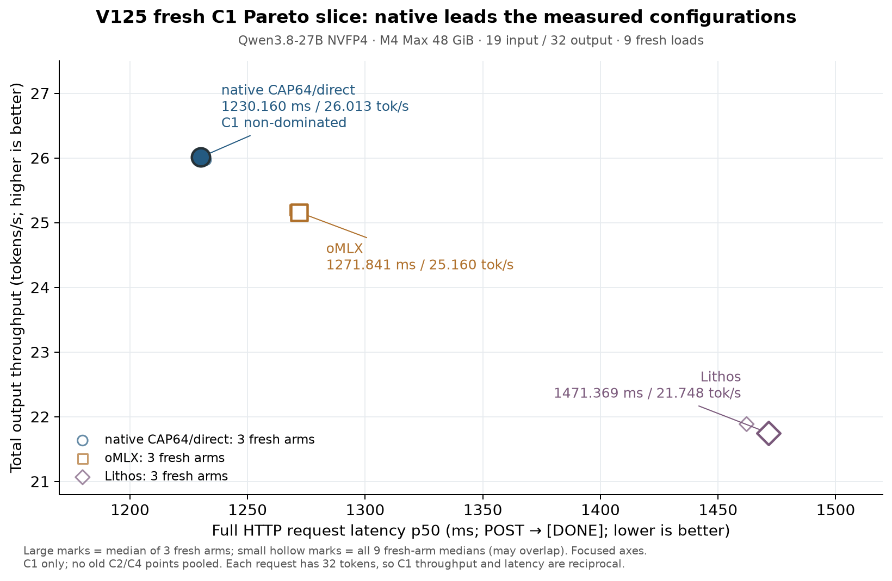

# 43 · 新 C1 Pareto 切片：本方小幅领先

V125 完成了三家各三次 fresh 加载、共 9 个 arm 的新 C1 测量。本方 native 在三轮配对中均小幅领先 oMLX；按三个 fresh-arm 中位数，本方完整请求延迟为 **1230.160 ms**，总输出吞吐为 **26.0129 token/s**。这次只测 C1，不与旧 C2/C4 拼接成新的完整前沿。[旧 C1/C2/C4 历史图](../progress/2026-10-17-m4-pareto/m4-throughput-latency-pareto.png)单独保留，不参与本章统计。

| 配置 | 完整请求 p50 | 总输出吞吐 | 文本 TTFT p50 |
|---|---:|---:|---:|
| native CAP64/direct | 1230.160 ms | 26.0129 token/s | 159.342 ms |
| oMLX | 1271.841 ms | 25.1604 token/s | 214.158 ms |
| Lithos | 1471.369 ms | 21.7485 token/s | 422.365 ms |

横轴是客户端 **POST 开始→SSE `[DONE]`** 的完整请求耗时，越低越好；纵轴是组内实际输出 token 数除以最晚 DONE 与最早 POST 的时间差，越高越好。每个 arm：3 次 HTTP warm，随后 3 次正式请求，先取正式 group 中位数；每配置再取 3 个 fresh arm 中位数。C1 每组一个请求、固定 32 输出，因此两轴互为倒数。新字段 `latency_p50_ms` 只是把已有完整请求时钟按此层次聚合成毫秒；旧 `x` 是 first-text 后的辅助代理值，不再作为主胜负指标，POST/DONE 采样与吞吐公式未改。

本切面中 native 同时延迟最低、吞吐最高，是三种已测 C1 配置中唯一联合非支配点。三轮 native 对 oMLX 都有约 3% 的小幅优势，**不声称统计显著、全局最优、长请求或完整 C1/C2/C4 前沿胜出**。图中三个大点为配置中位数，九个小点保留全部 fresh-arm 中位数；没有把三次同进程请求冒充三次加载。

这次 native 不是旧主图的 native15：它沿用 V105 已冻结的 candidate44（conv/norm-reuse/gates）、CAP64 native101 direct FIFO 与 adapter102，在构造 engine 和任何 token 之前设置真实 capacity64，并继承 V103 双模式完整数值与生命周期资格。HTTP 中每步只观察 4B prediction，不恢复整套 state。V125 的 server 与 V105 **逐字节相同**，本章没有新增 kernel、改变数学或引入 DFlash/MTP。oMLX 沿用已测 balanced0.03，Lithos 沿用 pinned M4/noDraft/accelerator 配置；这些是已测配置，不是所有可能调参的最优值，也不宣称三家的 allocator policy 相同。

为什么重跑：[旧 V105](43-fresh-c1-source/prior105-stop-reference.json) 在 8/9 arm 后因 thermal 门停止，原始 STOP 保留，不能补上缺失 arm 后混成完整轮次。V125 用新一次性 marker，顺序为 **N–O–L / O–L–N / L–N–O**，全部重新加载。唯一性能计划增量是在前八个成功 arm 完成卸载、wait/reap、拒绝端口和资源检查后，固定等待 **60 秒**再开始下一臂，共 480 秒；没有自适应冷却、失败重试或替换点。冷却、加载、readiness、资源探针及清理全部在请求计时之外。此次通过资源门不证明冷却就是系统状态变化的原因。

总计 54 次 HTTP 请求、1728 输出 token，其中 27 次正式请求、864 token；三个 native 服务另各做一次普通启动 warm，共 3 请求、96 token，合计 57 请求、1824 输出。启动 warm 的 96 token 按源码 assert 与 runtime 计数另列，不声称 57 次请求都保存了 raw IDs。18 次 native HTTP 的 raw32 与旧 workload 一致；官方接口记录的 raw IDs 为 null，只能核 visible-roundtrip32 和 usage。各家可见文本差异按原记录保留，不能称三家逐 token 数值等价。Lithos 的 usage 未报告 cached-token 子字段，缺失不计作实测零；另有 engine metrics 的 cached0，来源见[补充说明](43-fresh-c1-source/cache-observation-correction/REVIEW.md)，两者不混用。每个 native arm 的 186 步均 completed/delivered，6 reset、0 discard，ICB banks 为 96/90；HTTP 没有新增全 132 输出逐步资格声明。

155 个区间外资源采样（153 arm +2 campaign）全部为 AC、thermal 0、pressure 1，Swapouts 不变，swap usage 未增长（全轮记录从 5046.06 降到 5038.06 MB）。9 个服务均完成身份绑定的清理与 wait/reap；根进程另存 external release，确认 11 个 PID 与 9 个端口 absent。[独立复核](43-fresh-c1-source/independent-review/REVIEW.md)确认上述范围；这里只复核保存证据，不追加实时进程证明。

[冻结协议](43-fresh-c1-source/protocol.json)、[相对 V105 的 driver 差异](43-fresh-c1-source/driver.py.from105.diff)、[source proof](43-fresh-c1-source/source-delta-proof.json)、[54 组请求白名单](43-fresh-c1-source/requests-whitelisted.json)、[资源白名单](43-fresh-c1-source/resources-whitelisted.json)、[汇总原件](43-fresh-c1-source/suite-complete.json)、[独立复核安全数据](43-fresh-c1-source/reviewed_rows.json)和 [CSV](43-fresh-c1-source/plot-data.csv)随文保存；没有归档原始环境、进程 argv 或认证。离机复算：`python3 docs/experiments/43-fresh-c1-source/verify.py`，原实验机器可加 `--originals`。图由 [plot.py](43-fresh-c1-source/plot.py)从这些保存数据生成，需要 Matplotlib；不加载模型或 GPU。此处复现是保存证据的 CPU 复算；原 GPU 测量的一次性 marker 已消耗，重测需另建 fresh 实验，不能自动重用本轮入口。
