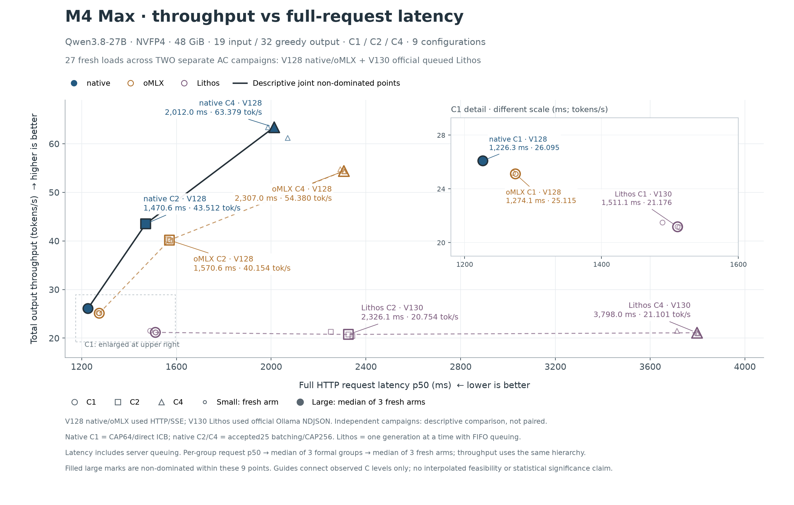

# 45：用 Lithos 的官方排队入口补齐 C1/C2/C4

Lithos 也应该测 C1、C2、C4。重新读实际 pinned 源码后发现，同版本已经提供官方 Ollama `/api/chat` 排队入口。此前第 44 章的 N/A 只限当时选择的 OpenAI 接口，不能推成“Lithos 不能接受多个请求”，也不是测得的 429 拒绝率。这次不改服务端、不升级版本，使用原入口重新完成了 9 次 fresh 测量。



横轴为完整 HTTP 请求 p50，越低越好；纵轴为并发组总输出 token/s，越高越好。大点是每配置 3 次 fresh 的中位数，小点保留实际重复；右上角放大 C1，原坐标没有移动。

**图中来自两个独立 AC campaign**：native/oMLX 的六个点沿用 [第 44 章 V128](44-fresh-full-throughput-latency.md)，Lithos 三个点来自新 V130，均为 M4 Max 48 GiB、Qwen3.8-27B NVFP4、19 输入和 32 贪心输出。27 个小点是旧轮 18 次加新轮 9 次，不能称为一次新三家 27-arm 配对 campaign。黑线表示这九个配置中描述性的非支配点，仍为 native C1/C2/C4；不据此作跨轮配对改善、统计显著性或全局最优声明。第 44 章原图保持不变，旧 Lithos OpenAI C1 没有混入新 Lithos 曲线。

## 1. 先改对请求入口

实际安装版本是 lithos-metal 0.1.2，源码固定在 `5485ad6bac0a5649d66a347f3e01a655ea29d937`。[`serve.py:482–491`](https://github.com/lithos-ai/lithos-metal/blob/5485ad6bac0a5649d66a347f3e01a655ea29d937/monolith/serve.py#L482) 先试非阻塞锁；只有 Ollama 协议在繁忙时等待，其他协议返回 429。它调用的仍是同一个 `Backend.complete`。

请求内容不变，只使用官方支持排队的协议和对应输出上限字段：

```http
# before：OpenAI 接口，重叠请求忙时拒绝
POST /v1/chat/completions
{"model":"<served model>","messages":[{"role":"user","content":"用一句话解释什么是 KV cache。"}],"temperature":0,"max_completion_tokens":32,"stream":true}

# after：官方 Ollama 接口，重叠请求等待
POST /api/chat
{"model":"<served model>","messages":[{"role":"user","content":"用一句话解释什么是 KV cache。"}],"options":{"temperature":0,"num_predict":32},"stream":true}
```

`model` 从 `/v1/models` 读取。完整实测请求还固定 `top_p=1`、`top_k=0`、`seed=0`、中性 `repeat_penalty=1`；服务仍为 M4/noDraft、同一 pack、max-context 2048、keep-warm 0。协议转换的 CPU 检查用实际 tokenizer 证明两种请求都得到相同的 19 个 prompt IDs；另有新入口 GPU 资格，未用转换检查替代实际生成检查。

Ollama 流是 **NDJSON，不是 SSE**：逐行读 JSON，累加 `message.content`，收到 `done:true` 才结束；最后一帧的 content 为空，没有 `[DONE]`。终止帧提供 `prompt_eval_count=19`、`eval_count=32` 和 `done_reason="length"`。计时从客户端 POST 前到该终止帧，包含排队及等待响应头的时间；不能拿服务端 `eval_duration` 代替完整请求延迟。

## 2. 新测量的三个位点

C 表示客户端每组同时发出 C 个请求。每个 C 各启动 3 次 fresh 服务，每次 3 个 warm 组后再测 3 个正式组。新轮共 126 个 HTTP 请求、4032 个输出 token，其中正式计时 63 个请求、2016 个输出 token。warm 和独立资格组都不参与图中中位数。

| Lithos 官方 Ollama 队列 | 完整请求 p50（ms，低优） | 总输出吞吐（token/s，高优） |
| --- | ---: | ---: |
| C1 | 1511.125 | 21.176276 |
| C2 | 2326.114 | 20.754379 |
| C4 | 3797.967 | 21.100825 |

每个组先取请求延迟 p50，再取三组正式结果的中位数，最后取三次 fresh 的中位数。吞吐每组按 `C × 32 / (最后 terminal − 最早 POST)` 计算，再经过同样的两层中位数。C2/C4 的 p50 与组吞吐不是简单倒数关系。

源码中的 [`FifoLock`](https://github.com/lithos-ai/lithos-metal/blob/5485ad6bac0a5649d66a347f3e01a655ea29d937/monolith/serving/lifecycle.py#L26) 按服务端取得 ticket 的次序接纳等待者；它不承诺客户端 R0/R1 的网络到达次序。实际服务仍一次只执行一个 generation。`max_sessions=8` 缓存的是 recipe/sampling 的编译变体，不能读成 8 个并发 GPU Session。

这就是队列与 batching 的区别：新 Lithos 结果中，C 从 1 增至 4，完整延迟增加，总吞吐仍约 21 token/s；native/oMLX 已测的 B>1 路径会把多请求放进真实模型 batch。允许请求排队补齐了服务能力测量，没有自动获得 batch 的权重读取复用。本章修正的是比较入口与测量覆盖，未新增 kernel 或引擎优化。

## 3. 正确性与资源的边界

新请求检查 HTTP 成功、无错误帧、19/32 usage、length 终止及完整可见文本的 32-token 重分词；官方接口没有暴露内部 raw IDs，不能称逐 raw ID 或完整 tensor 与本方一致。缓存字段缺失也不能补成 0；缓存情况使用独立引擎 metrics 核查。安全归档里的 normalized events 不等于原始 POST/SSE/NDJSON wire bytes。

新轮固定 AC，保留原有 thermal nominal、pressure、paging 和 owned-process 门；资源探针均在计时组外。root 的外部 release 确认 11 个 owned PID 和 9 个端口均已消失。客户端断开不会证明排队请求已被取消，因此仍保留 TERM/KILL、wait/reap 与端口回收。没有通过重试去掉慢组，也没有改变原始失败记录。

可复算数据和入口：[新 Lithos 三配置与九次 fresh](45-lithos-queued-source/lithos-perf-data.json)、[组时钟](45-lithos-queued-source/groups-normalized.json)、[请求时钟](45-lithos-queued-source/requests-normalized.json)、[来源、资源与复核](45-lithos-queued-source/README.md)。组合图的精确输入与来源在 [plot-data.json](45-lithos-queued-source/plot-data.json) 和 [CHART-NOTES.md](45-lithos-queued-source/CHART-NOTES.md)。
