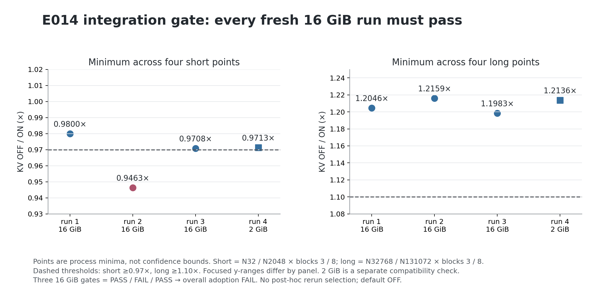

# E014 实际核心接入：数值通过，采用门未过

**四个进程的 2,944 组严格检查全部通过，但三个 16 GiB 进程的速度门为 PASS / FAIL / PASS，因此整体 adoption=false。** 保留默认 OFF 的实验模块。第 2 个进程 N32/block3 为 **0.946272×**，低于预注册的 0.97×，不能用其他进程或整体中位数覆盖它。

| Fresh process | 池 | 短点最低 | 长点最低 | 本进程门 |
|---:|---:|---:|---:|---|
| 1 | 16 GiB | 0.979995× | 1.204565× | PASS |
| 2 | 16 GiB | 0.946272× | 1.215939× | FAIL |
| 3 | 16 GiB | 0.970806× | 1.198261× | PASS |
| 4 | 2 GiB | 0.971258× | 1.213625× | 兼容性 PASS |

主采用合同要求三个 16 GiB 进程各自全部短点 ≥0.97×、全部长点 ≥1.10×。短点为 N32/2048 × block3/8，长点为 N32768/131072 × block3/8；N8192 仅描述。固定顺序 16/16/16/2，未追加挑选重跑。

## 测量与正确性合同

Apple M5 Ultra、256 GiB；被测提交 `05d75cf7444cd4b3b188a852bb69b73eb2822163`。固定 target `mlx-community/Qwen3.8-27B-nvfp4` revision `5ff8ef173ad0d7c3aae92f0be43031a6ab8067c6`，DFlash2 revision `50307d4c4cde6860d4eee73e2547cd786fe8e8a4`。

实际公开 `load_drafter` 加载 selector OFF/ON × bounded KV OFF/ON 四个组合，每个组合有独立量化权重。数值 oracle 使用 v2 冻结的实际旧 `DraftAttention.__call__`，旧文件 SHA `81bcde5b6fa7188144e1b32b3783faa636954bae365ae761707478bad37659b4`，并非重新抄写旧计算。

每进程 184×4=736 项检查：cold None+非空 ctx、初始空 KV、10 个边界长度的多步链、None/empty ctx、4095/4096/4097 的变 block 链、单次输入 2049/4097 行和每个计时点资格。逐项检查真实 selector 输入 hidden/logits、token IDs、10 个可保留 KV 后缀、10 个可见后缀、5 层逻辑位置与物理 bound。全部数值 JSON 和 seed 在四个进程间相同。CPU 侧独立重建 736 个键、position 和 incoming 长度，核对完整矩阵及每个 strict 字段；并未重新运行 GPU 数学。

正式计时使用 selector ON 的实际 KV OFF/ON，四份 drafter 权重常驻。每个点的数值资格后 reset 所有 drafter，释放资格产物，再计时。每 sample 分别记录 prepare、完整 draft、自己产物的 teardown；主指标是 **draft_ms + teardown_ms**，prepare 在主计时外。每个点 2 首样本、4 warm、12 正式 ABBA 样本；合计 **80 首样本、160 warm、480 正式样本、40 点**。保留各阶段与 ABBA arm/round，所有中位数和门重新计算。

计时中存在可见的绝对时间变化，例如第 3 个进程 N32/B3 的 reference 正式首/末样本为 5.959/3.677 ms，candidate 为 5.075/3.826 ms。三组 ABBA 全部保留，未删除慢样本，未将这些变化归因于未测量的硬件行为；这也是不能只取一个漂亮进程的原因。

这些长历史来自短真实 target 特征生成的 KV 重复扩展，**是 synthetic cache-state replay，不是实际长生成**。释放 Python 引用并同步不证明 allocator 或驱动立即回收底层内存。没有 target verification、GDN rollback、acceptance、端到端生成或 HTTP 资格。与原型 v2 的常驻权重数也不同，不能把跨阶段绝对 ms 差归因为一个算法改动。

## 资源、释放与保存范围

28 个资源样本全部 AC、pressure1、thermal0；swap 使用量 268.81 MiB 不变，Swapins 74570、Swapouts 303419、Pageouts 14985 不变。Compressions/Decompressions 的全部变化如实记录在 audit JSON，不把全局计数归因到某个 arm。已知程序名与 exact-owner 探针未发现活跃外部推理进程，但不保证排除所有 GUI 或未知 GPU 使用。

四个模型 child（98568/98709/98876/99078）均 exit0、wait/reap，保存 strict absence 并由 CPU 后审再次确认 absent。四个 owner 时间窗不重叠。外部 omlx-server PID74384 的 start identity 匹配，lease 完成后 T→S 恢复。

最初旧 selector 目录的错误 test pattern 产生零测试/exit5，原始记录保留；正确的 bounded-KV 6 项与 selector 2 项测试随后通过。该初次错误不计入 PASS。

每个进程 36 个 plan 源文件已逐 SHA 冻结，另存原始旧 attention。四进程 source/model/workload SHA 一致。CPU 审计重核源、config 和 workload，未再次读取大权重；权重 SHA 是四个实测进程各自完整读取的结果，归档不包含模型本体。

- [summary.json](summary.json)：四进程门、全部 40 点、phase 中位数及 ABBA arm/round。
- [audit.json](audit.json)：独立矩阵、数值字段、phase、资源、进程与恢复审计。
- [manifest.json](manifest.json)：242 个成员的大小及 SHA-256。
- [evidence.tar.gz](evidence.tar.gz)：351,605 bytes；全部成员重新读出验证通过。
- [进展图与逐源 chartdata](../../../optimization-guide/progress/2026-10-17-v1/README.md)：所有独立进程及失败点，PNG/SVG 可离线重画。

归档 SHA-256：`9ab46fc4a01f6ed879e18dc24820e5f30f5053b4ed15136e36479fa5d1e7554d`。
