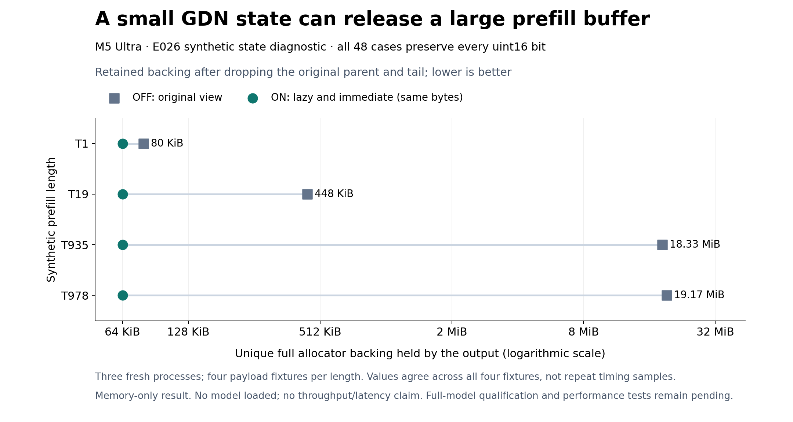

# E026 tiny device diagnostic: bit-preserving state compaction

**PASS for this isolated state-copy diagnostic. No full-model qualification or throughput/latency result.** The exact plan was committed in `e03ff2d` before execution. Three fresh child processes each ran 16 fixed cases, covering T1/19/935/978 with all uint16 word patterns plus a finite fixture.

All 48 cases and 528 recorded phases passed. The independent auditor and root rerun agree exactly: 1,474,560 raw words match, every arm/length covers all 65,536 distinct payloads, signed zeros and NaN/Inf payloads are preserved, and all 12 finite cases remain finite. Original parent SHA values independently reconstruct from the fixture rules.

| Prefill length | OFF backing | ON-lazy backing | ON-immediate backing |
|---|---:|---:|---:|
| 1 | 81,920 B | 65,536 B | 65,536 B |
| 19 | 458,752 B | 65,536 B | 65,536 B |
| 935 | 19,218,432 B | 65,536 B | 65,536 B |
| 978 | 20,103,168 B | 65,536 B | 65,536 B |

The table reports full allocator backing retained by the output after dropping original parent/tail references. All four fixtures agree at each arm/length. ON establishes a separate 65,536-byte allocation and releases the old parent; every case returns observed active memory to zero after all roots are dropped. At T978 the retained reduction is 20,037,632 bytes. This does not extrapolate to a measured whole-model footprint reduction.

Use `retained_backing_reduction_bytes` for the attribution. The finite-validation temporary also releases 98,440 active bytes in OFF, while its full original parent backing remains. Total active-byte change is therefore not the size of the optimized parent.

The independent tiny resource policy passed 11 samples: pressure stayed at its pre-existing level 2, physical free memory stayed at least 69.53 GiB, Swapouts and swap-used growth were zero. This permits only this bounded no-weight diagnostic and does not satisfy or change the pressure-1 model/performance contract. Per-boundary active/peak observations stayed below 64 MiB; no OS hard allocation cap or absence of between-sample transients is claimed.

All three children exited 0, were waited/reaped, and have strict PID-absence receipts. The root owner also exited. The original service PID74384/start identity was restored T→S; no cold restart, model unload or configuration change occurred. The separate cold-restart approval remains pending.

`raw-evidence.tar.xz` preserves 665 original members (16,310,305 bytes before compression), including exact raw tails, phase ledgers, all resources, plans, frozen source, direct-owner cleanup and the outer service lease. Every member was independently rehashed against `manifest.json`. Runtime binaries are represented by verified pins rather than duplicated. `independent-audit.json` and `root-review.json` retain the scope and evidence.

The figure reads all 48 audited rows from `chartdata.json`, verifies the four fixtures agree, and combines the two identical ON results explicitly. It has logarithmic memory units and no timing axis. Re-render using the repository’s existing `progress-render-venv/bin/python plot.py`; no model or GPU is loaded.

Next: isolate the hook to real ordinary prefill, qualify its model/cache behavior and materialization placement, then run a separate unobserved HTTP throughput-versus-complete-request-latency comparison. This result does not complete E023 or explain its resource abort.
