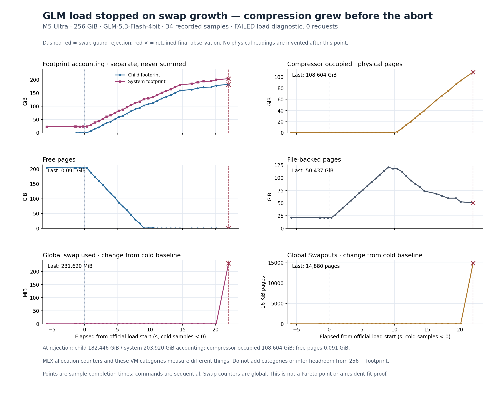

# E034 加载内存诊断图

这张图解释失败发生前的内存过程，**不是 inference 性能点或 Pareto 图**。读取原 owner 的 34 份实际观测：cold-0/cold-1，以及 physical-0000 到 physical-0031；冻结的 [E034 实验归档](../E034-glm-flash-load-v3/)未改动。

加载期间，空闲页先降到接近零，file-backed 页先升后降，压缩器占用随后持续上升，最后一份观测出现 swap 增量并触发中止。观察到这种先后关系，**尚不能把原因归到模型副本、文件缓存或某一个进程**。所有 VM swap/compressor 指标都是系统全局值。

| 已测指标 | cold-1 基线 | 最后 physical-0031 |
|---|---:|---:|
| Child footprint accounting | 子进程尚未启动 | 182.445617 GiB |
| System footprint accounting | 23.330795 GiB | 203.919907 GiB |
| Compressor occupied，实际占用页 | 0.208282 GiB | 108.603943 GiB |
| Compressor stored，代表的逻辑页 | 0.658890 GiB | 110.096085 GiB |
| Free pages | 204.053268 GiB | 0.091202 GiB |
| File-backed pages | 21.146469 GiB | 50.436508 GiB |
| Global swap used 相对基线 | 0 MiB | +231.620000 MiB |
| Global Swapouts 相对基线 | 0 页 | +14,880 页 |

File-backed 的已测最高值是 **121.018326 GiB**（`physical-0017`，加载起点后 9.061008 秒），并非只看末次的 50.437 GiB。压缩器使用的是 `Pages occupied by compressor` × 16,384 bytes；`Pages stored in compressor` 是另一项逻辑量，只保存在数据和上表，不冒充物理占用。

最后一份物理采样本身状态为 `MEASURED`，其 monitor guard 状态是 `INCOMPLETE`，错误为 `runtime swap growth`。红色虚线标记实际 guard 结束时间 **22.026763 秒**，红 × 保留它拒绝的观测；未补任何之后的物理读数。原 loader 后来在取消过程中返回，不意味着 pool 已准入或模型正确性通过；请求数仍为 0。

## 口径与来源

- 各点横坐标为该样本测量结束的 monotonic 时间，零点为实际 `official_vlm_load:before` 事件。cold 读数因此落在零点以前。每份样本内多个命令依次执行，不能当成同一瞬时快照；连线用于跟踪已测点，不确定变化发生于采样间的哪个时刻。
- Cold footprint 目标是 owner PID 34153；未来模型子进程 PID 34218 尚不存在，所以 cold child 值为 `null`，没有画成零。全局 VM 指标仍可作为基线。
- Child/system footprint 是各自的 accounting 读数；不相加，也不与 compressor/file-backed/free 类别相加。**`256 GiB − sys_footprint` 不能在这里解释为可用内存**。
- [observations.json](observations.json)保存全部标量、原始时间、样本标识、页面大小、拒绝状态，以及 36 份实际来源的绝对路径/SHA256/字节数。来源为 34 个 `sample.json`、原始 `events.jsonl` 和 monitor；原始 `vm_stat` 在 sample 的 command stdout 中逐项解析，没有启动新的资源探针。
- [extract.py](extract.py)可从这些原件重新提取；[render.py](render.py)只读提取后的 JSON，用现有 `.artifacts/m5-ultra-256gb/progress-render-venv/bin/python -I -B` 渲染。重画时将脚本和 JSON 放到新目录；脚本拒绝覆盖已有数据和图。
- [render-receipt.json](render-receipt.json)是实际渲染产物 SHA；[verification.json](verification.json)记录 36 个来源 SHA 复验及 PNG 实际视觉检查 PASS。[SVG](GLM-load-memory.svg)可直接导出。
- 提取和渲染实际命令均返回 0；不导入 MLX、不加载权重、不操作服务，也不改变原始的零 swap 门槛。源码机制与下一步控制见 [加载内存评审](../../../../bench/reviews/2026-10-19-glm-load-memory.md)。
