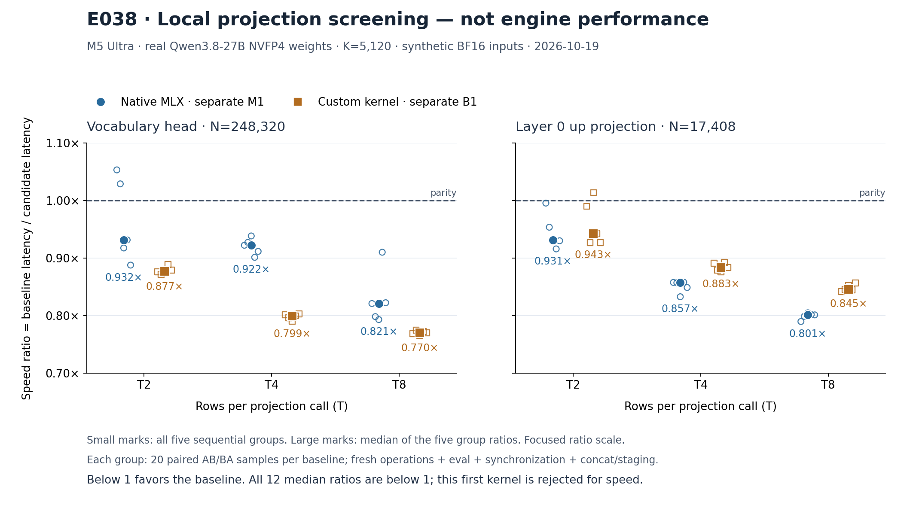

# E038: real-weight local projection speed screen

**Numerical and execution checks PASS; the first multirow reuse kernel is rejected for speed.**
The independent offline audit finds all six saved cases finite and three-way BF16 byte-identical:
18 full output matrices, 3,720,192 elements per route, 11,160,576 pairwise word comparisons.
It also reconstructs all 2,400 timing samples and their exact baseline/group/pair/AB–BA order.
All 12 median speed ratios are below 1. This is a local projection result, not an engine Pareto
point or full-model qualification.

| Projection | T | Native M1 / candidate | Custom B1 / candidate |
| --- | ---: | ---: | ---: |
| head | 2 | 0.931513× | 0.876554× |
| head | 4 | 0.922243× | 0.799456× |
| head | 8 | 0.820917× | 0.769801× |
| up | 2 | 0.931196× | 0.942674× |
| up | 4 | 0.857143× | 0.883247× |
| up | 8 | 0.801152× | 0.845492× |

Ratio means **baseline latency / candidate latency**. For each baseline and each case, compute
its 20-sample median and the candidate's 20-sample median separately in each of five sequential
groups; divide, then take the median of those five ratios. This is not the ratio of pooled
medians. Each pair alternates AB/BA; native-vs-candidate groups precede custom-vs-candidate groups.
The figure shows every group, not confidence intervals: head T2 has two native group ratios
above 1, and up T2 has one custom group ratio above 1. No observation was dropped.

Against native M1, candidate latency is about 7.35%, 8.43%, 21.82% higher for head T2/T4/T8,
and 7.39%, 16.67%, 24.82% higher for up T2/T4/T8. These within-process measurements reject this
implementation for these cases; they do not identify whether the cause is register pressure,
occupancy, compiler behavior or memory traffic. No such hardware attribution was measured.

The weights are the actual pinned Qwen3.8-27B NVFP4 vocabulary head (K=5120, N=248320) and
layer-0 up projection (K=5120, N=17408). Inputs are deterministic synthetic BF16 values, not
captured hidden states. The full original output bytes for independent native M1 calls,
custom B1 calls and the candidate were saved before each case's timing. Timed outputs were
evaluated and released, not saved per sample. Fresh-operation construction, five warmups per
route, eval/synchronization, baseline row slicing/concat and candidate staging are supported
by the frozen source and successful execution records; the offline audit does not rerun them.
Only contiguous real-weight input layouts were used here.

The device and parent both exited 0. Original oMLX PID 39988 has retained T→S resume and
before/after healthy original-model receipts. There are four indexed resource snapshots
(one before pause, three during the child), plus a separate after-resume snapshot. Reparsed
pressure level is 1 throughout; global swap used is unchanged at 1887.25 MiB, with Swapouts
unchanged at 782442. These saved observations do not establish continuous isolation or zero
unobserved GUI/GPU activity. MLX is reported as 0.32.3 on Apple M5 Ultra (`applegpu_g17d`).

## Evidence and scope

`evidence.tar.xz` contains 70 explicit members: original probe inputs/outputs, raw timing JSONL,
all producer summaries, weight references and original headers, execution/lease/health/resource
records, frozen source files and the actual CPU entry-test evidence. Every member was reread
and SHA-verified against both its original and `manifest.json`: 23,196,076 uncompressed bytes,
3,109,248 compressed bytes. Archive SHA256:
`0eb369269db1dcde37aaf67da0766e8e375dc57dc1d1ca59ae22bde4979cbe8f`.

The two `selected-weights.safetensors` files (765,296,968 B combined) are deliberately excluded.
Original source-shard full SHA, header SHA, exact tensor ranges, slice SHA and selected-file SHA
are retained in `weights.json`. Header/range/source-manifest consistency is independently
checked; payload hashes are producer evidence and were not rehashed by this offline audit.
No real model weights were copied into this documentation archive.

The first offline reader attempt failed because it incorrectly treated safetensors'
`__metadata__: null` as a tensor key. `attempts/audit-v1-failed/` preserves the exact failed
reader, command, logs and result. The repaired reader explicitly accepts that observed null
metadata and passes; all tensor key/dtype/shape/span/equality gates remain. The existing
verified raw archive was reused. This was an auditor-format error, not a failed device case.
The first figure rendering is also retained under `attempts/render-v1-layout/`; the final
render separates labels from marks and the footer from the axes.

`audit.py` uses only the Python standard library. Extract `evidence.tar.xz` into a fresh
folder and run `python3 -I -B audit.py --evidence EXTRACTED_FOLDER --out FRESH_RESULT.json`.
`render.py` reads `independent-audit.json`; the recorded plotting interpreter is
`.artifacts/m5-ultra-256gb/progress-render-venv/bin/python`. Render into a fresh copied folder
because it refuses to overwrite images. `render-receipt.json` binds figure/data/source SHA;
`visual-review.json` records actual PNG inspection. `document-integrity.json` binds all
surrounding documents, code, receipts, attempts and figures, excluding itself.

No GPU, service action, benchmark rerun or commit was performed by this offline audit/archive.
