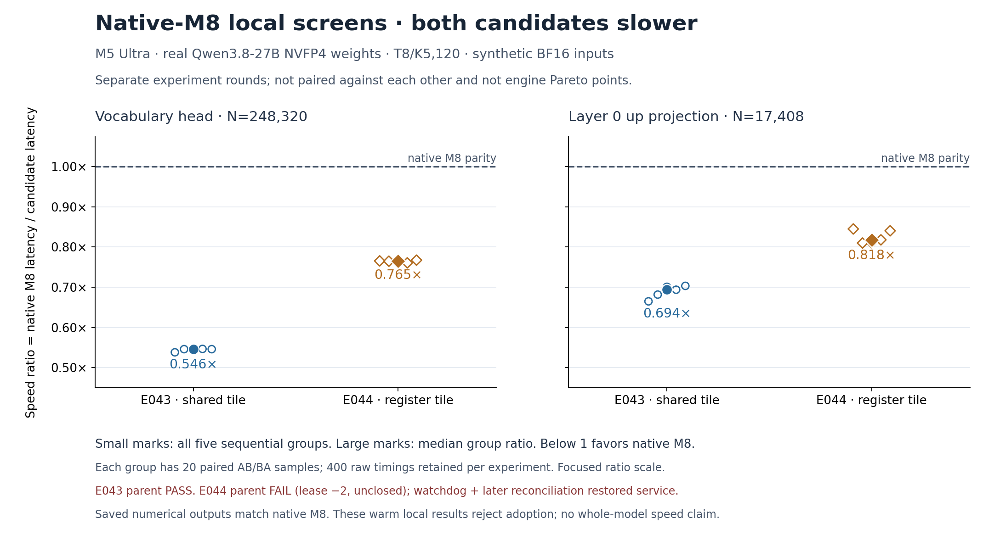

# E044: native-M8 register screen — slower; original parent FAIL retained

**Saved numerical/timing audit PASS; original parent execution remains FAIL.** The numerical
child completed both cases and its400 timing samples with a directly waited exit0. The parent
then hit the natural-exit/cleanup race: `owned numerical child identity`, followed by
`lease did not close`. Lease returncode is−2 and original `closed` is false. These fields and
the original final/lease records are unchanged. Watchdog restoration and a later fresh
read-only reconciliation pass are recorded separately; neither converts this cycle into PASS.

The independent reader verifies four original BF16 output matrices,2,125,824 pairwise words,
all finite and identical to one actual native M8 call per input. It reconstructs all400 timing
samples, exact group/pair/AB–BA order and all ten ratios. Every group is slower than native.

| Projection | Native M8 latency / candidate latency | Candidate latency increase |
| --- | ---: | ---: |
| head | 0.764702547× | 30.77% |
| up | 0.817788032× | 22.28% |

E043 and E044 are separate rounds. Each uses its own native-M8 baseline and five groups of
20 AB/BA pairs per projection; plotted large marks are the median of five group ratios,
small marks show every group. No inter-round pair or confidence interval is implied. Both
implementations are rejected for adoption based on these local screens; E044's incomplete
parent closure also prevents promotion to a fully qualified performance cycle. No point
is added to engine Pareto. The figure visibly retains parent FAIL and restoration-only status.

## Candidate and numerical scope

The default-OFF candidate instantiates the pinned native `fp_qmv_wide_impl<DT,16,4,8,16>`
function, using one nv8 register tile instead of native M8's two nv4 tiles. It keeps the same
64-thread group and unchanged helper arithmetic, with no shared-memory tile or new barrier.
Its intended weight/decode reuse can be offset by registers, spills, occupancy or compiler
behavior; none of those hardware causes is measured here. The candidate has no production
installation, full-prefix, acceptance/rollback, HTTP or engine qualification. E042's fixed
prefix proof belongs to a different kernel and does not transfer.

The actual weights are pinned Qwen3.8-27B NVFP4 head K5120/N248320 and layer0 up K5120/N17408;
T=8 activations are deterministic synthetic BF16, not captured model hidden states. Native
M8 is one complete matrix call, never eight M1 calls. Whole saved original outputs must be
finite/equal before timing. Frozen source shows five warmups, fresh operations and evaluation/
synchronization/staging inside every sample. Raw timing observations are all retained; timed
output tensors are not individually saved. Repeated same-weight warm calls may have different
cache residency from full-model traversal. This screen does not measure cache capacity/DRAM
traffic or exclude all potential streaming reuse designs.

## Exact failure and later restoration

`job-0.json` records child57173 waited=true/returncode0 and the exact plan command. Parent
source/records show its next child-identity observation collided with natural child completion;
cleanup interrupted lease57165 during normal restoration. The full stderr trace ends in
`KeyboardInterrupt: 15` and remains archived. There is no normal `resume.json` and no invented
closed=true record. The watchdog's own receipt reports same-identity T→S resume for PID52818.

`post-failure-reconciliation.json` is a fresh read-only follow-up with status
**PASS_RESTORATION_ONLY**, SHA256
`bee0a1ca402151f9f30dd975e8fe194efe64aae4715c71655f0cc90c80607d0a`.
It observes PID52818 with the same Mon Oct19 09:22:08 start identity in S, all three health
endpoints consistent with the original loaded model, and both57173/57165 absent. It pins
original failed evidence hashes and explicitly keeps parent FAIL/lease−2/closedfalse. This
archive checks consistency of those saved receipts, not present-time process or service state.

Four child physical observations, one admission observation, five indexed resource snapshots
and separate after-resume snapshot are retained. Saved pressure is1 and swap/Swapouts show no
growth. These are discrete observations, not continuous isolation or hard allocation limits.
No future cleanup success is inferred. A separate parent v2 fixes the completion race; its
5-test then7-test CPU passes and exact historical source snapshots are retained under
`future-cleanup-v2`. That parent has no new device run or performance result here.

## Evidence retention and reproducibility

Actual plan SHA256: `2c6518d2de4392c91cd4481011d7bfd999888739ced5c3e005b29b980382ac9f`.
Candidate SHA256: `361fe483cde02a13c505287652249016f74b16d1d179c3741da843a3060cf71a`.
`evidence.tar.xz` has 108 explicit members: raw numerical inputs/outputs, all timings,
producer result, original parent failure/lease/watchdog/reconciliation, physical/resource/
health observations, original preparation/CPU11 and future-parent CPU5/7 evidence, frozen
sources and pinned native headers. All archived members were reread and matched to originals
and manifest: 9,443,965 bytes → 3,123,164 bytes. Archive SHA256:
`f1400de1d2f0fa94c012fe98ae7cdf964e94c97c5fa679e7d7f19157d6e43982`.

Two selected real-weight payloads (765,296,968B) are excluded. Original full-shard,
header and slice/readback hashes remain as producer evidence; the offline reader independently
checks header/range/manifest consistency but does not rehash those real model payloads.

First archival attempt stopped before the audit because the future cleanup tests expanded
from5 to7 while current-source pins were assembled. `attempts/archive-v1-source-race/` retains
that exact script, command, output/exit and partial-staging reference. Executed device sources
were unchanged. The repaired archive binds historical5 tests to their retained snapshot and
current7 tests to theirs; both remain independently checked. The second archival attempt and
first figure render passed. No device rerun or numerical standard was changed.

`audit.py --evidence EXTRACTED --out FRESH.json` recomputes the retained local result while
preserving parent FAIL. `chart-inputs` holds both independently audited rounds with SHA refs;
`render.py` recreates the combined chart in a fresh copied output directory. Render receipt,
actual PNG inspection and outer `document-integrity.json` are retained. No GPU/service action,
new benchmark or commit was performed by this offline archival step.
