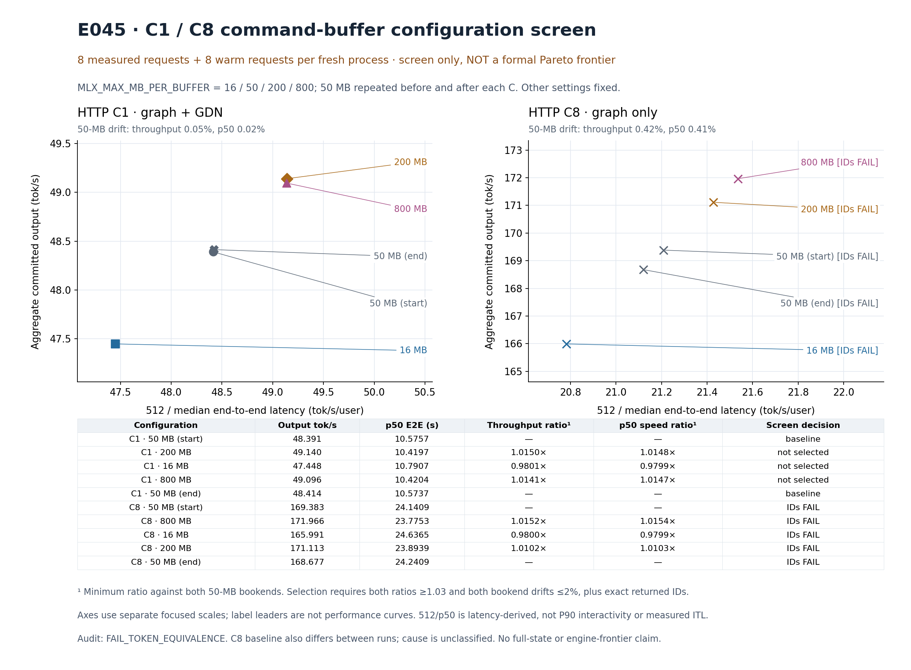

# E045 — separate C1/C8 command-buffer screens

No configuration is promoted and the formal v16 frontier is unchanged. The C1 200-MB setting gains about 1.5%, below the preregistered 3% gate. Every C8 setting fails the returned-token equivalence screen, including the original 50-MB baseline's own warm versus measured requests. This does not isolate the MB threshold as the cause.

This is an eight-request diagnostic per setting, with eight prior warm requests in each fresh process. C means HTTP concurrency, not GPU batch. Only `MLX_MAX_MB_PER_BUFFER` changes among nominal 16/50/200/800; both C values have separate 50-MB start/end processes. Other MLX settings remain ops=50, BFS=20, fast-sync=0. C1 uses E033's combined graph+GDN entry; C8 uses the same combined server with GDN off. C8 is not the exact E024 entry. No historical oMLX/Lithos points are mixed into this screen.

The chart's x-axis is `512 / median end-to-end latency`, not P90 interactivity or measured ITL. All observed requests returned 512 committed tokens. Panels use independent focused scales; lines point to labels and do not interpolate a Pareto frontier. Original timings remain visible even when correctness disqualifies them.

## Results and scope

- V2 parent: `PASS_CAPTURE_AND_RESTORE`; screen producer: `PASS_CAPTURE_ONLY`. All ten fresh processes completed their two eight-request phases.
- Independent raw audit: `FAIL_TOKEN_EQUIVALENCE`, `errors=[]`, 160 requests reparsed. All C1 warm/measured outputs agree exactly by fixture. C8 warm/measured mismatch counts against its own start50 warm reference are 0/4, 2/3, 4/2, 5/4, and 3/4 for start50, 800, 16, 200, and end50 respectively. The warm reference's zero is a self-comparison, not independent validation.
- A separate stdlib Base64/SSE parser, without importing the original parser or comparison code, reproduces every mismatch across all 20 groups/160 requests. Request bodies and paths are identical by fixture within each C, prompt IDs match specifications, and C1/C8 canonical references remain separate. See `comparison_recheck.py`, its actual command/execution/logs, and `comparison-recheck.json`. The earlier exploratory tool `1e3468` is followed here by a retained rerun; no runtime was rerun.
- C1's best setting, 200 MB, measures 49.140388 output tok/s and p50 10.419658 s. Against the more demanding of the two bookends its throughput ratio is 1.0150018 and p50 speed ratio 1.0147874. Both bookends are stable (throughput drift 0.04789%, p50 drift 0.01836%), but both improvements must reach 3%; none does.
- C8 timings do not qualify. Its timing bookends differ by only about 0.42%, but their IDs differ. Timing stability must not be confused with output equivalence. The baseline's measured D04/D06/D07/D08 first differences are indices 59/22/187/209; the cause remains unclassified.
- Resource audit: `PASS_SAVED_OBSERVATIONS`, 400 physical and 400 metadata samples plus the admission baseline, ten server identities/releases. Maximum observed system footprint: 197,455,822,848 B (183.8951 GiB); child current: 24,023,723,840 B (22.3738 GiB); child auxiliary historical peak: 26,038,497,256 B (24.2502 GiB). Maximum observation gap: 3.252489 s; baseline-to-first gap: 2.433405 s. All pressure=1, thermal=0, AC; swap growth=0 B and Swapouts=807478 throughout.
- The original saved lease is closed with return code 0, original PID 52818 identity preserved, runner waited, and the saved before/after three-endpoint health contracts pass. This is a review of recorded facts, not a new live service check. Full process inventory text and every repeated start-identity probe were not retained; saved inventory rows and source-bound assertions have narrower scope. Sampling is not a hard allocation cap or proof of inter-sample headroom.

Returned-ID equality is not full-vocabulary/state, compiled-path or whole-engine correctness qualification. There is no formal performance promotion from E045.

## Failures retained

The v1 real trial itself passed, but its runner failed on duplicate `label` arguments in `dict(label=label, **result)`. Original v1 parent `FAIL`, lease return code 1, logs, and restoration records remain unchanged. V2 uses a separate source namespace and output directories.

The first CPU trial attempt retains 10 tests with one failure and two errors; subsequent 10-test and 11-test passes remain separate. Auditor and owner CPU evidence are retained. The first chart retains its `FAIL_LAYOUT` review (panel titles overlapped drift annotations). The second layout was viewed by both root and this reviewer and is readable with all C8 failures visible. `visual-review.json` records that separate PASS; the producer's `RENDERED` receipt is unchanged.

## Retention and verification

`evidence.tar.gz` contains all requested v1/v2 screen, execution, lease, audit, resource, chart, and CPU directories, both source namespaces with preregistration, the current analysis source, and the independent recheck/visual records. No requested directory was missing; no tensor payload was present in these selected directories. `references.json` retains original source-pin maps. The original layout's render-source hash is retained in its receipt; the current source snapshot corresponds to layout2.

`archive.py` creates an explicit per-member path/size/SHA manifest, then independently streams every compressed member back and compares it with both the manifest and original source. Actual execution returned 0: **1,805 members / 148,303,716 uncompressed bytes**, all verified. The archive is **14,451,583 bytes**.

- Archive SHA256: `939b8f187eed63f94e91328fe9535ff8d0f95a772ae76242a7a12bcde36b23dc`
- Manifest SHA256: `9df4fa9484f0d6e4e800d5fc471d4646c216554ea99bd074de11401c96a616d8`

Archive integrity does not change any original experiment's status. `summary.json` provides compact outcome/metric records; `document-integrity.json` covers the final files alongside the archive. No GPU, service, benchmark, or test rerun was performed during archival.
