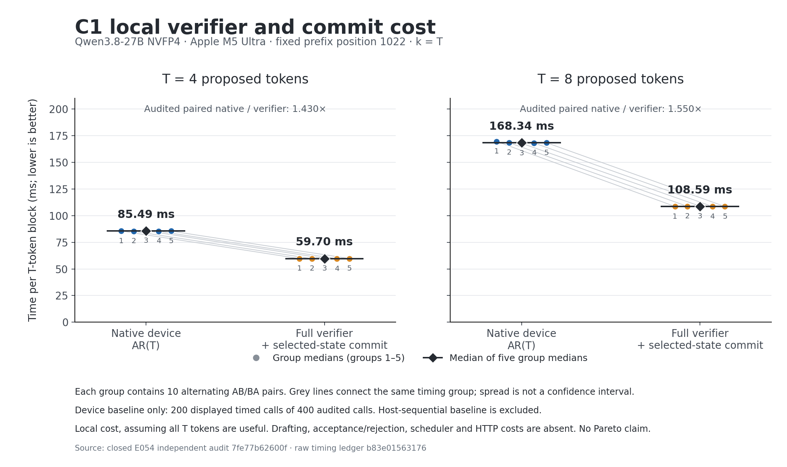

# E054 — complete C1 verifier local cost

The device run completed and restored the same oMLX service. The corrected independent audit passes all **32 saved files / 2,064 tensor pairs**, six selected-prefix and continuation cases, and **400 raw timing samples / 20 groups**. The candidate remains default OFF. This is a local verifier-cost result, not an HTTP or engine Pareto point.

| T | Native baseline | Native / verifier, median of five group medians | Native p50 | Verifier p50 | Remaining draft + overhead budget* |
|---:|---|---:|---:|---:|---:|
| 4 | Device-dependent AR(T), primary | 1.4304× | 85.471 ms | 59.685 ms | 25.724 ms |
| 8 | Device-dependent AR(T), primary | 1.5495× | 168.490 ms | 108.666 ms | 59.655 ms |
| 4 | Host-synchronized AR(T), reference | 1.5861× | 94.482 ms | 59.561 ms | 35.000 ms |
| 8 | Host-synchronized AR(T), reference | 1.7433× | 188.855 ms | 107.938 ms | 80.629 ms |

*Budget is the median of five group medians of paired native-minus-verifier durations, assuming every proposed token is useful. Draft generation, acceptance/rejection, scheduling and HTTP are excluded. It is an upper budget, not measured speculative-decoding gain. Every one of the 50 pairs per comparison was positive; all groups are retained.

Each timed call builds new work, evaluates all T vocabulary rows and the selected k=T state, commits the local state holder, and synchronizes. The primary native baseline derives each next token on device; removing host synchronization is therefore not counted as the primary gain. Input seed setup and pure audit instrumentation are outside both timed routes. Selected-prefix correctness covers k=1, T/2 and T with native continuation, including the ninth step after T=8. Short-prefix cost, compiled operation, speculative acceptance/rollback and an integrated generation loop remain unqualified.

The saved qualification tensors independently establish finite original-bit equality. Timed samples retain all token IDs and source-bound commit checks; their full output/state tensors were not saved for all 400 calls. Parameter-preservation and live holder/seed checks retain the scope of their producer receipts. No new model or runtime payload hash was computed during archiving.

Resource review passes 25 physical and 25 metadata observations: maximum gap 3.338 s, child current 22,135,586,512 B, historical peak 22,402,923,016 B, and system footprint 195,888,316,416 B. These are separate accounting measurements, not additive. Pressure remained 1, thermal state 0, AC power, swap growth zero and Swapouts 807478. The 64 GiB child / 240 GiB system thresholds are sampling gates, not allocator caps. Saved terminal sample → acknowledgement → wait/reap and same-PID 52818 restoration / three health checks passed; this review makes no fresh live-service claim.

The first byte auditor read all 32 files but failed its own expected producer-receipt inventory: canonical names are `root/root/…`, not its assumed `root/…`. That FAIL and its exact source/command/logs remain retained. The v2 auditor corrects only that expectation and passed on the same device evidence; no device rerun occurred. CPU evidence also retains the first audit test attempt (12 tests, two errors), then 12 passing tests and eight tests for the corrected auditor, alongside seven screen and 19 owner tests.

`evidence.tar.gz` contains metadata, all actual attempts, sources, CPU receipts, original timings, resource commands and chart evidence. `raw-file-references.json` binds the 32 local snapshots to the SHA values checked by the passing byte auditor; their payloads are excluded. `archive-verification.json` records an independent readback of every archived member's size and SHA against the manifest and original source. `execution-provenance.json` distinguishes coordinator-reported tool observations from actual saved command/log files. The original producer's false HTTP/performance/Pareto flags remain unchanged.

The verified archive contains 372 members (25,165,666 bytes before compression; 2,791,008 gzip bytes). All 32 local snapshots total 8,213,378,816 bytes and remain outside Git. Archive SHA-256: `94862b778dffe9e1dca4a4325e13495c8e1c19488b556149e15c07a719026455`.
