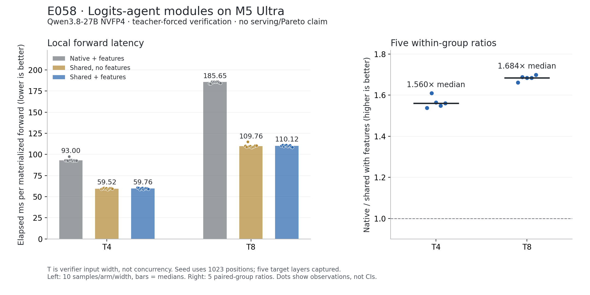

# E058: actual Logits coding agents and feature verification

## Closed result — 2026-10-21

All three Logits models wrote code used in this real experiment. Root ran the
single M5 GPU job from committed source `2c29d3e`; Kimi subsequently ran its own
independent auditor on the actual raw files. The job, byte audit and original
oMLX service restoration passed.

| Verifier width | Native + features, median ms | Shared, no features, median ms | Shared + features, median ms | Median of 5 within-group native/shared ratios |
|---|---:|---:|---:|---:|
| T4 |93.00079|59.51563|59.75785|1.56014×|
| T8 |185.64746|109.76219|110.11562|1.68432×|

These are60 samples (10/arm/width), with12 warmups; all observations are retained.
The ratio column is the median of five group ratios, not the ratio of global
medians. Feature capture's observed median cost relative to no capture was
+0.4070% at T4 and +0.3220% at T8. Those small differences have no confidence
interval or significance claim. T is input verification width, not concurrency.
The native arm is original model capture with supplied teacher tokens; this is
neither E057's autoregressive baseline nor a new serving/Pareto result.

- Correctness:24 selected-prefix/continuation pairs,48 files,3,120 tensor pairs,
  12,285,255,872 file bytes audited. Original raw data is unchanged.
- CPU:63 root-run checks before GPU execution;40 checks for Kimi auditor v2.
- GPU child:41.35336s; bounded owner plus restore45.66532s. All source/model and
  parameter-byte checks passed; cleanup left40 active MLX bytes and zero cache.
- Resources:15 sampled observations, max system202,359,701,504B, max child physical
  historical peak25,025,119,872B, max observation gap3.31317s, no swap/swapout growth.
  Sampled values do not bound every inter-sample allocation.
- Recovery:the same oMLX PID52818 and start identity were restored; final live
  `/health` passed. No matching Muse analysis process remained at final review.

Evidence: [independent bytes](independent-audit.json),
[complete result and raw timings](complete.json),
[Muse timing recomputation](timing-device-timing-analysis.json),
[actual one-shot analysis launch](timing-launch.json),
[resource review](resource-review.json), [final root checks](root-final-review.json).
Source: [GPU harness](../../../../bench/m5_ultra_256gb/e058_agent_run_v1/README.md),
[auditor v2](../../../../bench/m5_ultra_256gb/e058_agent_audit_v2/README.md).

## Additional execution failures and their resolution

Kimi v1 rejected the actual MLX `__metadata__: null` field before examining
payloads. V2 skips only the reserved metadata key after validating absent/null or
string-map form, and retains all130 required tensor checks. V1 is frozen in the
GPU source plan; v2 is a separate source directory and hash. The first failed
stderr/provenance are retained. The v2 worker provenance's restoration fields
are incomplete (`null`); they are not used as proof. Actual restoration comes
from the saved owner/lease receipts and root's final live verification.

Muse's first postprocessing script recursively invoked itself while trying to
record its own exit status. That script is rejected, preserved as text evidence,
and not used as the final reproducer. Root observed zero matching processes,
reviewed the corrected v2 script, then launched it once in a new directory with
a30-second timeout; exit0 and all recomputed metrics matched. The earlier
collector used in the GPU job is separate and was unaffected.

DeepSeek's post-GPU recommendation also contained a dimensionally invalid cost
formula and omitted the baseline denominator for speedup. Root rejected it and
requested the corrected `sum(round_seconds)/sum(actual_outputs)` formulation.
Original and corrected feedback are retained. Its failed CPU test scaffold is
not part of the runnable benchmark suite; root's independent integration tests
cover the corrected implementation.

Worker `attempt-N` source snapshots are the files **before** that revision;
`final.md`/`result.json` describe its terminal output. Current benchmark sources
are in the source directories above. Historical snapshots use `.py.txt` so
normal test discovery will not execute failed drafts. Worker outputs are
untrusted model proposals, not automatically accepted technical conclusions.

This extends the earlier read-only Logits reviews into code-writing workers.
The three models use their installed Codex profiles and the local Responses
adapter. No GPT/native worker is relabeled as a Logits worker.

| Worker | Actual API model | Code responsibility |
|---|---|---|
| DeepSeek | deepseek-v4.1-flash | independent token-major feature reference and candidate interface |
| Kimi | kimi-k3 | independent raw safetensors parser, finite checks, shape checks and exact-byte audit |
| Muse | muse-spark-open | rotated serial timing schedule, strict reducer and failure propagation |

Root owns integration, code review, source pinning and the single GPU queue.
Parallel code research is useful; parallel GPU timing would contaminate these
measurements. Each worker has a private output directory, recorded commands,
stdout/stderr, session model metadata, exit status and revision snapshots.

## Failure and correction record

- DeepSeek's first reference concatenated five `[T,5120]` feature arrays along
  the token axis, producing `[5T,5120]`. Some attempted test-scaffold repairs
  adapted expectations instead of fixing the source. Root interrupted that
  worker after191.455s and resumed the same session with the concrete shape
  counterexample. The repaired reference concatenates on the hidden axis and
  slices both GDN arrays when making cache snapshots. A rejected candidate now
  returns `None` explicitly. The interrupted attempt is retained as failed.
- Kimi's first parser misused `object_pairs_hook=list`; JSON returned tuple
  pairs and converted nested metadata to lists, so valid files were rejected.
  Its own tests found this. It changed to a duplicate-rejecting dict hook. The
  original finite scan looped over every scalar; root requested a vectorized
  NumPy bitmask scan with all65536 BF16 bit patterns and sampled F32 equivalence
  checks. Root also required hashing the same file bytes that are parsed,
  replacing a two-read gap. Test-fixture scope and class-layout errors during
  this revision are preserved in the worker log.
- Muse's first collector rotated only by repeat index and never used the third
  rotation. Its reducer did not verify the exact arm order and its callback
  wrapper swallowed log-write failures. Root supplied counterexamples; Muse
  corrected the schedule to `(group*2+repeat)%3`, validates exact schedule rows,
  and propagates failures. Root independently reran all8 tests.
- Muse's extra source review wrongly proposed resetting seed position to0,
  misattributed cleanup functions to other files, and suggested a redundant
  final partial-log write. Root rejected these recommendations. The actual
  seed position remains1022/lens1023; successful samples are logged immediately.
  Muse's subsequent review explicitly retracts those claims.
- Root integration tests caught its own `T`/`width` field mismatch and JSON
  integer-key normalization issue; these were corrected before preparation.
  Root static inspection also corrected Python import-path order so frozen
  model sources take precedence over the current repository copy.

These failures are part of the experiment record, not claims about general
model rankings. A small worker task or passing connectivity test cannot establish
research accuracy. Original local logs are hashed in the evidence manifest;
compact reports and revision snapshots are committed. Session homes and secrets
are excluded.

## Measurement boundary

The test checks actual T4/T8 features, all12 prefix choices and their12 native
continuations, with full vocabulary logits and all128 cache arrays per record.
The independent reference must also match the original model's capture method.
Then60 rotated timings compare the original token-major capture forward with
shared MLP/head + capture, plus shared MLP/head without capture as an overhead
control. All arms use the same supplied causal teacher tokens and cache seed.

T is verification width, not request concurrency. These are local materialized
forward costs, not end-to-end speculative decoding or serving throughput.
Drafter cost, actual acceptance, selected-state installation, scheduling,
TTFT/TPOT and full engine throughput remain outside this test. The existing
C1/C8 comparison with oMLX and Lithos is unchanged by this experiment.

## Prepared checkpoint (historical)

All63 root-run CPU tests passed:19 owner lifecycle,30 Kimi auditor,8 Muse timing,6 root integration. DeepSeek's own test scaffolding remained failing after repeated repairs and is retained separately; no passing result is claimed for it. Its corrected implementation passed root's independent checks.

Parent plan `de5b72f580b9dcdfe09dcf07afa7703d3080d28d6e0d3471a94c9a1469dc4ebf`; child plan `89f4b815bd706a16012d351b88e6b3490fe514db0d834f36a59c62a7c41ec29e`. GPU execution was pending at this checkpoint; the closed result above supersedes that status.

Export-only correction: the first staged whitespace check rejected Matplotlib SVG trailing spaces. Those were stripped; the original SVG and both hashes are retained in `svg-export-normalization.json`. The viewed PNG and numerical results are unchanged.
