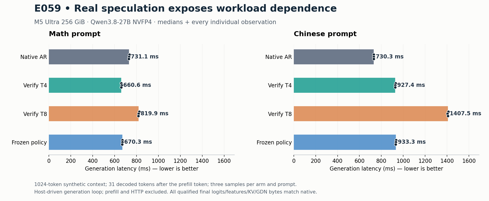

# E059: DeepInfer-inspired verification budgeting

**Closed: GPU correctness and independent raw audit PASS; no overall performance win.** Run from daec7b5, M5 Ultra / MLX0.32.3 / original frozen Qwen3.8-27B NVFP4.

| Prompt | native | fixed4 | fixed8 | adaptive |
|---|---:|---:|---:|---:|
| Math | 731.070 ms | 660.645 ms | 819.857 ms | 670.261 ms |
| Chinese | 730.261 ms | 927.405 ms | 1407.501 ms | 933.301 ms |

Three samples/arm/prompt, medians above. Full generation loop includes draft8, actual accept/reject, target feature capture, selected-state install and synchronization. Prefill and HTTP are excluded; denominator is31 new decoded tokens, excluding the initial prefill token. Native uses the existing decode_model runner through a host-driven loop, not the serving scheduler/lookahead.

Combined two-context throughput relative to native: fixed4 0.919817×, fixed8 0.655987×, adaptive 0.912342×. These are exploratory synthetic-context results, not a production adoption decision. Frozen calibration selected T4 throughout and failed to generalize to the Chinese acceptance pattern.

Independent audit:16 raw final files,1040 tensor pairs, all24 timings and token/round/EOS/cap accounting PASS. 8 unique seed files rehashed;1349 target and175 drafter parameter receipts unchanged. Final-state/raw qualification covers the dedicated untimed trajectories, not full per-round raw state for every timed run. All timed outputs match the qualified IDs. CPU: 38 root +12 independent audit checks pass.

Resource observations:28 physical+metadata samples, max system187.31GiB / child physical peak22.46GiB, zero swap/swapout growth. Bounded child reaped and same oMLX PID52818 restored. Final live health is saved in the E060 report after the second experiment. MLX active bytes at in-function cleanup were209,409,032 (residual allocations before function return; retained local references are a likely cause), cache0; process exit/reap releases the remainder. No zero-residual-memory claim.

[Independent audit](independent-audit.json) · [all timings/IDs](complete.json) · [resource review](resource-review.json) · [source/receipt manifest](device-evidence-manifest.json). Raw multi-GiB tensors remain under `.artifacts` and are indexed by `pairs.json`; no weights or credentials are committed.

## Original pre-run record

Status: implementation/CPU checks complete, GPU NOT RUN yet. Default OFF, experimental bench module.

Official source pinned at `deepseek-ai/DeepInfer@9bd9cf243fc53ef9afbf8f04d391d989117d6ab9`. The release supports V4.1-Flash on SM100/Ascend950, not Apple GPU. We reuse the principle of expected emitted tokens per measured round cost, not its CUDA/distributed infrastructure or checkpoint. See [official scheduler](https://github.com/deepseek-ai/DeepInfer/blob/9bd9cf243fc53ef9afbf8f04d391d989117d6ab9/csrc/engine/mtp_varlen.hpp#L150-L265).

## Hypothesis and fixed scope

E058 reduced local T4/T8 verifier cost, but omitted draft/acceptance/commit. E059 closes that gap with an actual DFlash2 loop, preserving draft block8 and selecting target verification prefix4/8. The drafter has no learned acceptance-confidence head. Empirical P(A≥j) comes only from a full8 calibration trajectory and is frozen before two test contexts; no short-width suffix imputation or current-draft lookahead. Expected count is `1 + sum(survival[:min(T-1, remaining-1)])`.

Three deterministic 1024-token synthetic contexts (code calibration, math and Chinese tests), output cap32, greedy normal EOS. Fixed8 calibration estimates T4/T8 total cost from draft8 plus verification. T4 estimate omits small host selection/commit work; this is a cost-model approximation to disclose, not observed end-to-end savings. All test runs are measured in full.

Qualification compares actual greedy IDs, last full logits, every KV/GDN byte and all computed target-feature rows against original causal M1 traversal. Stress alternates T4/T8 and forces first rejection. It does not force every middle rejection/full-accept on GPU; CPU selection exhaustively covers them. Canonical seed bytes are saved/rechecked; timed no-capture native uses the original engine runner and gets a separate full-state/logit check. Native remains host-driven without HTTP scheduler/lookahead, not a fastest-serving claim.

Only after qualification: one warmup per test/arm and three groups rotating native/fixed4/fixed8/adaptive, 24 full generation samples. Prefill excluded, first prefill token excluded from throughput numerator. No retry/slow-sample filtering. No production adoption or HTTP/Pareto point from this screen. Existing v16 remains unchanged.

## Ownership and stopping

Reuse E058 single direct child, 64GiB child/240GiB system observation ceilings, no swap growth, bounded 1500s work/1650s owner/1800s parent. Temporarily pause the authorized original oMLX service, then restore same PID and verify health. Fresh versioned outputs; no overwrite of old experiments.

## Real agents and pre-run corrections

- DeepSeek-v4.1-flash (Logits): official-source research and risk checklist. Several suggestions rejected: it conflated emitting the bonus with computing/committing it, reversed the official accepted-length comparison, and treated unconditional prefix survival after a mismatch as censored. Once the first mismatch is known, `A≥j` is false for every later j; only an untested truncated suffix can be censored. Original output is preserved as untrusted research.
- Kimi-k3 (Logits): selection module and 13 CPU tests, including 2928 enumerated cases. Root independently reran them.
- Muse-spark-open (Logits): cost policy and 8 CPU tests. Root tightened the nonincreasing probability check to reject any increase.
- Native reviewer: identified missing seed immutability evidence and capture/no-capture native branch qualification; both added before GPU.
- Root: implemented actual generation integration and bounded owner; corrected copied terminal qualifier path before execution. 38 CPU tests passed before audit integration.

All costs/acceptance above are planned measurements, not speedup claims.
