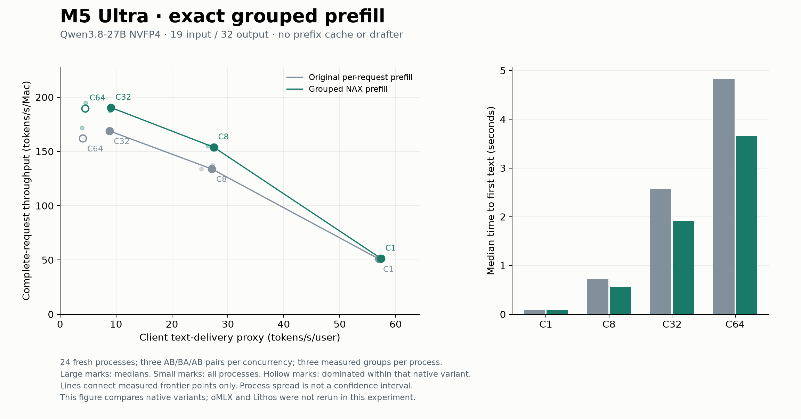
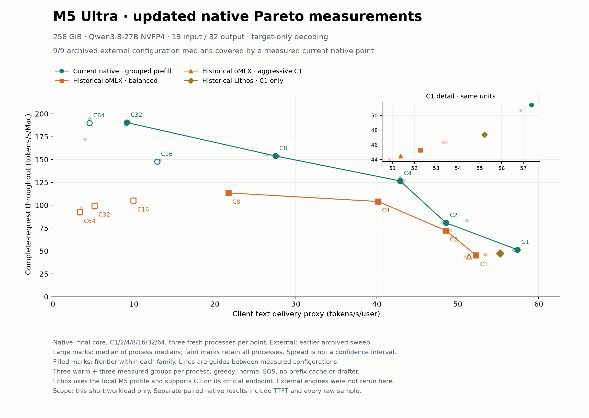

# E010：M5 NAX分组prefill与更新后的Pareto曲线

2026-10-16。最终核心 `b33b282`，已通过预声明HTTP采用门。M4分支最新
`0ed8df8`已通过合并`861d13c`同步；该合并没有改变已测核心。

同一机器：Apple M5 Ultra / 80 GPU cores / 256 GiB，MLX0.32.3。
模型 `mlx-community/Qwen3.8-27B-nvfp4`，revision
`5ff8ef173ad0d7c3aae92f0be43031a6ab8067c6`。
全部计时为19输入/32输出、greedy、正常EOS、无prefix cache、无草稿模型。

## 实际改变与配对收益

原来逐请求运行prefill，现在把兼容的fresh同长度请求按层成组。
广播packed weight保留单序列M=T，避免改变split-K和NAX tile的浮点归约；
不符合条件的投影仍逐请求。只改两个核心文件，新增25行、删除9行，净增16行，无新kernel。
边界限定MLX0.32.3/M5 Ultra、B2–32、T1–512、B×T≤4096；M4原路径保持。
[设计依据与后续方向](../../../optimization-guide/prefill-design.md)。

C1/8/32/64各三对全新进程，顺序AB/BA/AB；两臂使用同一核心，reference只关闭
runner分组。每进程三组预热、三组测量，2 GiB allocator池，compile/fuse decode启用。
24进程、1,890条正式请求、60,480输出token。下面是**逐对比值的几何平均**，
不是中位数相除；预声明门保存在原始plan中。

| 并发 | 总吞吐变化 | 首文本延迟TTFT变化 | 每用户交付速率x变化 |
|---|---:|---:|---:|
| C1 | +0.32% | -1.21% | +0.22% |
| C8 | +14.68% | -26.29% | +2.62% |
| C32 | +12.30% | -24.42% | +2.89% |
| C64 | +14.54% | -23.02% | +6.40% |

C64三对吞吐比值为1.20184、1.17141、1.06731，全部保留，包括较慢的最后一对。
峰值MLX活跃内存两臂均约43.43 GiB；未增加模型权重副本。未测量硬件DRAM流量。



## 当前前沿与历史外部对照

补测C2/C4/C16各三进程，得到最终核心的全部7点。两阶段共33进程、2,088条正式请求、
66,816输出token、462个资源样本；正式与预热合计4,176条请求。
图中大点是三个进程中位数的中位数，小点保留全部进程；离散范围不是置信区间。

| 并发 | 交付速率x tok/s/user | 总吞吐y tok/s/Mac | TTFT秒 | 联合前沿 |
|---|---:|---:|---:|---|
| C1 | 57.366 | 51.435 | 0.0820 | 是 |
| C2 | 48.540 | 80.806 | 0.1473 | 是 |
| C4 | 42.869 | 126.675 | 0.2765 | 是 |
| C8 | 27.485 | 153.891 | 0.5514 | 是 |
| C16 | 12.863 | 147.721 | 1.0612 | 否 |
| C32 | 9.118 | 190.445 | 1.9173 | 是 |
| C64 | 4.491 | 189.828 | 3.6503 | 否 |

当前实测native点覆盖9/9历史外部配置中位数。C16被C8支配；C64中位数被C32支配。
C32/C64吞吐仅差约0.3%，且C64波动更大，不能声称C32有显著吞吐优势；
C32的每用户交付速率与TTFT更好。连接线仅为实测配置间的视觉引导。



外部27个进程来自[上一轮归档](../pareto-batch-v1/m5-ultra-pareto-results.json)：
oMLX balanced C1/2/4/8/16/32/64、aggressive C1、Lithos C1。
本轮**没有重跑外部引擎**。oMLX为官方0.7.1.dev1 wheel，其VCS提交未知；
Lithos upstream `5485ad6`加本机M5 profile `2236580`，官方接口仅测C1。
这是target-only短负载的已测配置前沿，不是全模型、长上下文、质量/能耗或投机解码结论。
MTP/DFlash2/DSpark等合法草稿配置不在本图中，M4与M5数据不混合。

x使用首文本之后的token交付速度估计，包含客户端stream分块行为，不等同纯GPU decode。
y为全部完成token除以组内最早开始到最晚完成的窗口；TTFT为开始到首文本事件。
源JSON保留每请求时间戳、usage、文本、token IDs与完整组窗口。

## 正确性、干扰和恢复

原型通过448项逐层输出/cache检查、7组整模和连续decode检查，以及22组边界、16步调度。
最终接入核心另重跑22组边界及16步固定调度：logits/cache/输出逐位一致。
四项CPU guard与进程识别检查通过；两个实现的全部结果均归档。

HTTP自由到达会改变实际batch划分。两臂在C32/C64分别都出现2/3种32-token流，
因此不声称不同异步进程的逐请求输出恒同；逐位合同明确为相同输入和固定调度。
请求计数、重编码IDs、使用量、时间戳和指标另经独立CPU重算。

初筛及HTTP v1期间发现外部`omlx-server`被旧matcher漏识别；该次HTTP中止，
原始完成与失败数据均保留，不进入最终收益和图。初筛1.26–1.42×仅为临时观测。
改用可执行进程名探针后，在用户授权下暂停该服务，再跑最终资格、配对及补点。
两次暂停均验证PID/start身份并在finally恢复；没有触发看门狗恢复。
已确认原服务恢复运行，`/v1/models`返回HTTP200。
所有33个自有服务均wait/reap且保存PID不存在证明；资源压力均1、热状态均0。
探针不排除所有GUI或未识别GPU活动，不声称绝对GPU独占。

## 证据与复核

- [summary.json](summary.json)：24进程全部计时、配对比值与采用门。
- [audit.json](audit.json)：数值、调度、输出流频数、释放与恢复验证。
- [frontier.json](frontier.json)：21个当前native进程、27个历史外部进程、前沿与支配关系。
- [manifest.json](manifest.json)、[archive.json](archive.json)、[evidence.tar.gz](evidence.tar.gz)：
  1363个原始记录与源文件，SHA256逐项校验通过；含受干扰尝试、旧/新冻结核心及两次服务恢复。
- 可导出的[前沿PDF](current-native-frontier.pdf)和[配对PDF](paired-prefill.pdf)。

压缩归档SHA256：`41bfe655f9c2641122108802a3347742b8ed3e8c9447ababa1fa096bad2767b6`。
归档是文本证据与源码，不含模型、虚拟环境、原生可执行文件或原始tensor。
保存的hash不能替代重新计算tensor。运行harness依赖本机冻结路径，不能在M4直接执行旧PID命令。

在仓库根目录可离线验证所有归档成员，无需MLX或GPU：

```sh
python3 -B - <<'PYVERIFY'
import hashlib, json, tarfile
from pathlib import Path
p = Path('docs/experiments/m5-ultra-256gb/prefill-nax-v2')
m = json.loads((p / 'manifest.json').read_text())
a = json.loads((p / 'archive.json').read_text())
assert hashlib.sha256((p / 'evidence.tar.gz').read_bytes()).hexdigest() == a['archive_sha256']
with tarfile.open(p / 'evidence.tar.gz') as t:
    assert set(t.getnames()) == set(m) and len(t.getmembers()) == len(m)
    for entry in t.getmembers():
        data = t.extractfile(entry).read()
        assert len(data) == m[entry.name]['bytes']
        assert hashlib.sha256(data).hexdigest() == m[entry.name]['sha256']
print('PASS', len(m), 'archive members')
PYVERIFY
```

本机原始路径仍在`.artifacts/m5-ultra-256gb/`。独立重算入口为
`bench/m5_ultra_256gb/prefill_http_v2/summarize.py`、`audit_prefill.py`及
`summarize_prefill_frontier.py`；完整已执行参数在归档的plan/job记录。
重画图用`prefill_report.py --summary ... --out ...`和
`plot_prefill_frontier.py --results ... --out ...`，需要matplotlib；本轮使用独立uv环境，
未更改冻结的推理环境。

下一项重点是混合长度prefill和B>8的decode矩阵路线。当前C16下降提示需要分解prefill、
稳态decode和批量切换成本，但尚未证明单一根因；不据此直接扩大graph/fusion范围。
