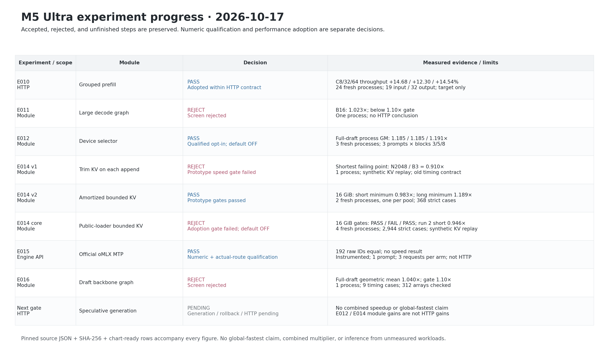

# M5 Ultra progress snapshot · 2026-10-17

E014 原型 v2 的两个池都通过，但实际生产 loader 接入的三个 16 GiB fresh processes 为 **PASS / FAIL / PASS**。第二进程 N32/B3 为 **0.946272×**，低于 0.97×；因此整体采用门未过，模块保持默认 OFF。四进程全部 **2,944** 个严格数值检查通过。2 GiB 兼容性进程通过。所有进程均保留，未合成一个掩盖失败的中位数。



## 可复现科学图

- [E014 prototype latency](e014-prototype-latency.png) · [SVG](e014-prototype-latency.svg)
- [E014 prototype speedup](e014-prototype-speedup.png) · [SVG](e014-prototype-speedup.svg)
- [E014 integrated latency](e014-integrated-latency.png) · [SVG](e014-integrated-latency.svg)
- [E014 integrated speedup](e014-integrated-speedup.png) · [SVG](e014-integrated-speedup.svg)
- [E014 independent-process gates](e014-integrated-gates.png) · [SVG](e014-integrated-gates.svg)
- [HTTP / module measured progress](measured-progress.png) · [SVG](measured-progress.svg)
- [Status table](progress-status.png) · [SVG](progress-status.svg)

图中的 history 是实际数值坐标（log₂），长 history 由短真实 KV 重复构建，是 **synthetic cache-state replay，不是实际长生成**。Block 3/8 分面。KV OFF 蓝色、KV ON 橙色；进程使用不同形状及线型。原型每个条件只有一个 fresh process；core 接入保留全部三个 16 GiB 及一个 2 GiB 进程。小点是全部正式 timing，粗点是每进程六样本的中位数，不是独立进程或置信区间。连接线只引导阅读，不推算未测点。

v1 每次追加都裁 KV，legacy timing 包含 restore + draft；v2 改为 physical > 4096 才裁到 2048，并测量完整 draft + 本臂 teardown，pre-restore 不计时。策略、计时生命周期及池条件均改变，**不能把 v1→v2 的绝对毫秒差归因于一个因素**。core 接入又有四份独立 drafter 权重常驻，是另一个阶段。应用层 Python refs 清理不等于 allocator 立即回收。原型 16 GiB 最后资源区间 Swapins +3，不能声称完全无 paging。

HTTP E010 是 19→32 target-only 请求；E012/E014/E016 是局部 draft 模块；E015 是有观察器的官方 EnginePool 数值/真实路由资格，**没有 speed 结果**。这些比值不相乘、不相加，也不构成全球最快或 speculative HTTP 的结论。

## 逐步状态

| ID | Scope | Module | Decision | Evidence | Limits |
|---|---|---|---|---|---|
| E010 | HTTP | Grouped prefill | Adopted within HTTP contract | C8/32/64 throughput +14.68 / +12.30 / +14.54% | 24 fresh processes; 19 input / 32 output; target only |
| E011 | Module | Large decode graph | Screen rejected | B16: 1.023×; below 1.10× gate | One process; no HTTP conclusion |
| E012 | Module | Device selector | Qualified opt-in; default OFF | Full-draft process GM: 1.185 / 1.185 / 1.191× | 3 fresh processes; 3 prompts × blocks 3/5/8 |
| E014 v1 | Module | Trim KV on each append | Prototype speed gate failed | Shortest failing point: N2048 / B3 = 0.910× | 1 process; synthetic KV replay; old timing contract |
| E014 v2 | Module | Amortized bounded KV | Prototype gates passed | 16 GiB: short minimum 0.983×; long minimum 1.189× | 2 fresh processes, one per pool; 368 strict cases |
| E014 core | Module | Public-loader bounded KV | Adoption gate failed; default OFF | 16 GiB gates: PASS / FAIL / PASS; run 2 short 0.946× | 4 fresh processes; 2,944 strict cases; synthetic KV replay |
| E015 | Engine API | Official oMLX MTP | Numeric + actual-route qualification | 192 raw IDs equal; no speed result | Instrumented; 1 prompt; 3 requests per arm; not HTTP |
| E016 | Module | Draft backbone graph | Screen rejected | Full-draft geometric mean 1.040×; gate 1.10× | 1 process; 9 timing cases; 312 arrays checked |
| Next gate | HTTP | Speculative generation | Generation / rollback / HTTP pending | No combined speedup or global-fastest claim | E012 / E014 module gains are not HTTP gains |

## 重画与证据

从仓库根运行（Python + Matplotlib 3.9.4；不导入 MLX，不使用 GPU）。本机使用独立 `.artifacts/m5-ultra-256gb/progress-render-venv`，完整版本见 [requirements.txt](requirements.txt)：

```sh
python3 bench/m5_ultra_256gb/progress/plot.py
```

只从本快照已固定的小 JSON 重画到新目录，无需模型、原始 .artifacts 或网络：

```sh
python3 bench/m5_ultra_256gb/progress/plot.py --snapshot docs/optimization-guide/progress/2026-10-17-v1/sources --output /tmp/minivllm-progress-rebuild
```

[chartdata.json](chartdata.json) 保存每个图点及其原始 JSON path/pointer、正式样本和独立进程身份；[source-manifest.json](source-manifest.json) 保存每个输入的 SHA-256 / bytes；`sources/` 保存输入副本；[summary.json](summary.json) 保存复核与采用结论。生成器在画图前重算全部 E014 中位数、速度比和门，以及 E010 逐进程配对比值、E012/E016 模块比值。正式实验的完整数组、资源与进程清理审计属于对应实验归档，本图不会代替它们。

源实验：[E010](../../../experiments/m5-ultra-256gb/prefill-nax-v2/README.md)、[E012](../../../experiments/m5-ultra-256gb/E012-draft-selector-integrated-v1/README.md)、[E014 v2](../../../experiments/m5-ultra-256gb/E014-draft-window-v2/README.md)、[E014 integrated](../../../experiments/m5-ultra-256gb/E014-draft-window-integrated-v1/README.md)、[E015](../../../experiments/m5-ultra-256gb/E015-official-mtp-v1/README.md)、[E016](../../../experiments/m5-ultra-256gb/E016-draft-graph-v1/README.md)。

固定背景白色、细灰网格、DejaVu Sans；PNG 为 180 dpi，SVG 保留文字。工程仓库图使用本项目身份，无第三方品牌装饰。
