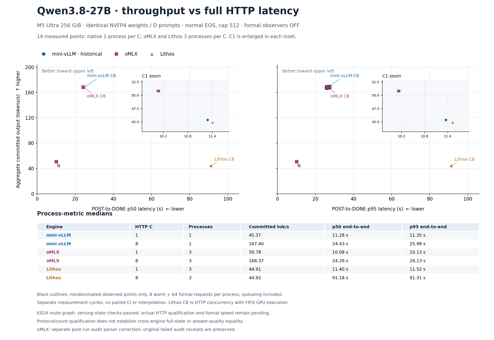

# D512 三引擎吞吐—完整请求延迟（v10）



新增六个 oMLX 正式进程点，保留 v9 的八个历史点原值。共14个实际观测，p50/p95分别作图；黑色轮廓只表示这些观测中的非支配点，没有插值。

同一 Qwen3.8-27B NVFP4 revision、八份 D coding fixtures（886–978输入tokens）、greedy、normal EOS、cap512。每个新进程8 warm +64 formal，正式observer OFF。吞吐为正式committed tokens /（最后formal DONE − 首个formal POST）；延迟为每请求完整 POST→DONE，含服务器排队、不含客户端等待并发槽位。EOF/drain/close另有协议检查，不计入该延迟区间。

| Engine | HTTP C | Processes | Committed tok/s | p50 (s) | p95 (s) |
| --- | ---: | ---: | ---: | ---: | ---: |
| mini-vLLM | 1 | 1 | 45.372147 | 11.283287 | 11.348184 |
| mini-vLLM | 8 | 1 | 167.398907 | 24.431814 | 25.979063 |
| oMLX | 1 | 3 | 50.781568 | 10.079909 | 10.128053 |
| oMLX | 8 | 3 | 168.365034 | 24.263937 | 26.130037 |
| Lithos | 1 | 3 | 44.910185 | 11.402589 | 11.521853 |
| Lithos | 8 | 3 | 44.916329 | 91.183519 | 91.313418 |

表中是每配置的进程指标中位数，不是池化请求分位数或新观测点。native 每C仅一次，oMLX/Lithos每C三次，来自不同周期、未配对，不能给出配对置信区间。

当前 native C1 落后于 oMLX。C8吞吐接近：native 167.40、oMLX中位数168.37 tok/s；native p95 25.98s，比oMLX中位数26.13s略低。p50坐标下，最快oMLX C8观测支配native C8；p95坐标下，native C8仍是本批观测的非支配取舍之一。这些小差异不能作为跨轮统计优越性结论。Lithos C8为HTTP并发、官方GPU FIFO执行，不能描述为batch8。没有最大并发或全网最快结论。

## oMLX 失败记录与独立复审

实际六进程共48warm/384formal、196608 formal committed tokens；全cap512、EOS早停0。原服务已恢复并独立PASS。第一次冻结的资源审计错误地要求outer reader不保存的stderr字段，正式审计因此在原始请求重读前FAIL。原始归档及两份FAIL保持不变。

新的版本化离线审计核对outer真实三字段与12份真实inner stderr/回收证据，再独立重读全部432请求。资源与正式审计均PASS；阈值、计数、计时数学未改变。它们是明确记录的事后解析器修正，不是预注册审计；未伪造缺失字段或重跑性能。CPU六项真实证据回归通过，完整命令/源码/收据在[补充归档](../../../experiments/m5-ultra-256gb/E023-omlx-d512-formal-v2-audit-supplement/README.md)，原始[失败归档](../../../experiments/m5-ultra-256gb/E023-omlx-d512-formal-v2/README.md)保留。

该资格支持实际协议、路线、计数和计时，不证明跨引擎full-state或答案质量相等，不证明所有后台任务健康、generator EOF或暖KV恢复。E024图复用已通过原37请求/42参数调用的serving状态门；真实HTTP资格在运行，正式速度仍未测，本图不使用其诊断耗时。

## 来源与重画

九份来源原字节及SHA/大小保存在 [manifest](sources/manifest.json)。Renderer绑定新审计与补充归档的精确收据、原FAIL和原归档，检查历史八点不变、六个新点与审计逐项一致，计算非支配集合及进程指标中位数。

- [逐点数据](chartdata.json) · [验证收据](verification.json) · [renderer](render.py)
- [PNG](D512-throughput-latency.png) · [SVG](D512-throughput-latency.svg)
- [oMLX正式审计](sources/omlx-independent-audit.json) · [资源](sources/omlx-resources.json) · [恢复](sources/omlx-restoration.json)

从仓库根目录执行：

```sh
.artifacts/m5-ultra-256gb/progress-render-venv/bin/python -I -B docs/optimization-guide/progress/2026-10-17-v10/render.py
```

已实际渲染并目视检查PNG：双坐标、C1放大窗、C8标签、表格及范围脚注均可见，无裁切；未运行GPU或新增测量。
