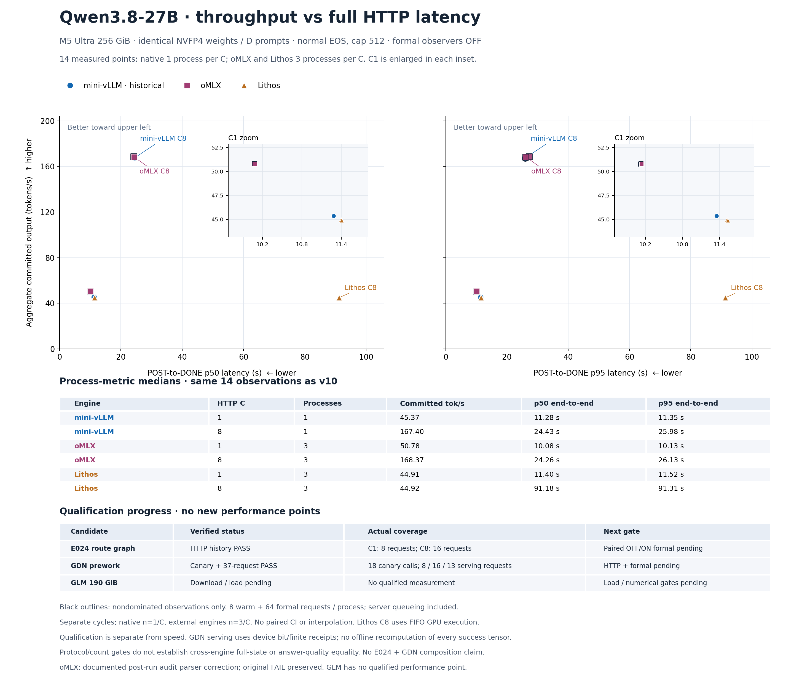

# D512 吞吐—完整请求延迟（v11）



**14 个正式性能观测及全部指标与 v10 完全相同。** 本版只增加独立的资格进度表：E024 实际 HTTP 历史资格 PASS；GDN canary 与37请求同调度资格 PASS。它们没有产生新的性能点，也不表示已测得优化收益。

同一 M5 Ultra 256GiB、Qwen3.8-27B NVFP4、八份 D coding fixtures、greedy normal EOS cap512。每进程8 warm +64 formal、observer OFF。吞吐为 formal committed tokens /（最后 formal DONE − 首个 formal POST）；p50/p95为每请求完整 POST→DONE，包含服务端排队，不包含客户端等待并发槽位。EOF/drain/close另行核验，不计入延迟。

| Engine | HTTP C | Processes | Committed tok/s | p50 (s) | p95 (s) |
| --- | ---: | ---: | ---: | ---: | ---: |
| mini-vLLM | 1 | 1 | 45.372147 | 11.283287 | 11.348184 |
| mini-vLLM | 8 | 1 | 167.398907 | 24.431814 | 25.979063 |
| oMLX | 1 | 3 | 50.781568 | 10.079909 | 10.128053 |
| oMLX | 8 | 3 | 168.365034 | 24.263937 | 26.130037 |
| Lithos | 1 | 3 | 44.910185 | 11.402589 | 11.521853 |
| Lithos | 8 | 3 | 44.916329 | 91.183519 | 91.313418 |

表格为进程指标中位数，不是池化请求分位数或新增观测。native每C只有1个历史进程，外部引擎各3个；来自不同周期、未配对，不提供置信区间或跨轮统计优越性结论。黑色轮廓仅标出所展示实际观测中的非支配点，不插值。Lithos C8是HTTP并发，官方GPU执行为FIFO，不能解释为GPU batch8。

## 已闭合资格与未覆盖范围

- **E024 route graph**：实际 C1×8 / C8×16 请求捕获与重放通过独立数值、来源、资源、回收和恢复审计。两条历史分别4096 /1028 steps，观察到的终止EOS均为0。范围是这两条真实HTTP历史；配对 OFF/ON 正式性能尚未运行。[周期审计](qualification-sources/e024-cycle.json) · [C1](qualification-sources/e024-c1.json) · [C8](qualification-sources/e024-c8.json)
- **GDN prework**：18-call canary的60份原始tensor文件、54对输出/状态及24对因果state比较已独立复核。新增原37请求同调度资格独立PASS：D-C1 / D-C8 / lifecycle各8 /16 /13请求、4096 /1027 /40 steps，终止EOS观察数0；96次layer安装与恢复闭合。长B1执行候选，多row执行原回退；E024/E028开关关闭。成功tensor依赖固定源码的设备逐位与finite收据，不是离线重新计算全部成功tensor。[Canary](qualification-sources/gdn-canary.json) · [37请求审计](qualification-sources/gdn-serving.json)
- **GDN资源与恢复**：211份资源样本全部pressure1，swap使用量增量0、Swapouts0、Pageouts0；仍有Swapins8 /Decompressions2126，不能称为完全没有分页。原服务29328→43565，独立恢复PASS；暖KV和精确运行时签名未恢复。[资源](qualification-sources/gdn-serving-resources.json) · [恢复](qualification-sources/gdn-serving-restoration.json)
- **仍未取得资格**：GDN HTTP及正式性能、参数替换、未观测取消/采样key失效、E024+GDN组合。GLM190GiB下载/加载待完成，没有合格性能点；此项为快照时的维护者状态，不是测量收据。

协议/计数资格不证明跨引擎full-state或答案质量相等。诊断耗时与资源占用没有作为吞吐—延迟点。oMLX沿用v10的明确事后解析器修正：原始FAIL永久保留，版本化独立审计重新读取全部432请求后PASS；本版没有重跑性能。[v10说明](../2026-10-17-v10/README.md)

## 来源、渲染与复核

本次实际 prepare 和 render 各执行一次，均returncode0、stderr为空。渲染于2026-10-18T02:28:04Z完成（本地10月17日19:28 PDT）。随后 `view_image` 目视检查2880×2484 PNG：双坐标、C1放大窗、C8标记、指标表、独立资格表及脚注均清晰可见，未见裁切或文字重叠。

独立的小型复核再次确认14份完整point记录、6组process medians与v10逐字段相同，并重新计算p50/p95非支配集合与中位数。原v10 renderer/chartdata SHA不变。没有运行GPU、模型或服务。

- [PNG](D512-throughput-latency.png) · [SVG](D512-throughput-latency.svg) · [逐点数据](chartdata.json)
- [绘图验证](verification.json) · [数据与目视复核](visual-review.json)
- [9份原性能来源](sources/manifest.json) · [16份资格/前版来源](qualification-sources/manifest.json)
- [实际prepare命令](render-evidence/prepare-command.json) · [实际render命令](render-evidence/render-command.json)
- [准备源码](prepare.py) · [固定来源renderer](render.py)

PNG SHA256：`8aff5bbe70e1f077ffd31b2d6cfd5c9d28be1640327d32e9723ef08b744ba0f5`  
SVG SHA256：`c48a4d3c69b5c1fc8da0ad2ea921a3cc7554ecb9a52a27e762fe4aa75f905fcc`  
Chartdata SHA256：`df412e157da1e08436bdf81ef1cfaa126eaca42da7d12d6241b8ad6e46073123`

重画使用已封存来源副本：

```sh
.artifacts/m5-ultra-256gb/progress-render-venv/bin/python -I -B docs/optimization-guide/progress/2026-10-17-v11/render.py
```

`prepare.py`只允许首次封存，不能覆盖。prepare及renderer均fail-closed：任一必要资格证据FAIL /INCOMPLETE、缺失或绑定不符时不生成本版图；不以canary PASS代替37请求资格，不从生产者PASS推断独立审计通过。
