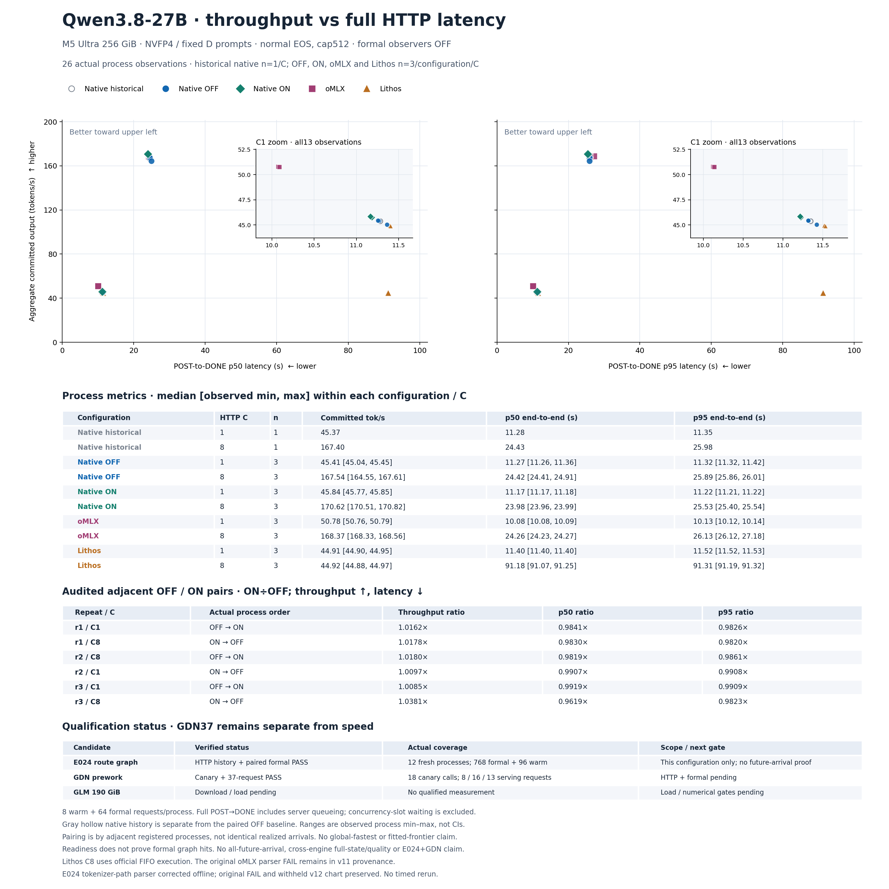

# Qwen3.8-27B NVFP4 D512: paired graph results



[SVG](D512-throughput-latency-v2.svg) · [26 process observations](chartdata.json) · [Complete experiment and correction](../../../experiments/m5-ultra-256gb/E024-route-http-formal-v2-reparse-v1/RESULTS.md) · [Visual QA](visual-review-v2.json)

All12 new native OFF/ON processes pass independent count, timing, resource and restoration audits:96warm+768formal requests. All14 historical observations are unchanged. Historical native n=1/C is separate from new OFF/ON n=3/configuration/C.

| Configuration | HTTP C | Median tok/s | Median process p50 s | Median process p95 s |
| --- | ---: | ---: | ---: | ---: |
| Native OFF | 1 | 45.406 | 11.271 | 11.320 |
| Native OFF | 8 | 167.537 | 24.419 | 25.892 |
| Native ON | 1 | 45.835 | 11.166 | 11.215 |
| Native ON | 8 | 170.620 | 23.976 | 25.531 |
| oMLX | 1 | 50.782 | 10.080 | 10.128 |
| oMLX | 8 | 168.365 | 24.264 | 26.130 |
| Lithos | 1 | 44.910 | 11.403 | 11.522 |
| Lithos | 8 | 44.916 | 91.184 | 91.313 |

All six adjacent pairs improve throughput and p50/p95: C1 throughput +0.847–1.621%, C8 +1.777–3.807%. Native ON leads the separately measured oMLX C8 point estimates but remains behind at C1. Lithos C8 uses its official FIFO execution. Medians/ranges summarize process metrics; they are not pooled percentiles or confidence intervals. No global-fastest, maximum-concurrency or unmeasured-frontier claim.

The display retains the policy committed in v12 before ON results: all26 observations,10 configuration/C groups,6 pairs and separate p50/p95. GDN37 correctness and new CPU tests add no speed points.

The original frozen auditor rejected a legitimate registered HF tokenizer snapshot symlink. Its FAIL and v12 withheld chart remain. Separate v2 validates the exact registered path, manifest, original target hash/stat and current bytes;8 targeted regressions pass. The same864 raw requests and resources were rechecked without rerunning timing.

[All actual render attempts](render-evidence/manifest.json) are retained. First render failed because root.venv lacks Matplotlib; identical source/data rendered in the existing plotting environment. Visual review found x-axis/table-heading overlap. Separate render_v2.py changes only panel bottom.585→.615 and output/provenance names. The first image/source/receipt and failed review remain. Final PNG was viewed, SVG parsed, and data is unchanged.

[Preparation](preparation.json) · [First render](verification.json) · [Final render](verification-v2.json) · [Final source](render_v2.py). Reproduction requires a fresh output copy, since each render refuses overwrites:

```sh
.artifacts/m5-ultra-256gb/progress-render-venv/bin/python -I -B docs/optimization-guide/progress/2026-10-17-v13/render_v2.py --run
```

The graph remains default OFF. These results do not establish every arrival schedule, observed graph-hit counts during timing, GDN/E028 composition, cross-engine full-state quality equality or larger batch qualification.
