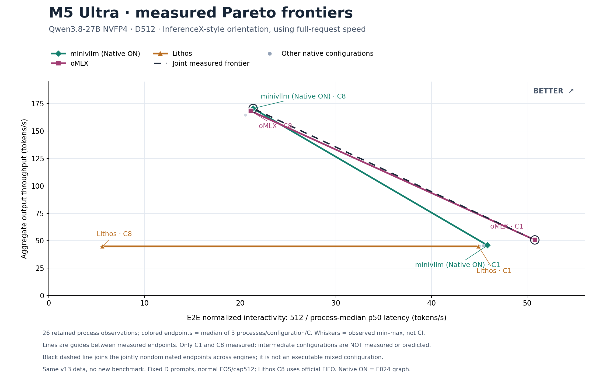
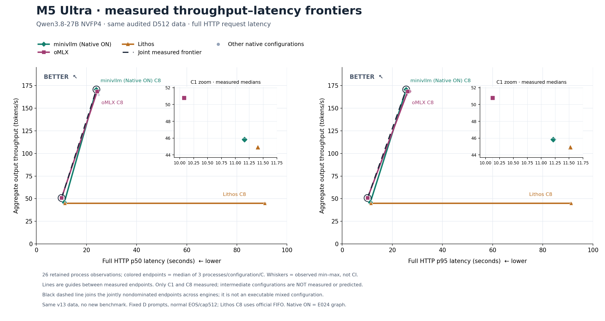

# D512：显式绘制已测 Pareto 前沿



绿色为minivllm Native ON，紫色为oMLX，橙色为Lithos。彩色实线连接各引擎的非支配汇总点；黑色虚线连接三家合并后的非支配汇总点。**连线只是视觉引导，中间配置未测，不能按线段预测性能。** 跨引擎线段也不代表可执行的混合配置。

此图修正v13只有散点、没有实际画线的问题。沿用[已审计v13](../2026-10-17-v13/README.md)的26个原始进程观察，没有新增实验或速度点。按配置/并发，从26点重新计算10组进程指标中位数及min–max，全部与原表一致。主要彩色端点是Native ON、oMLX、Lithos各C1/C8、每组3个独立进程；旧Native OFF/history作为灰色背景保留，不与ON混合。

横轴为`512 / median_process(p50_HTTP_latency)`，越右越好；所有实际请求均输出512 tokens。它是包含首输出前时间及完整HTTP交付的E2E归一化速度，**不是ITL/TPOT倒数，也不声称是逐请求速度的同分位统计**。纵轴为整台机器的实际输出吞吐。这个单调坐标变换保持端点的Pareto支配关系，但连接线在不同坐标下不表示同一种插值模型。

[原始延迟坐标的p50/p95双图](D512-frontier-latency.png)继续使用完整POST→DONE延迟，越左上越好。



在p50、p95两种口径下，各引擎自身均有两个非支配端点。**联合前沿均只有oMLX C1与Native ON C8**；加入Native OFF和history后不变。Lithos C8吞吐仅比C1高0.00614 tok/s，严格点估计仍非支配；这不代表统计显著提高。误差线为实际进程min–max，不是置信区间。C1/C8之间仍需补测；本图不证明完整前沿、全网最快或全线超越。

[源数据副本](source-v13-chartdata.json) · [前沿集合与派生数据](chartdata.json) · [生成核验](verification.json) · [视觉检查](visual-review.json) · [脚本](render.py) · [SVG](D512-frontier-interactivity.svg)

复现（输出到不存在的新目录，保留已有图）：

```sh
MPLCONFIGDIR=/tmp/minivllm-plot-cache .artifacts/m5-ultra-256gb/progress-render-venv/bin/python -I -B docs/optimization-guide/progress/2026-10-17-v14/render.py --repo "$PWD" --output /tmp/minivllm-frontier-recheck
```
