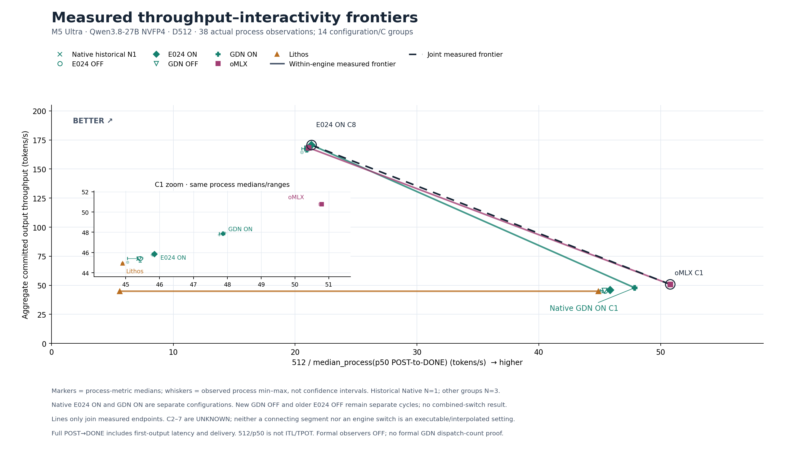
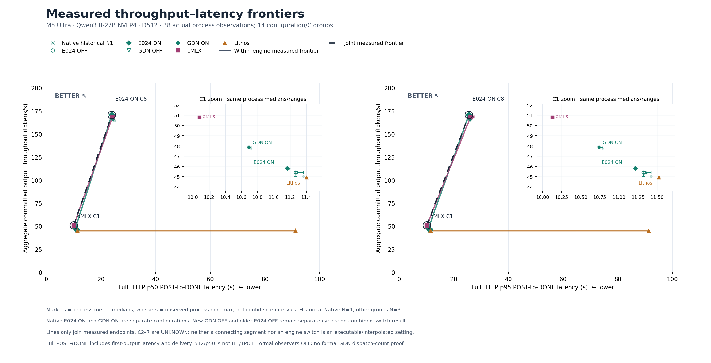

# v15：GDN 改善 C1，联合前沿仍由 oMLX C1 与 E024 C8 构成



2026-10-18 实际闭合后更新。新增 [GDN-only 十二进程正式结果](../../../experiments/m5-ultra-256gb/E029-gdn-http-formal-v1/README.md)：独立正式审计、资源与恢复均 PASS，96 warm + 768 formal 请求完整核验。v14 原26个进程点及10组汇总值全部保留不变；新增12点后，共 **38个观察、14组配置/并发汇总**。这是实测更新，不是预测。

GDN ON C1 的三进程吞吐中位数为 **47.860 tok/s**，完整 POST→DONE p50 为 **10.694秒**。与本轮独立 OFF 配对，三次吞吐增幅分别为5.567%、5.574%、5.191%。GDN ON C8 的吞吐中位数167.420 tok/s，相对本轮 OFF 167.697 tok/s未呈现收益；不将其描述为全并发优化。

按配置汇总点独立计算，Native 自身前沿可择 **GDN ON C1、E024 ON C8**；它们是两个不同的可执行配置，**没有运行 E024+GDN 的组合**。p50、p95 两种口径的联合非支配端点仍是 **oMLX C1、E024 ON C8**。GDN缩小了C1差距，但本机这些测量不支持“全线超过”。



下表为各配置独立进程指标的中位数。历史 Native N=1 只保留为历史观察；其余每格N=3。两轮 OFF 分开、不合并成六次重复，也不把跨引擎或跨周期结果称为配对实验。完整三进程 min–max 与配对比值见 [chartdata.json](chartdata.json)。

| 配置 | C | 进程数 | 输出 tok/s | POST→DONE p50 秒 | p95 秒 |
|---|---:|---:|---:|---:|---:|
| Native historical (N=1) | 1 | 1 | 45.372 | 11.283 | 11.348 |
| Native historical (N=1) | 8 | 1 | 167.399 | 24.432 | 25.979 |
| Native E024 cycle OFF | 1 | 3 | 45.406 | 11.271 | 11.320 |
| Native E024 cycle OFF | 8 | 3 | 167.537 | 24.419 | 25.892 |
| Native E024 ON | 1 | 3 | 45.835 | 11.166 | 11.215 |
| Native E024 ON | 8 | 3 | 170.620 | 23.976 | 25.531 |
| Native GDN cycle OFF | 1 | 3 | 45.372 | 11.277 | 11.330 |
| Native GDN cycle OFF | 8 | 3 | 167.697 | 24.402 | 25.862 |
| Native GDN ON | 1 | 3 | 47.860 | 10.694 | 10.741 |
| Native GDN ON | 8 | 3 | 167.420 | 24.431 | 26.000 |
| oMLX | 1 | 3 | 50.782 | 10.080 | 10.128 |
| oMLX | 8 | 3 | 168.365 | 24.264 | 26.130 |
| Lithos | 1 | 3 | 44.910 | 11.403 | 11.522 |
| Lithos | 8 | 3 | 44.916 | 91.184 | 91.313 |

横轴 `512 / median_process(p50_POST-to-DONE)` 是完整请求的归一化速度，不是 ITL/TPOT 或逐请求速度的混合分位数。原延迟图保留p50/p95。所有点的实际正式请求均输出512 committed tokens。误差线为观察到的进程 min–max，**不是CI或显著性结论**。

彩色线按每个引擎可选择的独立配置连接非支配端点；黑虚线是联合前沿。线段只引导阅读，**C2–7未测**，既不能内插性能，也不代表可执行的引擎/开关混合。HTTP并发不是GPU batch大小。形式上的点估计非支配不等于统计显著优势。

正式计时的observer关闭。资格来自先前真实捕获历史，不能据图声称所有未来调度、正式GDN命中次数、通用质量或组合开关已验证。此次绘图消费已审归档的小回执与manifest，并不重放HTTP或重新解压/哈希整个证据流。

8项CPU测试**首跑8/8 PASS**，原始stdout/stderr、命令及源码前后SHA均保留；Matplotlib3.9.4预检通过。真实prepare首跑通过。首轮渲染发现C1拥挤，只增加放大框与GDN标签后第二轮通过目视检查；首图和两次源码快照完整保留，数据/prepare/测试未修改。SVG通过XML及文本检查，未单独栅格化。v14和current链接未修改。

[闭合输入与准备回执](preparation.json) · [实际图核验](verification.json) · [目视检查](visual-review.json) · [全部尝试记录](render-history.json) · [原始CPU记录](validation/execution-v1/tests/receipt.json) · [PNG首版](validation/first-render/D512-frontier-interactivity.png) · [SVG主图](D512-frontier-interactivity.svg) · [p50/p95 SVG](D512-frontier-latency.svg)

`source-manifest.json` 原样保留的是执行前 PREPARED_NOT_RUN 历史快照；实际运行以 `render-history.json` 与 `visual-review.json` 为准。最终文件SHA见 `result-manifest.json`。复现使用已有可用绘图环境并写不存在的新输出目录：

```sh
.venv/bin/python -I -B docs/optimization-guide/progress/2026-10-17-v15/prepare.py \
  --run --repo "$PWD" --out /tmp/progress-v15-prepared-recheck
MPLCONFIGDIR=/tmp/minivllm-plot-cache .artifacts/m5-ultra-256gb/progress-render-venv/bin/python -I -B \
  docs/optimization-guide/progress/2026-10-17-v15/render.py --run --repo "$PWD" \
  --data /tmp/progress-v15-prepared-recheck --out /tmp/progress-v15-render-recheck
```
