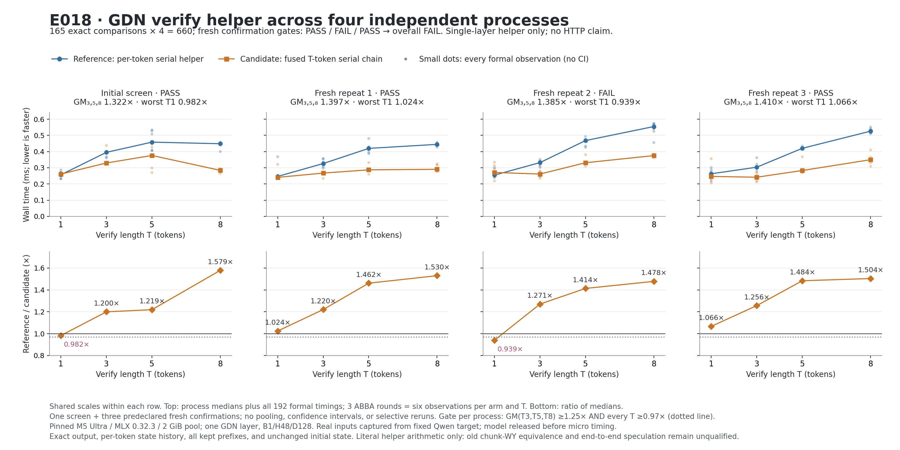

# Progress snapshot v2 · E018 · 2026-10-17

**至少一个 fresh confirmation 未达独立预注册门；保留全部结果，不授予下一层采用资格。** 初筛和三次 fresh process 均独立展示；165×4 = **660** 个数值比较通过。没有池化进程中位数，也未筛掉负收益。



[可编辑 SVG](e018-helper-progress.svg) · [图数据](chartdata.json) · [来源 SHA](source-manifest.json) · [摘要](summary.json)

| Process | PID | T1 | T3 | T5 | T8 | GM(T3,T5,T8) | Gate |
|---|---:|---:|---:|---:|---:|---:|---|
| Initial screen | 1941 | 0.982453× | 1.199745× | 1.219095× | 1.578766× | 1.321746× | PASS |
| Fresh repeat 1 | 2270 | 1.023888× | 1.220317× | 1.461622× | 1.530151× | 1.397486× | PASS |
| Fresh repeat 2 | 2341 | 0.939084× | 1.270615× | 1.413632× | 1.478124× | 1.384694× | FAIL |
| Fresh repeat 3 | 2419 | 1.066419× | 1.256273× | 1.483812× | 1.504110× | 1.410092× | PASS |

每个进程的门是 GM(T3,T5,T8)≥1.25× 且每个 T≥0.97×，T1 的负收益原样保留。图顶排显示真实 ms，底排 reference/candidate 倍数；横轴为实际 T1/3/5/8，同行共用尺度。每点每臂六个正式观测，三组 ABBA；四进程共 192 个正式样本，64 warm、32 首样本全部随 chartdata 保存。小点是观察样本，不是独立进程或置信区间；连接线只辅助阅读。

本实验只比较 **单层 GDN helper**：原 per-token literal helper 串行调用，对比在一个 kernel 中保持同样串行数学的 T-token chain。设备为 M5 Ultra / MLX0.32.3 / 2 GiB allocator pool，shape B1/H48/D128。模型只用于抓取真实输入，micro timing 前已释放。三个初态 real/zero/independent_random 分别检查 output、每 token state history、所有可保留 prefix，以及初始 state 不变。

**没有证明旧 chunk-WY 路径等价、完整模型正确性、target rollback、投机生成或 HTTP 性能。** 不把本图倍数乘到 E010/E012/E014，不作全网最快结论。

E017 Lithos DSpark 已通过正式路线与返回 IDs 资格：两个 fresh processes、同一 19-token prompt 各三请求，共比较 192 raw IDs；这次 **没有速度结论**，见 [E017 归档](../../../experiments/m5-ultra-256gb/E017-lithos-dspark-v1/README.md)。[v1 的七张进展图](../2026-10-17-v1/README.md) 保持冻结，包含 E014 core 采用失败等完整历史。

## 离线重画

用 Python + Matplotlib 3.9.4（本机独立 CPU venv `.artifacts/m5-ultra-256gb/progress-render-venv`），仓库根运行：

```sh
python3 bench/m5_ultra_256gb/progress/gdn.py
python3 bench/m5_ultra_256gb/progress/gdn.py --snapshot docs/optimization-guide/progress/2026-10-17-v2/sources --output /tmp/minivllm-e018-rebuild
```

生成器重算每点六样本中位数、speedup、GM 和每个独立门；检查全部 660 个 strict 字段及两臂 SHA 一致，再画图。`sources/raw-artifacts/` 保存原 JSON 的副本（避免被 `.artifacts` ignore 规则排除），source-manifest 保留原路径和副本映射。此图核验不替代正式实验的 source/resource/owner 审计。
