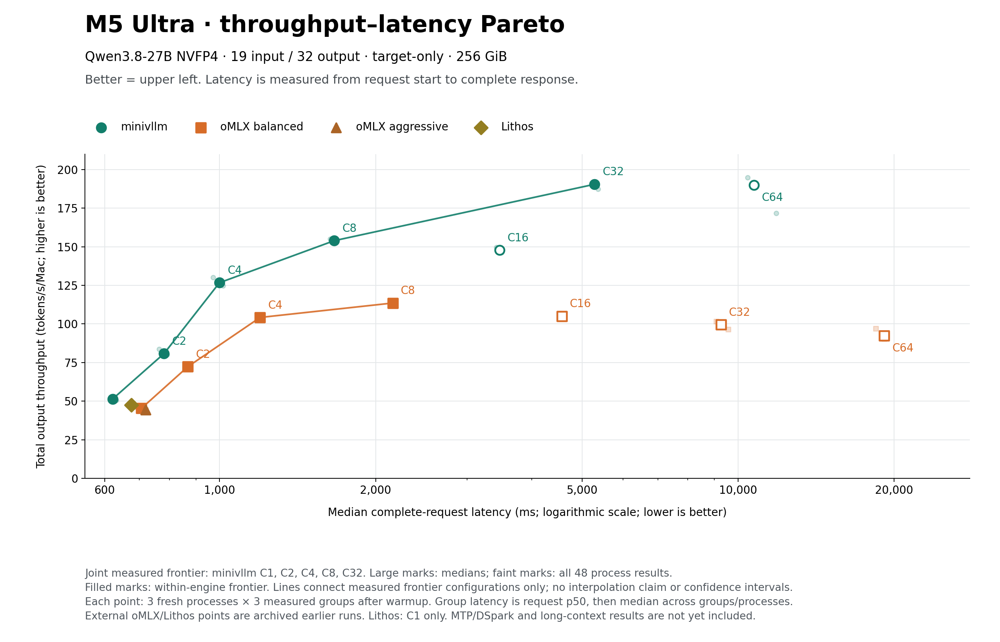

# Throughput–latency Pareto · 2026-10-17 v3

横轴为真实 **HTTP 请求开始到完整响应完成的延迟**，单位 ms；纵轴为总输出吞吐 tok/s。越靠左上越好。正确性是进入候选集合的前提，不是可牺牲的优化轴。



[SVG](throughput-latency-pareto.svg) · [逐请求重算数据](chartdata.json) · [SHA](source-manifest.json)

| 引擎 | 并发 C | 完整请求延迟 ms | 总吞吐 tok/s | 首文本 TTFT ms | 联合前沿 |
|---|---:|---:|---:|---:|---|
| minivllm | 1 | 622.1 | 51.43 | 82.0 | 是 |
| minivllm | 2 | 781.3 | 80.81 | 147.3 | 是 |
| minivllm | 4 | 999.3 | 126.67 | 276.5 | 是 |
| minivllm | 8 | 1662.9 | 153.89 | 551.4 | 是 |
| minivllm | 16 | 3464.3 | 147.72 | 1061.2 | 否 |
| minivllm | 32 | 5286.7 | 190.44 | 1917.3 | 是 |
| minivllm | 64 | 10718.9 | 189.83 | 3650.3 | 否 |
| oMLX balanced | 1 | 706.5 | 45.29 | 113.5 | 否 |
| oMLX balanced | 2 | 868.5 | 72.31 | 231.2 | 否 |
| oMLX balanced | 4 | 1196.8 | 104.17 | 421.6 | 否 |
| oMLX balanced | 8 | 2157.5 | 113.52 | 724.1 | 否 |
| oMLX balanced | 16 | 4568.8 | 105.08 | 1454.2 | 否 |
| oMLX balanced | 32 | 9262.1 | 99.51 | 3249.4 | 否 |
| oMLX balanced | 64 | 19126.4 | 92.46 | 8406.9 | 否 |
| oMLX aggressive | 1 | 719.5 | 44.48 | 114.7 | 否 |
| Lithos | 1 | 675.7 | 47.36 | 114.6 | 否 |

全部48个进程、2304条正式请求从原始timestamps重算。每组延迟取request p50，每进程取三个正式组的中位数，每配置再取三个fresh进程的中位数。吞吐为组输出token总数除以最早开始到最晚完成的窗口，随后按相同层次聚合。不是用旧交付速率取倒数，也没有把TTFT当作完整请求延迟。原始逐请求记录和全部进程点均保存，没有删去回退点；小点不是置信区间。

限定同机Qwen3.8-27B NVFP4、19输入/32输出、greedy、normal EOS、无prefix cache、target-only。native是E010最终核心，外部为此前归档的oMLX/Lithos实测；本图没有重新跑外部引擎。Lithos当前只有C1点，MTP/DSpark不在此性能图。长上下文与GLM尚无这组证据。

正确性沿用已有资格：native在相同输入和固定调度下logits/cache/输出精确一致；HTTP自由到达可导致不同batch划分，不能声称跨异步进程或跨框架全部token逐位一致。每请求的usage、正常结束、32个visible IDs及native raw IDs可用时的roundtrip均重新核对；详细数值资格见E010归档。已知数值失败或尚无HTTP资格的实验模块不进入这张图。

离线重画（Python + Matplotlib 3.9.4；输出必须是新目录）：

```sh
python3 bench/m5_ultra_256gb/progress/latency_pareto.py --snapshot docs/optimization-guide/progress/2026-10-17-v3/sources --output /tmp/minivllm-latency-redraw
```

旧图保留。本快照把之前的交付速率横轴改为实际请求latency，并按 latency越小、throughput越大的规则重新计算Pareto支配关系。
