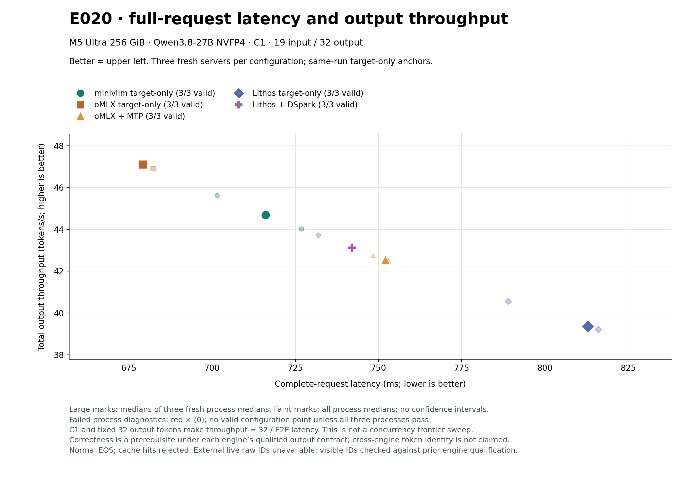
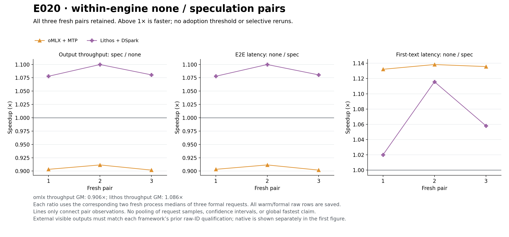

# Throughput–latency 更新 · 2026-10-17 v4

主目标保持不变：**在正确性通过的前提下，降低完整请求 latency、提高整机 throughput**。本次新增 E020 的同轮官方投机模式对照；此前的并发扫描保存在 [v3 Pareto 曲线](../2026-10-17-v3/README.md)。两轮没有混成一条前沿。



[SVG](e020-throughput-latency.svg) · [全部点和逐请求数据](chartdata.json) · [源文件 SHA](source-manifest.json)

| 配置 | 完整请求延迟 ms ↓ | 输出吞吐 tok/s ↑ | 首文本 TTFT ms ↓ |
|---|---:|---:|---:|
| minivllm target-only | 716.10 | 44.69 | 135.45 |
| oMLX target-only | **679.32** | **47.11** | 113.48 |
| oMLX MTP | 752.06 | 42.55 | **99.76** |
| Lithos target-only | 812.92 | 39.36 | 278.71 |
| Lithos DSpark | 741.96 | 43.13 | 251.65 |

每项为三个 fresh process 中位数的中位数，每进程保留三次 warm 与三次 formal 请求。15 个进程、90 条请求全部通过预注册输出/路由合同；45 条正式请求、1440 个正式输出 token。小点保留所有进程，不是置信区间。

这次 C1 的 latency–throughput 最优实测配置是 **oMLX target-only**，minivllm 没有全面领先。MTP 首文本更早，但完整请求更慢；主图不因 TTFT 优势而改变坐标。Lithos DSpark 相对本轮 Lithos target-only 的三个成对吞吐比几何平均为 **1.085991×**；oMLX MTP 为 **0.905527×**。全部正负结果保留。



主图横轴直接取 HTTP POST 开始至 SSE DONE 的实测时长，纵轴取实际 completion usage 除以该时长。C1 且每次输出 32 tokens，因此本轮两个量互为重标度；它是并发前沿的一个切面，不能替代 C1/2/4/8/16/32/64 扫描。TTFT 仅作辅助诊断。

固定 M5 Ultra 256 GiB、Qwen3.8-27B NVFP4、同一 19-token 输入、greedy、normal EOS、无实际 prefix-cache 命中。native 当次 raw IDs 直接核对；外部 HTTP 的 visible IDs 对照此前同引擎 raw-ID 资格。Lithos 与 native/oMLX 的数值路线和 qualified 输出不同，本图没有声称跨框架逐 token 相同。错误候选不能进入性能前沿。

E020 当前 native 锚点比 E010 历史曲线的 622.15 ms / 51.43 tok/s 慢，两个 HTTP adapter 的逐 chunk payload 和观察器不同。这里保留新锚点；尚未通过因果实验解释差异。候选 E022 仅测试 accepted socket 的 TCP_NODELAY，不能提前算作已取得的收益。

独立输出、路由、资源、生命周期审计及完整原始归档见 [E020 实验归档](../../../experiments/m5-ultra-256gb/E020-external-spec-http-v1/README.md)；方法和限制见 [E020 tutorial](../../tutorials/020-external-spec-http.md)。最终服务恢复记录确认原 PID 74384 identity 不变、状态 T→S。

离线重画（输出须使用新目录）：

```sh
python3 bench/m5_ultra_256gb/progress/external_spec.py \
  --snapshot docs/optimization-guide/progress/2026-10-17-v4/sources \
  --output /tmp/minivllm-e020-redraw
```

GLM-5.3-Flash 的固定 revision 混合 4/5/6-bit 权重下载已启动，62 shards 合计 203,992,076,296 bytes。下载与 SHA 验证不等于加载或速度资格；GLM 尚无可放入 Pareto 图的性能点。
