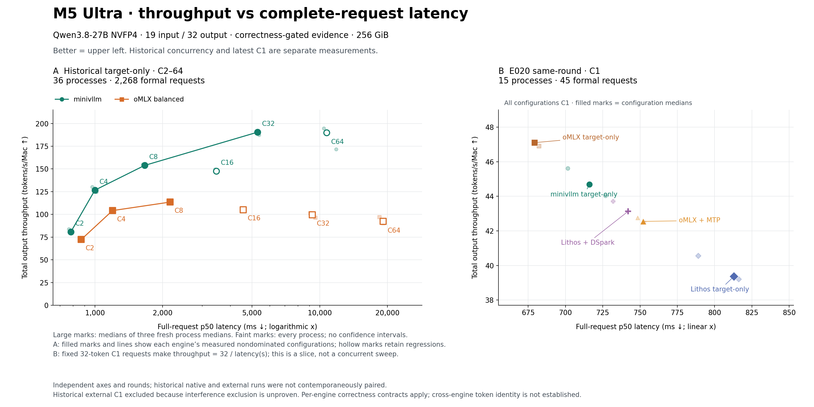

# Correctness-gated throughput–latency · 2026-10-17 v5

横轴是完整请求从 POST/start 到 SSE DONE 的实际 p50 延迟，单位 ms；纵轴是实际输出 token 总数除以整组首 POST 到末 DONE 的窗口，单位 tok/s/Mac。正确性是入图前提。图中两轮分别展示、分别计算支配关系；没有拼成跨轮前沿。



[SVG](qualified-throughput-latency.svg) · [全部进程/分组数据](chartdata.json) · [输入与来源 SHA](source-manifest.json) · [独立审计副本](sources/audit/pareto-v3-v4-audit.md)

左面板保留历史 native/oMLX target-only 的 C2、4、8、16、32、64：36 个 fresh process、2,268 条正式请求。先取每组请求延迟 p50，再取每进程三个组的中位数，最后取三个进程的中位数；吞吐按组实际 token/window 计算后采用同样聚合层级。浅色点是全部进程，不是置信区间。仅连接各引擎已测非支配配置；空心点保留较差配置，没有删除 C16/C64。左 x 为 log；两面板轴范围独立。

| 历史配置 | C | 完整请求 latency ms ↓ | 整机 tok/s ↑ | 引擎内前沿 |
|---|---:|---:|---:|---|
| minivllm | 2 | 781.340 | 80.805636 | 是 |
| minivllm | 4 | 999.266 | 126.674834 | 是 |
| minivllm | 8 | 1662.854 | 153.890592 | 是 |
| minivllm | 16 | 3464.325 | 147.720561 | 否 |
| minivllm | 32 | 5286.723 | 190.444616 | 是 |
| minivllm | 64 | 10718.857 | 189.827696 | 否 |
| oMLX balanced | 2 | 868.482 | 72.306662 | 是 |
| oMLX balanced | 4 | 1196.768 | 104.171573 | 是 |
| oMLX balanced | 8 | 2157.480 | 113.523080 | 是 |
| oMLX balanced | 16 | 4568.812 | 105.080726 | 否 |
| oMLX balanced | 32 | 9262.127 | 99.512615 | 否 |
| oMLX balanced | 64 | 19126.450 | 92.463892 | 否 |

右面板完整保留 E020 同轮 C1 的五配置、15 个 fresh process、45 条正式请求。每进程三次正式请求，配置点为三个进程中位数的中位数。oMLX target-only 是这一同轮切面唯一非支配配置；不据此外推其他并发、长度或模型。C1 每次恰好32输出 token，所以 `T=32000/L_ms`，它只是一张切面，不能替代并发扫描。TTFT 不作为本图横轴。

| E020 同轮 C1 | 完整请求 latency ms ↓ | 整机 tok/s ↑ | 本面板前沿 |
|---|---:|---:|---|
| minivllm target-only | 716.098 | 44.686593 | 否 |
| oMLX target-only | 679.324 | 47.105667 | 是 |
| oMLX + MTP | 752.063 | 42.549627 | 否 |
| Lithos target-only | 812.920 | 39.364259 | 否 |
| Lithos + DSpark | 741.955 | 43.129274 | 否 |

历史外部 C1 的排除依据是资源来源证据不足，不是按性能挑选。PID74384 启动于 2026-10-16 15:01:58 UTC；旧外部 C1 资源记录在 15:03:12.541121–15:05:18.369638 UTC，旧检测器只匹配已知 benchmark 命令，无法证明该 `omlx-server` 不存在、被暂停或 GPU 空闲。证据同样不能证明它当时一定活跃推理，也不能把差值归因为干扰。旧 C1 数据仍完整保存在输入快照；历史 native C1 也不拼接到新 C1 面板。

历史外部 C2–64 资源记录为 14:34:32.449459–14:59:06.383925 UTC，早于该 PID 启动；这只排除这个具体 PID 的时间重叠，不能把旧检测器追认为完整 GPU 独占证明。native 与外部仍是不同时间测量，左图只称历史比较。

正确性范围严格沿用 [v3](../2026-10-17-v3/README.md)、[v4](../2026-10-17-v4/README.md) 和独立审计：native 在固定输入/同调度下通过 logits/cache/输出精确资格；历史外部 HTTP 只有已记录的计数、visible-text/roundtrip 合同，没有 live raw-ID oracle。E020 外部 visible IDs 与此前各自引擎 raw-ID 资格核对，native 当次直接核 raw IDs。跨框架逐 token 相同、相同下游任务质量、每条自由到达调度的完整数值等价均未建立。不得把这些范围扩大为统一质量 oracle 或“全网最快”。

均限定 M5 Ultra 256 GiB、同一 Qwen3.8-27B NVFP4 snapshot、19-token 输入、greedy、normal EOS、cap32、无 prefix-cache 命中；历史左图仅 target-only，右图另含官方 MTP/DSpark。GLM、未通过的 E022 与未获得该合同的实验没有点。C 表示 HTTP outstanding，不保证 GPU batch 恒等于 C；历史组是有限 burst，不是持续混合业务流量。

新 renderer 逐请求重算选中数据的 timestamps/usage，并核对全部原始快照 SHA；没有修改 v3/v4。输入副本保留所有 204 个原始来源文件（含已排除 C1 便于复核）、两个 chartdata、manifests 与审计证据。未把两个面板的请求或进程池化。

离线重画，输出必须是新目录（Python + Matplotlib）：

```sh
.artifacts/m5-ultra-256gb/progress-render-venv/bin/python \
  docs/optimization-guide/progress/2026-10-17-v5/sources/renderer/qualified_pareto.py \
  --snapshot docs/optimization-guide/progress/2026-10-17-v5/sources \
  --output /tmp/minivllm-qualified-pareto-redraw
```
