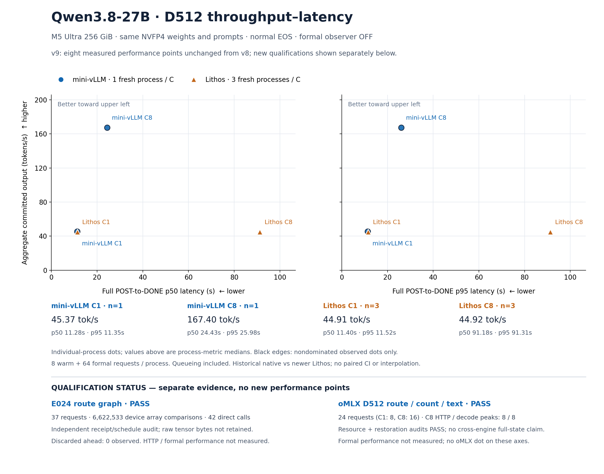

# D512 性能点与新增资格进展（v9）



性能图完整保留 [v8](../2026-10-17-v8/README.md) 的八个实际点，数值与来源逐项一致；新增 E024 和 oMLX 资格只放在独立状态面板。**资格通过是性能入图的前置条件，资格执行耗时不当作正式吞吐或延迟。** 没有添加 oMLX 或 E024 的性能点，也没有插值或外推。

相同八份 D coding fixtures，输入886–978 tokens，贪心采样、正常EOS、输出上限512。每个正式进程8 warm +64 formal请求，observer关闭。纵轴是 committed output tokens ÷（最后formal DONE − 首个formal POST）；横轴是完整POST→DONE请求延迟p50，右图另列p95。包含服务器排队，排除等待客户端并发槽位；EOF/drain/close必须通过，但不计入该延迟区间。

| Engine | C | Repeat | Committed tokens | Window (s) | tok/s | p50 (s) | p95 (s) |
| --- | ---: | ---: | ---: | ---: | ---: | ---: | ---: |
| mini-vLLM | 1 | 1 | 32768 | 722.205195 | 45.372147 | 11.283287 | 11.348184 |
| mini-vLLM | 8 | 1 | 32768 | 195.747992 | 167.398907 | 24.431814 | 25.979063 |
| Lithos | 1 | 1 | 32768 | 729.634050 | 44.910185 | 11.404540 | 11.521853 |
| Lithos | 1 | 2 | 32768 | 729.026220 | 44.947629 | 11.397076 | 11.517165 |
| Lithos | 1 | 3 | 32768 | 729.772161 | 44.901685 | 11.402589 | 11.531824 |
| Lithos | 8 | 1 | 32768 | 730.059929 | 44.883987 | 91.252783 | 91.313418 |
| Lithos | 8 | 2 | 32768 | 728.711273 | 44.967055 | 91.072059 | 91.186858 |
| Lithos | 8 | 3 | 32768 | 729.534247 | 44.916329 | 91.183519 | 91.324838 |

黑色轮廓只表示这八个实际进程中的非支配点。图下摘要为每配置的进程指标中位数，不是新的观测坐标、池化请求分位数或置信区间。native每C仅一次、Lithos每C三次，来自不同周期，未配对；Lithos C8是HTTP并发，其官方GPU执行为FIFO。没有最大并发或全网最快结论，也未证明跨引擎logits、状态或代码质量相同。native资格覆盖已记录代表性HTTP历史；Lithos资格覆盖完整输入IDs、实际路线、计数、文本与缓存检查，正式wire只有计数。

## 单独的资格面板

| 项目 | 已核实范围 | 尚未获得的结论 |
| --- | --- | --- |
| E024 route graph | 37请求、12,411 committed tokens；6,622,533项原dtype设备比较收据（logits10,315、state6,596,864、ahead15,354）；42直接参数调用（6 baseline、18 changed、18 restored）及17,068额外比较；独立数值、资源、恢复审计PASS | HTTP及正式性能未测；discarded ahead实际0，不能授予未发生的取消/失效路径资格；无combined E028资格 |
| oMLX D512 | C1的8请求+C8的16请求；实际raw wire/路线/输入/计数/文本/缓存资格PASS；C8 HTTP outstanding峰值8、实际decode batch峰值8；独立资源与恢复审计PASS | 正式性能未测；无完整状态或跨引擎质量资格；已保存日志哈希不等于所有lifespan任务健康证明 |

E024采用gates ON、norm reuse OFF；完整调度独立重建，成功张量原始字节未保留，所以此处核的是完整设备比较收据，不能描述成离线重算GPU算术。oMLX本次24请求均未实际观察EOS早停；其completion token合同排除终止EOS，不能套用Lithos的计数变换。oMLX原生EOF/observer.close未获证明，真实request seal、原始wire和直接server回收是该资格的边界。

## 来源与重画

本目录保留10份固定来源原字节，来源绝对路径、SHA和大小见 [manifest](sources/manifest.json)。资格来源只读小审计收据；没有重新扫描大型原ledger或重哈希权重。E024详细范围见[实验归档](../../../experiments/m5-ultra-256gb/E024-serving-v1/README.md)。

- [原v8 chartdata](sources/v8-chartdata.json) SHA `3939ad59d8b08f725bb7acea66438cc7b0d2be150fd405142febb06401b555b6`
- [native性能审计](sources/native-independent-audit.json) · [Lithos性能审计](sources/lithos-independent-audit.json)
- E024：[数值](sources/e024-numerical.json) · [资源](sources/e024-resources.json) · [恢复](sources/e024-restoration.json) · [完整归档](../../../experiments/m5-ultra-256gb/E024-serving-v1/README.md)
- oMLX：[资格](sources/omlx-qualification.json) · [资源](sources/omlx-resources.json) · [恢复](sources/omlx-restoration.json)
- [PNG](D512-performance-and-qualification.png) · [SVG](D512-performance-and-qualification.svg) · [chartdata](chartdata.json) · [验证收据](verification.json) · [renderer](render.py)

从仓库根目录执行（只读固定来源并重画本目录文件）：

```sh
.artifacts/m5-ultra-256gb/progress-render-venv/bin/python docs/optimization-guide/progress/2026-10-17-v9/render.py
```

Renderer核固定SHA、资格范围、八点与原性能审计逐项一致，以及非支配关系。已实际渲染并目视检查PNG：轴/单位、独立资格面板和文字均可见，无覆盖或裁切。未运行GPU、服务或性能测量。
