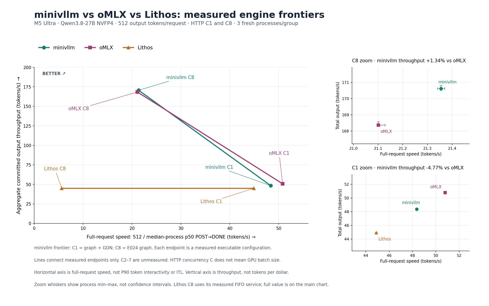
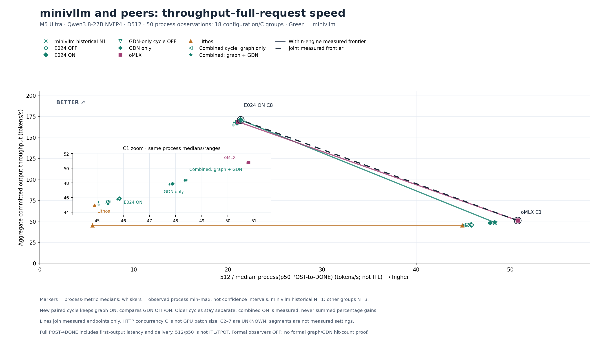
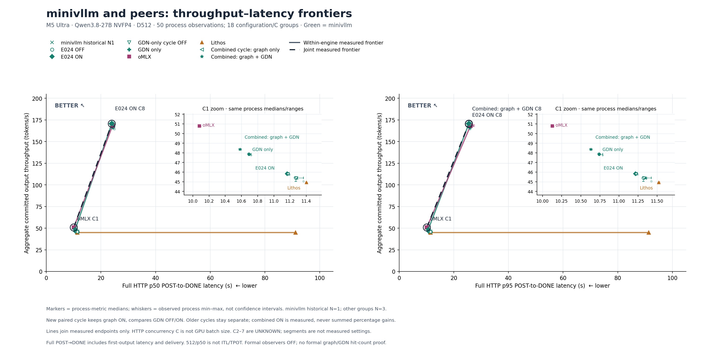

# 2026-10-19 v16：三引擎实测前沿

目标仍是 specialized minivllm 在目标模型、每个受测 batch/并发负载上，同时把吞吐与延迟推进到 oMLX、Lithos 之外，并取得明显领先。**目前没有达到这个目标。** 这张图把实际差距画出来，作为下一轮优化的基线。

C1 的 minivllm 使用 graph + GDN，吞吐 **48.357772 tok/s**，比已测 oMLX **低 4.77%**；C8 的最佳 p50 配置仍是 E024 graph，**170.619844 tok/s**，比已测 oMLX **高 1.34%**。minivllm 的两个端点均领先本次 Lithos 基线，但还没有大幅领先 oMLX。

图中每条实线连接同一引擎实测、非支配的配置端点，形成 engine frontier。横轴是 `512 / median_process(p50 POST→DONE)`，包括首 token 与传输时间；纵轴是总输出吞吐。因此两轴越大越好。它沿用参考图的前沿线表达，**不是 P90 token interactivity 或每美元 token 数**。

**这里只测了 HTTP C1 和 C8；C2–7 未测，不能把连线当作中间 batch 的结果。** HTTP concurrency 不等于 GPU batch；Lithos 的 C8 是其实际 FIFO 服务。每个最终端点来自三个独立进程，右侧误差线是进程指标的 min–max，不是置信区间。

| 引擎 / minivllm 配置 | HTTP C | 总吞吐 tok/s | 完整请求 p50 s | 完整请求 p95 s |
|---|---:|---:|---:|---:|
| minivllm graph + GDN | 1 | 48.357772 | 10.585902 | 10.636032 |
| oMLX | 1 | 50.781568 | 10.079909 | 10.128053 |
| Lithos | 1 | 44.910185 | 11.402589 | 11.521853 |
| minivllm E024 graph | 8 | 170.619844 | 23.976082 | 25.531040 |
| oMLX | 8 | 168.365034 | 24.263937 | 26.130037 |
| Lithos | 8 | 44.916329 | 91.183519 | 91.313418 |

## 本轮新增的事实

[E033 归档](../../../experiments/m5-ultra-256gb/E033-gdn-graph-combined-formal-v2/summary.json)已完成全部 12 个正式进程、864 个请求（96 warm + 768 formal）；独立性能、资源、恢复审计均 PASS，服务 RESTORED。这里把它的 12 点加入 v15 原有 38 点，原始值不变，总计 **50 点、18 个 configuration/C 组**。

在同一组合入口、graph 始终 ON 的条件下，GDN ON 对 C1 的三个吞吐配对收益为 **+5.53% 到 +5.66%**。C8 配对为 **+0.0417%、+0.1087%、−0.0675%**，不能宣称稳定收益。C8 combined ON 中位数是 170.378978 tok/s、p50 24.014079 s、p95 25.493209 s；旧 E024 ON 的 p50/吞吐更好，但 p95 略高，因此两者在 p95 前沿上都保留。

联合 p50 前沿仍为 **oMLX C1、minivllm E024 C8**。联合 p95 前沿为 **oMLX C1、minivllm combined C8、minivllm E024 C8**。这种有限样本的严格非支配关系没有统计显著性含义，也不能替代更多并发档位。GLM‑5.3‑Flash 还没有新的合格性能点，未混入本图。

## 完整历史视图

各次 OFF/ON 配对只在本轮内计算。组合 ON 是实际测量，未把单模块增益相加或相乘。此前 E024、GDN-only 和当前 combined cycle 的相同开关配置也各自保留；没有跨轮合池。旧引擎基线与本轮不是同时交错的成对引擎试验。

## 可复查和重画

- [精确逐点数据、指标中位数和前沿](chartdata.json)、[准备收据](preparation.json)、[渲染收据](verification.json)、[实际视觉检查](visual-review.json)。
- `inputs/` 保存读取的 E033 闭环审计/归档绑定以及原始 v15 JSON。准备过程核对已通过归档验证的收据、成员 hash、小文件原件和全部 raw pin 绑定；此绘图步骤没有再次读取 HTTP 原始响应或重新解压归档。
- `validation/` 保留每次真实命令、执行前源码、stdout/stderr、首轮图。首轮生成成功，最终版调整 inset 标签并新增简洁三引擎主图；没有覆盖首轮结果。
- `validation/cpu8-from-batch-v2/` 保留 v16 8 个 CPU 测试逐项 `ok`。整个 155 测试批次原状态为 FAIL，原因是一个独立 GLM 测试的异常类型断言；这里没有将整个批次改成 PASS。最终 renderer 在这之后修改并通过实际渲染/数据重算与视觉检查；prepare 和 test 源码与 CPU 测试版本相同。
- `prepare.py`、`render.py`、`test_cpu.py` 是这版的源码副本。重画时使用新的输出目录，命令见 `validation/execution-prepare-v1/receipt.json` 和 `validation/execution-render-v2/receipt.json`，现成绘图解释器为 `.artifacts/m5-ultra-256gb/progress-render-venv/bin/python`。
- [SVG 主图](D512-engine-frontier.svg)、[SVG 全历史](D512-frontier-interactivity.svg)、[SVG p50/p95](D512-frontier-latency.svg)可导出。`source-manifest.json` 固定源码，`result-manifest.json` 固定此快照全部文件（不包含自身）。
