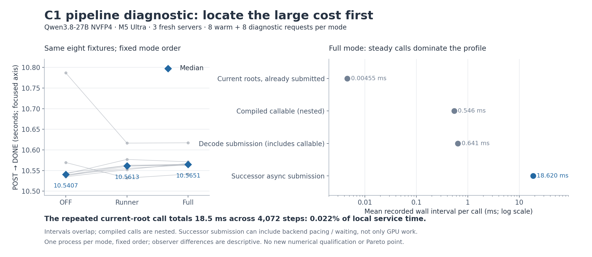

# 033：先找到大成本，再做 specialized engine

2026-10-19。目标保持不变：针对 M5 Ultra 256 GiB、Qwen3.8-27B 和
GLM-5.3-Flash 手写简单、可开关的专用路径，在正确性不变时，每个目标 batch
都大幅领先 oMLX 和 Lithos。当前还没有达到。代码短不自动意味着 GPU 少读权重。

## 假设与实际实验

E033 的 C1 正式点仍比历史 oMLX 慢约 4.77%。可能原因是 CPU 提交、模型计算、
设备依赖等待或 HTTP 交付。E035 用同一个已资格化的组合配置，三个全新进程
依次 OFF / runner / full，每个 8 预热 + 8 诊断请求；每请求正常 EOS/cap512。
全部 48 请求完成，三个孩子自然退出且回收，stop/owner/recover 均 0。
原服务 34623 恢复为 39988，独立诊断和恢复审计均 PASS。没有声称恢复原暖 KV。

[完整 1084 成员证据](../../experiments/m5-ultra-256gb/E035-c1-pipeline-profile/README.md)
保留原始 HTTP、计时事件、来源、命令、审计和恢复记录；压缩包 SHA
`2f1b1b8abc64ac822c295ce588b64d69bd798ac0183d694d0936ce0b03d2b763`。
[分析源码与逐项数据](../../../bench/m5_ultra_256gb/c1_profile_cycle_v1/analysis-v1/readout-v1/README.md)
可重算所有区间并集；不把嵌套区间重复相加。

## 实测排除了哪些主要方向

full 模式 8 个诊断请求的本地服务窗口合计 84.5431s。每请求 511 个 decode step，
510 次实际命中 ahead；只有首个 decode 需要当前前向。诊断段没有创建新图或首次
调用 compiled callable。完整输出交付都按真实 UUID 和 message ordinal 核对。

| 可见成本 | 实测 | 对下一步的含义 |
|---|---:|---|
| 已提交当前 root 的第一次 async 调用 | 4072 次合计 18.523ms，0.02191% | 删除这个调用本身无法给出大幅收益 |
| successor 的第二次 async 调用 | 4072 次合计 75.8216s，平均 18.620ms | 优先拆分后端编码、依赖等待与实际计算 |
| 长 decode submission 减去嵌套 compiled callable | 0.389686s，0.4609% | one-pass guard 可保留为小清理项 |
| 文本 decode/write/flush 并集 | 0.301884s，其中 99.831% 与 worker 重叠 | HTTP 胶水不是本轮大成本 |

第一次重复提交的区间很小，但移除它若改变调度仍可能产生间接作用；上表不是
任何改动的数学速度上限。长路径差值还包含其他 dispatch/state 处理，不能全算成
guard 循环。`async_eval` 这个名字不保证调用不阻塞，18.620ms 不是 GPU kernel
时间，更不是已经证明可删除的等待。

OFF/runner/full 完整请求 p50 分别 10.54068/10.56130/10.56509s，三窗口长度相差不到
0.1%。每模式只有一个固定顺序进程，OFF 前两请求较慢，其余稍快；不能解释成负
观察器开销或新的引擎加速。本轮不进入 Pareto；正式前沿仍是 [v16](../progress/2026-10-19-v16/README.md)。

## 大方向：明确复用权重

新的默认 OFF 候选 `nvfp4_multirow_reuse` 限定 T2/4/8。一个 lane 读取并解码一次
FP4 权重，更新 T 份独立累加器。保持原 B1 的 k/j 顺序、32-lane 归约、最后 BF16
转换，保留 contract(off)+safe；不提前吸收 scale、不加入 FMA 或改 split-K。
每个矩阵的逻辑权重加 scale 约为 9NK/16 字节，源码将 T 份读取改为一次复用。
真实带宽、cache、寄存器压力和速度必须测量，字节账本不能代替结果。

候选只有 107 行，5 个 CPU 机制检查实际 PASS。它不改变生产路径，也没有数值或
性能资格。先实际比较每行原始 MLX B1 与现有 custom B1 两个独立 oracle，再比较
所有 prefix 的完整 logits/KV/conv/S，最后才接入 accept/reject 与请求交付。
原生 M=T 矩阵路线可能改变归约，不能拿它冒充 B1 答案。连续化、拼接、草稿失败
和状态保留都要计入真实成本。

目前 layer-major verifier 只是把原 B1 计算按层排列，不能证明 weight 只读一次；
新 kernel 才提供明确的局部复用机制。最小接入位置是 verifier 尾部词表投影。
推广到各层需要把投影和串行 recurrent 更新分阶段，不能直接替换整个逐行 layer
调用后宣称获得了批量收益。

## 后端为何值得继续查

[MLX 0.32.3 源码审读](../../../bench/reviews/2026-10-19-mlx-async-eval-pacing.md)
确认 async_eval 在调用线程上遍历图并编码 GPU 操作，且会受 active-task 和内存
门槛限制而等待。下一步最小探针是原调用的 wall time 与线程 CPU time，不增加同步。
缩短一个 async 区间可能只是把等待移到最终 eval，必须回到完整请求计时判断。

## 可复查的推进记录

三模式配置先提交 8f40724 再执行；E035 原始记录随后独立审计。新专用 kernel、
GLM 无损重排计划和 CPU 证据在 096a7af 提交并推送。GLM 使用独立加载实验，
不把不同模型或未资格的结果混进 Qwen 图。每个 batch 最终都需要同权重、同负载
的真实吞吐与延迟比较；C1/C8 连线不代表 C2–7 已经领先，HTTP 并发也不等于 GPU batch。

文档写入的首轮 heredoc 被 Python 的源编码检查拒绝，退出 1，未执行任何文件改动；
改为直接 UTF-8 Markdown 文件后写入。实验、分析和图的原始结果均未受影响。
