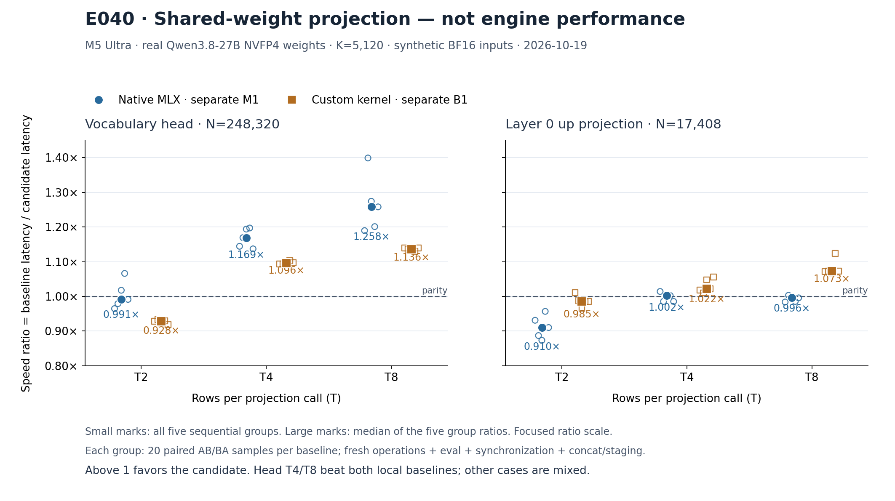

# 035：权重复用要测实际形状，局部赢了再接整模型

2026-10-19。本章记录 E038、E039、E040 的真实结果，并追加 E041 小型 CPU I/O、E042 固定 prefix 资格与 E043 native M8 负结果。目标仍是手写专用推理引擎，
在相同正确性合同下，每个目标 batch 都明显领先 oMLX、Lithos。**这些实验没有新增
引擎 Pareto 点。** 新 shared kernel 仍默认 OFF；head T4/T8 的局部收益值得继续，
但不能代表全部 projection、整模型或 HTTP 已经更快。

## 先让一个小实验淘汰错误的性能假设

E037 已证明第一版多行 NVFP4 kernel 在合成用例上逐字节正确。它将每个权重的
加载、解码放到 token 循环之外，再更新 T2/4/8 份独立累加器。从源程序看减少了
重复工作，却也改变了线程里的串行工作和活跃寄存器数量；是否更快必须由目标
形状回答，不能从源码中的 load 次数推出 GPU 带宽或延迟。

[E038](../../experiments/m5-ultra-256gb/E038-real-projection-screen-v1/README.md)
只取真实 Qwen3.8-27B NVFP4 的两个投影：词表 head 为 K5120/N248320，layer-0
up 为 K5120/N17408。输入是确定性合成 BF16，并非模型实际 hidden。每个 T 先保存
三路完整原始 BF16 输出：原生 MLX 的独立 M1、已有 custom B1、候选。全部有限且
字节相同才计时，没有使用原生 M=T 矩阵路线冒充逐行答案。

六个用例均数值通过，但十二个 median speed ratio 全部低于 1：head 相对原生
M1 的 T2/T4/T8 分别为 0.931513×、0.922243×、0.820917×；up 分别为
0.931196×、0.857143×、0.801152×。与 custom B1 的六个比较也全部更慢。
因此第一版候选**因速度被拒绝**，原先准备的昂贵整模型资格不自动执行。
这是数值正确的性能反例；原数据、源码和被拒绝的候选均保留。

E038 首次离线 reader 错把 safetensors 的 `__metadata__: null` 当成 tensor key，
失败尝试完整保存；仅修复格式处理后审计通过，未重跑 GPU 或改变数值门。
首张图的拥挤排版也保留后再修复。设备实验自身数值与执行成功，不能将 reader
失败写成 kernel 失败，也不能将归档成功写成性能成功。

## E040：把 token 并行度还给 SIMD group

第二版 [shared candidate](../../../bench/m5_ultra_256gb/nvfp4_multirow_shared/candidate.py)
选择更窄的 K=5120、T2/4/8、BF16 输入。一个 threadgroup 负责两个输出列，
用 5,760 字节 threadgroup memory 保存它们的 packed 权重和 scale。各线程合作
载入，每个位置单写，一次 barrier 后只读；每个 token/输出列分配自己的 SIMD group。

这次显式复用的是权重与 scale 的全局加载，各 token 仍各自解码和累加。
保留单行 B1 的 k/j 次序、四项乘积表达式、scale 位置、SIMD 归约和 BF16 输出，
禁用 contraction。不要将它描述为每个权重只解码一次，也不要声称测到了实际 DRAM
减少量。共享内存、barrier、线程占用和重复解码的代价都在实际计时内。
模块只接受已限定的形状/布局语义，默认 OFF，没有安装进生产引擎。

| 投影 | T | 原生 M1 / shared | custom B1 / shared |
|---|---:|---:|---:|
| head | 2 | 0.991231× | 0.928371× |
| head | 4 | 1.169216× | 1.095522× |
| head | 8 | 1.258057× | 1.136031× |
| up | 2 | 0.910122× | 0.985041× |
| up | 4 | 1.002304× | 1.022069× |
| up | 8 | 0.995709× | 1.073009× |

比值是 **baseline latency / candidate latency**，大于 1 表示候选更快。
Head T4/T8 对两基线的全部五组比值均大于 1；相对原生 M1，候选延迟分别降低
约 14.47% 和 20.51%。T2 head 仍慢；up T4 对原生仅约 0.23% 的中位数差，组点
跨越 parity，up T8 对原生仍略慢。这支持先验证 head T4/T8，不支持全投影启用。
E038 与 E040 是不同进程/轮次，不能把两轮数据当作交错配对或归因硬件计数器。
重复同一权重的热微基准，其缓存驻留可能不同于完整模型逐层遍历；本轮没有测硬件
计数器或缓存容量。up 的 mixed 结果不支持据此采用该候选，也不能证明整模型流式
遍历时的权重复用没有潜在收益。

[E040 独立复核与原始证据](../../experiments/m5-ultra-256gb/E040-shared-projection-screen-v1/README.md)
与 E038 各自均核对六个 case、18 个完整输出矩阵和 2,400 条原始计时。
每条路线预热五次；每个基线五组，每组二十对固定 AB/BA，逐 sample 新建操作并
`eval`、同步，基线包含逐行 concat，候选包含必要连续化与 shared copy。
每组先各取二十样本的延迟中位数再相除，最后取五个 ratio 的中位数。
图中的小点是全部组观察，不是独立进程置信区间。每个计时 sample 的输出张量未逐次保存，原始 2,400 条计时全部保留。

两次筛选都在原 oMLX 服务暂停期间完成，随后同一 PID/身份恢复且健康检查通过。
E040 保存的资源样本 pressure=1、swap/Swapouts 无增长；这些离散观察不能证明
连续完全隔离。原始模型 payload 不进 Git，保留来源、header、范围和 slice SHA。

## E039：离线重排成功仍不能替代加载成功

E036 将 113,446 个张量重排为 4,960 个、378 组 expert stacks、58 个分片，
完整保留 203,976,457,080 字节 payload。E039 实际让这个派生 checkpoint 进入
原官方 oMLX loader，没有假装原始 62 分片，也没有换引擎或使用 offload fallback。

[E039 保存的实际诊断](../../experiments/m5-ultra-256gb/E039-stacked-glm-load-v1/README.md)
仍然 **FAIL**。物理样本 0018 的全系统 swap 相对冷基线增加 1,247,805 字节
（约 1.19 MiB），Swapouts +76，触发原先不变的零增长门槛。子进程 footprint
148,261,492,112 B、system footprint 171,148,001,280 B，pressure=1；低于
220/240 GiB 观测门槛不能据此断言物理 fit。它是 swap 门槛失败，不是已证实 OOM。
这些全局计数器也不能单独把换页归因到模型进程或某个文件读取。

实际完成请求 0、token batch 事件 0。有 `official_vlm_load:before`，没有 after、
`after_pool_load`、loaded-engine、终态 complete 或协作 shutdown 收据。
取消后的 shutdown-start 不证明 loader 已返回；本次子进程最终 -9 并严格回收。
实际 stop/owner/recover 返回码为 0/1/0，journal RESTORED；独立恢复 PASS，
闭环诊断 FAIL，替代 oMLX 服务为 PID52818。恢复成功没有将 GLM 资格升级。

因此 E036 的字节正确性继续有效，但“已解决 GLM 加载”“更低最终峰值”或“GLM
推理更快”都不成立。较早停在更低 footprint 也不能与 E034 的失败峰值作收益比较。
文件缓存与 MLX allocation 的重叠仍是下一项假设，需要独立控制和观测。

## E041：小型 file-like I/O 实际 CPU smoke 通过

[E041](../../experiments/m5-ultra-256gb/E041-glm-filelike-io-smoke-v1/README.md)
已实际完成并提交 `327441c`：一份 276 字节 safetensors，U32/F16/BF16 三种张量，
分别经 filename、普通 file-like、F_NOCACHE file-like 路径加载，**3/3 PASS_BYTES_ONLY**。
同一 fd 在读取前实际设置 F_NOCACHE；两个 file-like 路径都在加载返回后关闭 fd，
再 CPU eval/save，原始 dtype/shape/payload 完全一致，关闭后未记录到 I/O。
保存并独立解析了输入与三份输出；没有模型、GPU workload 或服务操作。

这证明小文件的 API、字节和 fd 生命周期，不证明 190 GiB 加载无 swap 或峰值降低。
File-like 路径在返回前求值，而普通 filename 路径为 lazy；之后如验证 cache 假设，
应比较 cached-file-like 与 uncached-file-like，避免把求值时机也同时改变。

## E042：实际固定 prefix 与独立字节审计均通过

新 shared head 的设备 producer 与独立原始字节审计均已完成且退出0：九个 case、
42 个 prefix、5,418 对输出张量、96 个原始快照全部通过，九次 head 调用收据一致。
只有 `forward_prefix_qualified=true`；`full_model_qualified`、compiled、rollback、
HTTP、performance 均保持 false。这是固定 teacher-forced prefix 范围的资格。
Producer 58.171206 秒、独立审计 40.454174 秒包含存储/检查工作，不是速度测量。
47 个子进程物理观察、lease 闭环和原服务52818同身份恢复已核对；pressure1、
Swapouts不增长。父流程和数值子进程均严格回收。
[E042完整metadata证据](../../experiments/m5-ultra-256gb/E042-shared-head-prefix-v1/README.md)
保留474成员；96份24,476,249,870B原始状态留本机，只记录path/size/已审计SHA引用。
独立reader实际检查了原始字节；metadata归档没有重复扫描22.8GiB或伪装完整payload归档。
父计划 `55dbd68bb64a80b3091e629a20b6915a19d3ab92fb92c0b29417700aaefa6b7a`
绑定 `head-prereg-v2`；父 v1 仅做 CPU 准备，因子进程回收与环境审查修正而保留，
未实际启动。模型和数值子计划保持冻结。
[准备记录](../../../bench/m5_ultra_256gb/rowwise_native_verify/head-shared-prereg-v1/README.md)
保留先前40项CPU准备及新源绑定，与后来的实际设备结果分开。此次已覆盖T2/4/8、
used257/1023/1024、完整词表与全部KV/GDN/conv状态，输入与完整KV padding保留检查通过。
实际模型hidden和固定prefix字节一致支持进入verifier总成本实验；接受、拒绝、回滚、
EOS、完整HTTP仍未取得资格。1349项参数before/after原字节收据相同，但独立审计没有
重读模型参数payload；head dispatch与live storage身份也仍属于源码绑定的producer证据。

Head 约占逻辑投影权重/scale 扫描字节的 4.9621%，不是测得的耗时或 DRAM 占比。
不能把 1.258× head 加速乘到整模型，也不能把这个字节份额直接塞进 Amdahl 公式
当作运行时间份额。真正的大方向仍是减少主要 decoder 投影的重复权重/状态流量，
用局部实测筛掉不合算方案，再验证端到端；生产路径保持小且可开关。

## E043：换成真实 native M8 基线后，shared wide 候选明显更慢

[E043实际筛选](../../experiments/m5-ultra-256gb/E043-native-m8-shared-screen-v1/README.md)
改为一次原生 `quantized_matmul(X[8,5120], W, S)` 作为 oracle，不用八次M1。
新默认OFF候选保留 native wide 的kl16/four-dot/scale/shuffle运算合同，四输出列共
11,520B shared权重/scale，八token并行。两组真实head/up权重、合成BF16输入均
输出exact/finite；独立复核四矩阵、2,125,824对word和全部400条计时通过。

速度仍然失败：head的native M8/candidate中位数为 **0.545830×**，up为
**0.693706×**，十组ratio全部小于1。因此拒绝按这次筛选采用该候选，不进入昂贵
整模型资格。原服务52818已同身份恢复，原数据、源码和两个CPU准备attempt均保留。
这不是数值失败；也不能把E040的1.258×与此0.546×写成同一基线的配对退步。
新M8 kernel没有继承E042旧shared-head的prefix资格。

源代码节省一份全局权重tile不等于实际更快：本候选也付出了额外shared访问、线程、
barrier和每token解码。没有硬件计数器就不能给慢因定案；重复同权重的热局部筛选
不代表整模型流式访问，但其明显负结果已足够拒绝本次采用。下一项候选若存在，
仍应先做同一实际baseline的最小字节与速度筛选，不用代码体积或理论load次数代替测量。

正式三引擎前沿仍完全保持 [v16](../progress/2026-10-19-v16/README.md)：
C1 minivllm 48.357772 tok/s 对 oMLX 50.781568，约低 4.77%；C8 最好点
170.619844 对 168.365034，约高 1.34%。两个已测端点领先已归档历史 Lithos 基线，
但 C2–7、GLM 正式点仍未知，HTTP C 不等于实际 GPU batch。
本章没有新增引擎测点，逐 batch 明显领先两对手的目标仍未达成。
