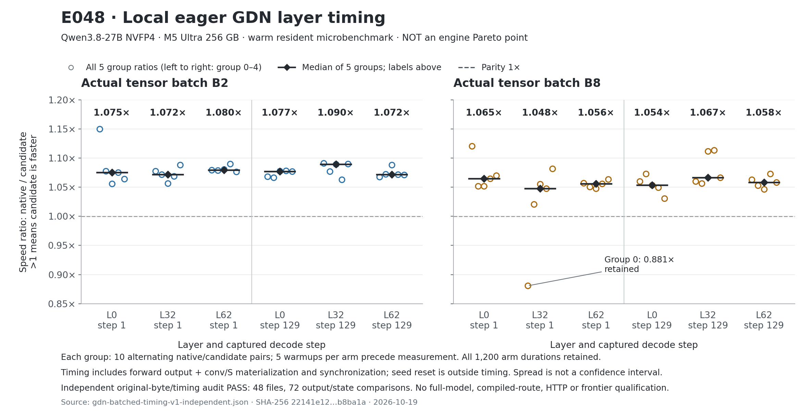

# 036：按并发选择配置，先找到真实瓶颈

2026-10-19。目标仍是让专用引擎在准确输出的前提下，按目标并发的吞吐与延迟超过
oMLX、Lithos。**E045 v2 已完成；C1 最好约 +1.5%，C8 返回 token 一致性失败，
没有配置通过晋级门槛。本章不新增正式 Pareto 点。**
本轮运行源码提交为 `df3bd1f`；[全部原始证据和图](../../experiments/m5-ultra-256gb/E045-concurrency-config-screen-v2/README.md)已封存。

## HTTP 并发 C 与 GPU batch B 是两件事

C 是客户端同时未完成的请求数；B 是某一次模型 decode 实际处理的行数。
请求到达、prefill、EOS、排队和 refill 都会使 B 随时间变化，C8 不能直接当作每步 B8。
已有记录中 C8 约 98.8% 的 decode 步为 B8，而已采用的 GDN prework 只命中 B1。
因此 C1 的优化收益不能按比例套给 C8，也不能用独立 M1 作为 native M8 的数值基准。

本轮从 E033 的同一个 combined HTTP 入口出发，固定两套已有路径：

| 工作负载 | 基准配置 | 已有证据的含义 |
|---|---|---|
| C1 | long decode graph ON，GDN prework ON | E033 三对测量较 graph-only 快约 5.6% |
| C8 | long decode graph ON，GDN prework OFF | 同入口的 graph-only 基准；E033 没有证明 GDN OFF 比 ON 更快 |

C8 基准是 E033 的 same-combined-entry graph-only，不能偷换成 E024 的另一个服务入口。
模型、NVFP4 权重、原始 D512 fixtures、EOS、max_len2048、max_seqs=C、
max_batched_tokens2048、cache2GiB 和数学开关保持原配置。

## 一个变量，十个新进程

只筛选 `MLX_MAX_MB_PER_BUFFER={16,50,200,800}`；固定
`MLX_MAX_OPS_PER_BUFFER=50`、`MLX_BFS_MAX_WIDTH=20`、`MLX_METAL_FAST_SYNCH=0`。
这些环境量必须在新进程初始化 MLX 前设置。MB 是该实现的提交阈值标签，
不是进程物理内存上限，也不能解释为实测 DRAM 流量。

每个配置独占一个新服务器进程，先 8 次 warm，再 8 次 probe；每次请求最多生成512个 token。
原始客户端测量阶段是 `admission_probe`，`formal_point_eligible=False`。
文件和复用的生命周期仍采用 warm/formal 名称，不能据此把八次筛选升级为正式测量。

- C1 顺序：50 → 200 → 16 → 800 → 50。
- C8 顺序：50 → 800 → 16 → 200 → 50。
- 同一 C 的首尾50基准，吞吐和 p50 的 `max/min−1` 均须不超过2%。
- 候选相对首尾两个基准，吞吐比和 `基准p50/候选p50` 均须达到1.03。
- 同一 C 的全部 warm/probe，逐 fixture 比较完整返回 token IDs；不混比 C1 与 C8。

只有满足这些条件的候选进入后续确认，不能把固定次序、单次配置筛选当作因果结论。
p95 在八次请求下就是最大值。吞吐重算为共同 POST→DONE 窗口内的实际 committed tokens/s；
既不只计成功子集，也不把 terminal EOS 算成用户输出。后续还需重复测量和准确性检查。
旧数值资格只对应旧环境；沿用 wire/count 合同不意味着新环境已有 full-state 资格。

## 保留失败，再重跑

v1 首个 trial 已 PASS，随后 owner 在汇总时重复传入 `label`，触发异常并以 FAIL 结束。
服务恢复成功；这次失败和首个 trial 原始证据保留，不能改写为完整 screen PASS。
v2 修复汇总问题，相关 CPU 测试 **19/19 PASS** 后重新运行。
CPU PASS 只说明准备、原始协议检查及模拟生命周期机制通过，不是 GPU 或性能结果。

| E045 v2 | C1 | C8 |
|---|---|---|
| 运行状态 | 5进程全部完成、恢复通过 | 5进程全部完成、恢复通过 |
| 首尾50计时漂移（吞吐 / p50） | 0.04789% / 0.01836% | 0.41882% / 0.41432% |
| 完整返回 IDs 一致性 | 全部 warm/probe 同 fixture 相同 | 失败；默认50的 warm/probe 已有4个 fixture 不同 |
| 最好观测配置 | MB200：49.140388 tok/s、p50 10.419658s | MB800：171.965865 tok/s、p50 23.775282s；输出不合格 |
| 达到3%门槛的配置 | 无；对两端最小收益吞吐1.5002%、p50速度1.4787% | 无；同时未通过输出一致性 |
| 正式 Pareto 更新 | 无 | 无 |

两份独立 raw SSE reader 都复算了20组、160请求：每次512 committed tokens，C1 全部一致，
C8 差异可重复核对。C8 默认50的 D04/D06/D07/D08 首个不同 token 下标为59/22/187/209。
**计时稳定不代表输出一致；默认配置已不同，也不能据此把差异归因于 MB 参数。**
当前怀疑到达顺序使 prefill 分块或早期 decode batch 形状变化，尚无设备证据排除 graph/ahead
实现问题。旧资料的固定 schedule 资格也不自动证明不同 schedule 的 batch invariance。
下一步固定 MB50，记录准确 scheduler 输出，再按相同 schedule 对照 eager 与 graph。
该诊断不计入性能图；不在事后放宽 E045 的晋级门槛。

400次物理资源观察最大系统183.895GiB、子进程当前22.374GiB，swap 增长0；
原服务52818同身份恢复，健康检查通过。采样只约束观察点，不证明未观察到的峰值。
归档保留原 v1 FAIL、首轮 CPU FAIL、首图排版 FAIL，以及 v2 的所有失败一致性检查。

## 论文给假设，机器给结论

[SpecLA（2026-07-18，§4.1、§5、§8）](https://arxiv.org/html/2607.16673v1)
提出按层验证、沿 V 维保留 state tile、跨 draft token 连续更新，并用紧凑因子恢复接受状态。
实验是 H100/GDN-1.3B，检查 greedy 输出 hash；没有 Apple 结果，也未证明我们的完整
logits/state 逐字节合同。可学习状态驻留，不能直接把其因子恢复或重排算式视为准确替换。

[Blackwell GDN 优化技术报告（2026-07-18，§3.2、§5.4）](https://arxiv.org/html/2607.16831v1)
说明 decode 线程布局应按 batch 分开选择，shared-memory staging 也可能回退。
这是 CUDA/B200 经验；其输出公式代数重排会改变浮点顺序，不直接采用。
可移植的是按形状做小实验的方法，具体线程布局和收益仍由 Metal 实测决定。

## 下一项最小实验

**C8：先运行已经准备的 batched GDN canary。**
[gdn_prework_batched](../../../bench/m5_ultra_256gb/gdn_prework_batched/CANARY.md)
保留五个 native batched Linear，只复用已有融合卷积、激活和 Q/K norm 的 kernel。
现有 qualifier 覆盖 B2/B8、早晚历史、GDN0/24/47、各三次连续状态，共36次调用。
用原生 batched 输出/conv/S 的原始字节比较，通过后再做局部 ABBA 和 graph 组合实验。
它的 graph OFF 配置不等于当前 HTTP 路径，也不能解释上述 C8 schedule 差异。
E046 已实际完成：36次候选调用全部通过，独立 reader 核对140原始文件、108输出/状态对、
48个连续状态对、80行 greedy logits 和324个设备比较数组，全部 PASS。
13次资源观察、退出确认/回收/恢复闭环也通过；原 oMLX 52818 同身份恢复。
这是 B2/B8 局部 real-activation canary；B3–7、完整模型、graph组合和速度仍未取得资格。
下一步用这些相同真实输入测 native batched 与候选的完整层耗时，逐样本保留 AB/BA 计时，
不把加载、hash 或写证据的时间当作 kernel latency。
[402成员元数据归档](../../experiments/m5-ultra-256gb/E046-gdn-batched-device-v1/README.md)
引用留在本机的140份原始张量，保留了当时的 pending 字段和独立审计时间顺序。

**C1：先测完整 verifier 是否值得，再增加算法。**
[E042](../../experiments/m5-ultra-256gb/E042-shared-head-prefix-v1/README.md)
已通过固定 T2/4/8 全 prefix 检查，但58.17秒含加载、teacher rollout和落盘，不是 verifier latency。
下一次测 T4/T8 的完整执行成本，保留必要输出物化，排除加载、hashing和文件写入。
平均每轮提交 token 数须超过 `(draft时间+verify时间+commit时间)/native C1单步时间` 才有加速空间。
若 state 路径值得优化，再试保持 SPLIT4 与原累加顺序的驻留链，先保留完整 prefix 作比较。
48个 GDN 的 S 合计144MiB逻辑存量，完整投影权重/scale全扫约14.412GB；它们都不是实测DRAM。
局部 head、state 或 canary 加速不能升级为整引擎结论，最终仍看准确输出下的吞吐与延迟。

## 局部实测：B8 融合收益成立，仍需 graph 组合验证

E048 直接读取 E046 的真实激活，原生基准保持一次 B2/B8 的五个 Linear，
候选只融合卷积、激活和 Q/K norm 前处理。每臂使用独立 seed，重新构造完整层调用；
计时含 output/conv/S 的求值与同步，加载、hash、seed reset 和证据落盘在计时外。
每点5次 warmup、5组×10对 AB/BA，全部1200个测量值保留。

| 实际张量 batch | 六个 case 的中位速度比范围 | 结论范围 |
|---|---|---|
| B2 | 1.071695–1.089616× | 局部完整 GDN 层，约 +7.17%–8.96% |
| B8 | 1.047935–1.066748× | 局部完整 GDN 层，约 +4.79%–6.67% |

独立 reader 重读48个原始文件，核对72组 output/conv/S 比较并重算60个 group。
所有12个 case 中位数均大于1，但 B8 early/layer32 的 group0为0.880700，原样保留。
这些是同一进程内的 warm-resident 组统计；组间离散不是置信区间，也没有跨机器外推。

这不是 C8 HTTP 吞吐提升。当前候选的下一道门是同 schedule 的完整 logits/state、
graph tracing/reuse 与 continued state 检查，通过后再测端到端。`gdn_batched_graph/integration.py` 只替换已有组合的 GDN 依赖，仍默认 OFF；
11个 CPU 生命周期检查通过，不等于设备组合资格。

## 真实调度排除一个过早归因

E047 固定 MB50、GDN OFF、graph ON，同进程记录两轮各8请求、共1030步。
D06 的 prefill 两轮都为 `[935]`，但早期 decode 路径为 warm 的 B2→B4→B6→B8/row1，
对照 screen 的 B4→B6→B8/row3，第46个输出 ID 分歧为24959/52883。
因此“prefill分块不同”不能独自解释 D06；batch形状、行位置、进程历史仍有差异。
其他 fixture 有改变分块却不改变返回 IDs 的例子，也不能只凭关联宣布因果。
[精确调度和原始记录](../../experiments/m5-ultra-256gb/E047-c8-schedule-diagnostic-v1/README.md)已封存。

E049准备对 warm 原始历史前49步做 eager/graph 同 schedule 完整比较；所有共批请求、
原始cap512和实际到达保持不变，在检查完第49步后明确停止为 `INCOMPLETE_BY_DESIGN`。
8个请求仍活跃，后8个尚未到达，不能伪造终止或称完整HTTP资格。

## E049: same-history prefix is correct; E050: compose the batched kernel

The actual E049 warm49 replay passed and was independently audited: 49 steps, 380 delivered IDs, 65,005 bit-equality receipts and 130,010 finite-value receipts. The original eager and route-graph engines replay the same captured scheduling history, including the D06 divergence position. All 8 admitted requests are still active, 8 future requests are unadmitted and zero requests are complete. Full tensors were compared by the pinned producer but not saved for an independent offline byte reread. This narrows the cross-wave diagnosis; it does not establish full-history qualification or an engine speedup. See [the immutable E049 evidence](../../experiments/m5-ultra-256gb/E049-c8-warm-prefix-diagnostic-v1/README.md).

E050 now prepares the same prefix with the real batched GDN candidate plus graph. The five original batched Linear projections stay intact. Installation precedes graph tracing, all 48 actual layers must take the candidate at least once without fallback, and teardown must restore every handle and cache. These are aggregate Python trace counters, not GPU-call counts or independent per-batch-size branch proof. The unchanged full-logit/state comparator checks the actual hooked model. Adapter CPU tests passed 10/10; owner tests passed 13/13. At this entry's commit E050 is prepared, not yet run. C1 and C8 remain independent configuration choices; no new Pareto point is claimed.

## E050 passes; extend to complete C8 history

The real batched GDN+graph prefix passed E050 and its independent audit: all380 delivered IDs and the full per-array logits/state receipts match the native oracle and recorded schedule. All48 layers took the candidate (5 Python executions each, including graph tracing), with zero fallback; all handles and cache ownership restored. These are not GPU invocation counters. Original oMLX resumed with its same PID. [E050 evidence](../../experiments/m5-ultra-256gb/E050-c8-batched-gdn-graph-prefix-v1/README.md) preserves all attempts.

E051 prepares the original complete1030-step/16-request history, without a prefix boundary or altered caps. This covers full request retirement and the second admission wave. The prior E024 complete numerical run reported68.553898GiB of MLX peak; the new owner preregisters an80GiB child **sampled abort threshold**, with240GiB system and zero swap growth. These are not allocator caps. The original2GiB allocator-cache setting stays unchanged. Qualifier CPU8/8 and owner CPU13/13 passed; the full device run is still pending at this commit. A successful recorded-history check will permit further serving qualification, not itself a new HTTP throughput point.

## E051 complete history passes; E052 captures the actual candidate server

E051 now passes the complete1030-step,16-request history:8192 original IDs,1028 compiled route calls, no fallback. The independent ledger audit checked1,324,017 bit-equality and2,648,034 finite receipts, including6 partial retirements and6 refills. All48 actual GDN layers recorded8 Python executions each; those384 branch executions are not GPU-call counts. The owner restored original oMLX PID52818. [E051 evidence](../../experiments/m5-ultra-256gb/E051-c8-batched-gdn-graph-full-v1/README.md) retains the complete553MB raw ledger and149 physical plus149 metadata samples.

E052 prepares a new observed HTTP capture from the actual batched GDN+graph server. It uses the same frozen loader/worker/transport and two eight-request waves. Qualification and formal modes share this new source; formal disables observers. The original combined observer assumed the GDN candidate was B1-only, so the new private trace policy explicitly admits B1..8 and requires zero fallback, retaining same-bound/batch tracing before compiled reuse. Ten CPU contracts passed. New captured arrivals still require their own full same-schedule replay before formal throughput claims.

C1 proceeds separately: a default-inert full T4/T8 verifier cost draft now compares against native device-dependent AR(T), with selected-prefix commit and continuation checked first. Audit-only ownership checks and head counters stay outside timing. Its7 CPU contracts pass, but there is no device timing or speculative speedup result yet.

## E052 v1 readiness failure and v2 correction

The first actual HTTP candidate capture failed before generation: the inherited expected identity contained `diagnostic_only: true`, absent from the real frozen combined server. Seven readiness GETs occurred; zero generation requests were sent. The original FAIL/exit1 remains preserved, the candidate server was reaped and original oMLX PID52818 restored. [Failure evidence](../../experiments/m5-ultra-256gb/E052-c8-batched-http-capture-v1/README.md) contains all145 archive members, independently reread.

The v2 trial removes only that expected identity field; its actual server, candidate math and transport remain frozen. Seven CPU contracts pass, including original readiness validation against the real v1 startup bytes. Parent plan `5290ddc18239d422e846f76ff4fa222b48188c6fb57bae68ea5119ec3bd9066c`, spec `e94ae435be73d39b060bafb7a24724011de48d03a485b1876ba0ecb07ee10a1d` are prepared. A metadata-only first prepare used the wrong closed-review filename (8f88b2); that failure is saved and corrected in45edb8 before any device run. v2 has not run at this commit.

C1 and C8 choose independent configurations. The C8 complete replay establishes exact-history correctness; future actual HTTP replay and observer-free measurements must establish serving correctness and speed. C1's full-verifier cost measurement will determine whether a speculative path can repay its verification/commit overhead. No new formal Pareto point is claimed.

### E052 v2 actual / E053 and E054 prepared

E052v2 root15a76c/session12844→dcb9e0 exit0,54.879346s PASS_CAPTURE_AND_RESTORE, same52818 restored. Raw join986843 exit0:16requests/1030steps. Independent saved resources9f1484 PASS20physical+20metadata, maxgap3.186007s, zero swap growth. The capture has no formal performance claim.

E053 prepares full same-history native-versus-batched replay of this actual candidate HTTP capture.11qualifier CPU/11independent-audit CPU/13owner CPU checks pass. Prepare22e0ca: parent4a2d6cc768545654a7931ea4dbc3afc8837b0bdc16a159021c9ade2f0104de47, child26f5d003fc61f96a22939750e7732858beeaa9313f4de40b94a0e4a0009c9431. Expected counts are derived from the actual history.

E054 prepares independent C1 T4/T8 full-verifier/commit cost, source CPU7 and owner CPU19pass; prepare1abb6c: parentf613b5df1494e9064ba84e2dd025b437177891b00bf5d98bcf18d03e5eb960ce, child3d10d60dc72eff7e2c70444239c61be09c865b6e15109c7f43b8cdf8a6a66c2c. No speculative or engine speed claim before measurement. Both E053 and E054 are prepared only at this commit and will use GPU serially.

### E053 actual candidate HTTP replay passes; E055 paired C8 timing prepared

E053 actual43778d/session32502→8ddd62 rc0,518.821436s diagnostic lifecycle, same52818 restored. Independent audit6d870c/session90617→9ca609 rc0,5.953631s PASS:1030steps/16requests/8192IDs,1,324,530bit-equality and2,649,060finite receipts.1028compiled route calls (8Python traces,1020reuse),0fallback; actual48layers installed/restored. This qualifies the new E052v2 captured history only, not all possible schedules. Successful full tensors were compared live but not retained for offline byte recomputation. Saved resourcec31e57 PASS. Audit actual output is the file `.artifacts/m5-ultra-256gb/c8-batched-http-replay-v1-independent-audit-attempt1` (no extension); an initial metadata lookup as a directory147dbe failed harmlessly and was corrected before E055 preparation.

E055 reuses the frozen observer-OFF server and native HTTP transport/count contract. Sixfresh C8 processes run ON/OFF,OFF/ON,ON/OFF, each8warm+64formal. Default environment50/50/20/0 and graph remain identical; only batchedGDN flag changes. Trial6CPU and reducer3CPU checks pass; exact actual-startup identity regression also passes. Root owner label was corrected during source review before preparation, no failed launch. Prepare13f1f9/session80732→c11d6d passed, parentfc24144f4c0676ca6de3aa26f93bb6eabb2976d8addbc403ec35e228b484ed4b. Not device-run at this commit. Timing validity, same-schedule numerical prerequisite and cross-schedule token equality are separate fields: a greedy trajectory difference alone is not an arithmetic error. No new frontier point yet.
