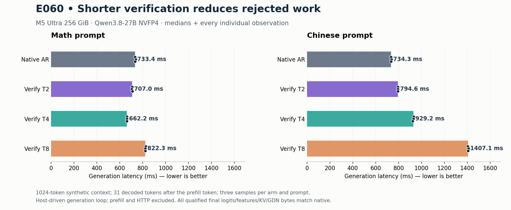

# 041：从 DeepInfer 学预算选择，把局部收益变成真实生成实验

2026-10-21，E059/E060。我们完成了真实 DFlash2 多轮生成、T2/T4/T8 验证前缀、EOS/输出上限提交与独立原始字节审计。数学负载已有约10.76%的局部生成吞吐收益；中文仍应保留 native。两项实验均不更新正式 oMLX/Lithos HTTP Pareto。

## 学到的机制

[DeepInfer 官方源码](https://github.com/deepseek-ai/DeepInfer/tree/9bd9cf243fc53ef9afbf8f04d391d989117d6ab9)当前面向 V4.1-Flash、SM100/Ascend950。其[验证预算调度](https://github.com/deepseek-ai/DeepInfer/blob/9bd9cf243fc53ef9afbf8f04d391d989117d6ab9/csrc/engine/mtp_varlen.hpp#L150-L265)按预计产出与实测成本选预算。总预算使用旧轮次信息，避免后缀 confidence 影响前缀是否被验证；异步实现再按更新的置信度分配请求长度。我们只实现适合本机 C1 的小模块，没有引入多机调度框架。

它的[confidence head](https://github.com/deepseek-ai/DeepInfer/blob/9bd9cf243fc53ef9afbf8f04d391d989117d6ab9/deepinfer/model_executor/models/mtp/dflash.py#L46-L79)需要训练权重。我们现有 DFlash2 没有这个头，因此采用历史实测前缀生存概率，不能把草稿最大 softmax 当作等价预测器。[官方异步调度说明](https://github.com/deepseek-ai/DeepInfer/blob/9bd9cf243fc53ef9afbf8f04d391d989117d6ab9/doc/inference_deployment_qa.md#L266-L275)也值得借鉴；现有 miniengine HTTP runner 已有一步 ahead，本轮 host-driven 投机实验还没有组合该路径。

## 第一性原理：只为真正输出的 token 计算收益

设 `A` 是连续接受的草稿数，验证块宽度 `T` 包含一个已输出但尚未计算的 anchor。未遇 EOS/cap 时：

```text
预期输出数 = 1 + Σ(j=1..T−1) P(A≥j)
预期效率 = 预期输出数 / (draft8 + verify(T) + selection + commit)
实测效率 = 所有轮次实际输出数 / 完整生成时间
```

`P(A≥j)` 是前缀生存概率，不是单 token 条件成功率。全宽验证已发现首个拒绝之后，后续 `A≥j` 都为假；只有较短验证中未观测的后缀不能补成失败或成功。遇输出上限时，应将预期计数截到剩余预算，实际计数则按真实输出与正常 EOS 计算。

DFlash 的块内注意力是非因果的，`draft4` 不一定等于 `draft8[:3]`。所以本轮始终执行原来的 draft8，只截取要交给目标模型验证的前缀。以后缩短草稿计算也必须重新测接受率，不能用本轮的分母或先验代替。

## 实验过程与结果

E059 从已审计的 E058 verifier+features 接口出发，增加真实草稿、私有前缀状态选择、跨轮特征与 pending anchor 交接。一个代码提示用于全宽校准，另外两个1024-token合成上下文用于测试。固定 T4、固定 T8 与冻结历史策略均与原生逐 token oracle 比较。T4 在数学上更快，但在中文上明显更慢；冻结策略一直选择 T4，整体速度比只有0.912342×。校准的 T4 成本少计少量 host selection/commit，是已披露的估计，不是完整实测。

E060 随后加入 T2，沿用已看过的两个测试上下文，明确属于探索性 follow-up。没有重新挑选测试或抹去 E059 的负结果。

| E060 局部生成中位延迟 | Native | T2 | T4 | T8 |
|---|---:|---:|---:|---:|
| 数学 |733.42ms|706.99ms|662.17ms|822.35ms|
| 中文 |734.25ms|794.60ms|929.21ms|1407.15ms|

同轮 T2 把中文相对 T4 的延迟减少14.49%，仍比 native 慢8.22%；T4 在数学吞吐约1.1076×。T2 两负载合并仍只有0.9790× native。更大的验证块不能保证更快。



## 正确性必须落在真实状态上

每轮产生 `n` 个输出，保留 `n` 个已计算输入的状态：anchor 加上输出序列除最后一个 token。最后输出的 correction/bonus 仍 pending，下轮才计算。EOS/cap 落在接受前缀内部时，同样只保留 `len(produced)` 对应的状态与特征。不能把输出的 bonus 当成已经写入 KV/GDN 的 token。

Kimi 的纯 CPU selector 覆盖 EOS/cap/拒绝位置，E060扩展至3072枚举case；实际 GPU 的强制拒绝轨迹交替 T2/T4/T8。两实验分别保存16终态文件、1040对张量，与独立原始字节 parser 比较 dtype、形状、finite 和字节；全部通过。每个计时样本验证 IDs，未声称每个计时轮次都保存了完整原始状态。两次实验共48正式生成计时，均保留。

独立审查还补了两个真实缺口：共享 seed 前后完整字节验证；capture oracle 与实际无 capture native runner 的完整状态比较。原生基线仍是 host-driven loop，尚未组合 HTTP lookahead，因此这些结果不能更新正式 serving 曲线。

## Agent 协作和失败

DeepSeek、Kimi、Muse 均通过已授权的 Logits profile 实际执行；对应模型/session路由证据已归档。DeepSeek 的研究稿混淆了 bonus 的输出与计算状态、前缀生存概率的删失含义，相关建议被拒绝并保留原稿；没有据此实现算法。Kimi 编写 selection 与枚举测试，Muse 编写成本策略；root负责真实 GPU integration，另一个 agent 独立实现并执行 raw 审计。

E060首次 CPU 测试的case总数断言仍是旧2928，新枚举实际3072，因此29/30通过；只修正计数后30/30通过。E059/E060审计分别12/12与13/13 CPU通过。实验期间没有GPU正确性失败、删样或挑选重跑。

## 下一项应验证的改进

把 native 作为预算选择的显式候选，让请求的实际接受率决定继续投机或退出；一个校准提示的固定先验不够。退出必须保留刚提交的私有状态和 pending token，不得重算/跳过输出。然后再组合现有设备 ahead，跑正常 EOS 的 D512 HTTP C1/C8 对照。T 是单请求验证宽度，C 是并发，不能混称 batch。当前全部新模块仍默认关闭。

DeepInfer 的 batch-invariant 路径和同历史混批测试提供了验证思路；其 SWA/YoCo 重放依赖模型结构，不能直接截断 Qwen 的 GDN 状态或 GLM 状态。

[完整 E059](../../experiments/m5-ultra-256gb/E059-deepinfer-generation-v1/README.md) · [完整 E060](../../experiments/m5-ultra-256gb/E060-short-verify-v1/README.md) · [正式 v16 前沿](../progress/2026-10-19-v16/README.md)。
