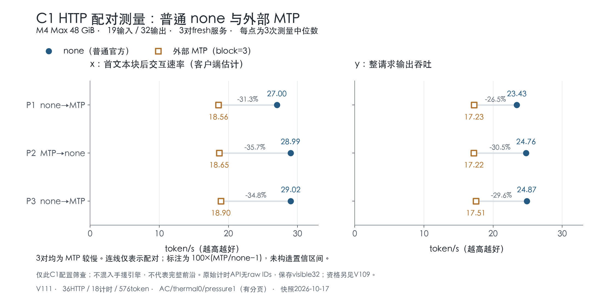

# 进展台账 · 2026-10-17

当前结论：已将同输入Linear的局部字节差异从351项降为0；整模修复尚未成立。官方MTP在这次短C1请求中较慢。

| 阶段 | 保存状态 | 实际观察 | 结论边界 |
| --- | --- | --- | --- |
| V108 · 缓存前缀事务 | `FULLMODEL_OLD_ID_FAIL` | 21项tiny事务通过；普通A96旧IDs通过；投机B旧ID硬门失败。 | 整模FAIL保留，不能以官方文本一致改判。 |
| V109 · 官方外部MTP资格 | `OFFICIAL_MTP_NUMERIC_PASS` | 6条raw32与fresh普通官方控制一致；每MTP请求17 verify / 34提案 / 15接受 / 32交付。 | 观察器计时不排名；34提案不是34交付。 |
| V111 · 官方none/MTP配对HTTP | `C1_MTP_SLOWER` | 3对均慢；有符号中位变化x −34.8496%、y −29.5934%。 | 仅两个C1配置，不是全局最好或完整Pareto前沿。 |
| V112 · 逐Linear形状敏感性 | `SAME_INPUT_DIAGNOSTIC` | 497项同输入Linear：146 exact / 351不同。 | 局部逐算子诊断，无整模修复或速度结论。 |
| V113 · broadcast-M1局部数值 | `LOCAL_BROADCAST_NUMERIC_PASS` | 同497输入全部exact；原112输入/output hashes重现。 | 仅局部数值通过；无实际PSO、整模96 IDs修复或速度结论。 |
| V114 · target-verify整合 | `RESOURCE_STOP_B_UNREACHED` | A三请求96旧IDs通过；资源压力触发SIGTERM，B未到达，事务0项。 | checkpoint仍为STARTED；不是数值FAIL也不是整模PASS。进程已reap/外部释放。 |
| V115 · device draft selector | `CPU_READY_GPU_UNRUN` | 冻结CPU准备记录；GPU数值未运行。 | CPU/source测试不替代GPU数值资格，无性能结论。 |

两张保存图：

数值资格、资源中止、CPU准备和计时结果分开记录，不折算成“完成百分比”。

来源身份在 [reviewed_rows.json](reviewed_rows.json) 的 `sources`；V114保留原checkpoint `STARTED`，资源STOP由owner/release证据确认。原始日志、argv、settings和任何凭据均未复制到本目录。
