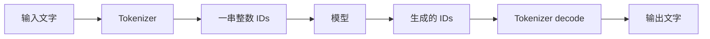

# 第一章：一次文本生成是怎么发生的

[目录与版本说明](README.md) · 代码版本：`tutorial-01` · [完整代码](../../tutorial_code/generate.py)

本章只完成一件事：观察一个模型怎样逐个生成 token。完成后，你应该能把“输入文字 → 模型计算 → 输出文字”讲清楚。

这一章借用 HF 的参考模型，建立正确性 baseline。我们自己写生成循环，把每轮的输入和输出打印出来。后面逐章替换模型实现、加 cache、再做批量和调度。

## 本章 baseline 的用途

本章的 HF 循环用于观察计算过程，并留下后续手写实现要对齐的结果。`use_cache=False` 是为了展示完整前缀重算，不能代表优化后的 HF 性能。

性能侧另设 oMLX baseline，已在独立环境跑通。两条参照的固定配置与运行方式见 [baseline 说明](../../tutorial_code/baselines/README.md)。本章先学习生成循环，后面完整引擎阶段再做性能对照。

## 1. 模型接收的是 token IDs

分词器 tokenizer 把文本切成片段，并把每个片段转换成整数 ID。一个 token 可能是一个字、一个单词的一部分，也可能是标点或特殊标记。



下面用 `[A,B,C]` 表示三个输入 token，用 X、Y、Z 表示生成的 token。这些字母是流程示意，实际代码使用整数。

## 2. 模型预测的是下一个 token

输入 `[A,B,C]`，模型对每个输入位置输出一组候选分数，叫 logits。

```text
A 位置的 logits：预测 A 后面接什么
B 位置的 logits：预测 A、B 后面接什么
C 位置的 logits：预测 A、B、C 后面接什么
```

生成时需要最后一组分数，因为它包含整个已知前缀。

假设最后一组只有三个候选，分数分别为：

| 候选 ID | 分数 |
|---|---:|
| 10 | 1.2 |
| 20 | 3.5 |
| 30 | 0.8 |

每次取最高分叫 greedy。这里选出 ID 20。代码用 `argmax`，它返回最高分所在的索引；词表 logits 的索引就是 token ID。

## 3. 生成多个 token，需要反复调用模型

这一章每轮重新处理整个已知前缀：

| 轮次 | 喂给模型的输入 | 根据最后一个位置选出 |
|---|---|---|
| 1 | A、B、C | X |
| 2 | A、B、C、X | Y |
| 3 | A、B、C、X、Y | Z |

X 是第一轮的预测结果，还没有作为输入经过模型。把 X 加回输入，才能预测 Y。

生成循环的源码片段：

```python
logits = model(input_ids=input_ids, use_cache=False).logits  # ← 关键①：HF 算分数，重算前缀
next_id = int(logits[0, -1].argmax().item())                  # ← 关键②：greedy 选 ID
input_ids = torch.cat([                                    # ← 关键③：把新 ID 接回输入
    input_ids,
    torch.tensor([[next_id]], device=args.device),
], dim=1)
```

**先看这三处关键行**：计算分数、选出下一个 ID、把 ID 接回输入。`use_cache=False` 让每轮都重算整个前缀，过程容易观察。

若选到模型配置中的 EOS（结束标记），循环会提前结束；`--max-new-tokens` 是输出 token 数的上限。EOS 也是 ID，使用 `skip_special_tokens=True` 解码时通常不会显示成正文。

## 4. 看懂 logits 的形状

HF 返回的 logits 形状是 `[B,T,V]`：

- B：这一批有几条输入，本章为 1。
- T：输入的 token 数，每轮增加 1。
- V：词表大小，每个位置有 V 个候选分数。

`logits[0,-1]` 取第 0 条输入、最后一个位置，得到长度为 V 的分数向量。`argmax` 从中选择一个 ID。

这一轮得到的 ID 再交给 tokenizer，就能还原为文本。单独的 token 有时只是某个字符的部分字节，因此代码最后统一 decode 整串生成 IDs。

## 5. 把这个循环跑起来

先按[目录中的固定版本说明](README.md)选择 `tutorial-01`，再运行本章命令。仓库里的文件链接显示当前分支内容；阅读旧章的精确实现可用 `git show tutorial-01:tutorial_code/generate.py`。后续各章也应使用各自标出的 tag，避免把新增的 cache 或默认参数带回旧实验。

在 `tutorial-01` 工作树根目录运行；若模型已下载且依赖已准备好：

```bash
uv run python tutorial_code/generate.py
```

换到新机器时，先在教学目录安装锁定依赖、下载小模型，再运行：

```bash
uv sync --frozen
uv run hf download Qwen/Qwen3.5-0.8B \
  --revision 2fc06364715b967f1860aea9cf38778875588b17
uv run python tutorial_code/generate.py
```

本章默认使用 PyTorch 的 MPS 后端，在 Apple GPU 上运行 HF 模型；模型以 fp32 加载，默认生成 8 个 token。暂时不测吞吐，也不需要安装 mlx-lm 或 dflash-mlx。

代码使用 `local_files_only=True`，运行示例时从本地缓存读取权重。`--model-dir` 可以指定一个已下载的 snapshot；MPS 不可用时可用 `--device cpu`。

本地运行的逐轮记录保存在 [chapter01-trace.json](../../tutorial_code/examples/chapter01-trace.json)。每轮你应该看到：输入长度增加 1、logits 的 T 维增加 1、生成一个新 ID。回答只生成 8 个 token，所以文本可能尚未完整。

这台机器上实际运行的前三轮是：

```text
round 1: input=19, logits=(1, 19, 248320), next_id=79852
round 2: input=20, logits=(1, 20, 248320), next_id=18887
round 3: input=21, logits=(1, 21, 248320), next_id=220
```

第一轮已有 19 个输入 token，词表有 248320 个候选。输出 ID 79852 加到输入末尾，第二轮的输入长度就变成 20。

本地实测生成 8 个和 12 个 token，两次的共同前缀一致，并与已保存的 HF fp32 参考一致。运行时可能看到 FLA、causal_conv1d 的 fallback 提示：这个参考环境会用通用 PyTorch 算子完成计算，本章无需安装这些加速库。

更换 prompt：

```bash
uv run python tutorial_code/generate.py \
  --prompt "The capital of France is" --max-new-tokens 8
```

## 6. prefill 和 decode 是哪个阶段

处理已有 prompt、预测第一个输出的阶段叫 prefill。随后逐个继续生成的阶段叫 decode。

本章的 decode 仍会重新处理整个前缀。后面加上 cache，decode 才只需要处理最新 token，并读取之前保存的状态。

```text
本章：    [A,B,C] → X；[A,B,C,X] → Y；[A,B,C,X,Y] → Z
加 cache：[A,B,C] → X；      [X] → Y；        [Y] → Z
```

第二行省略了 cache 输入，历史信息仍然参与计算。这是后面要解决的第一项重复工作。

## 7. 做一个小实验

把 `--max-new-tokens` 从 8 改成 12，观察前 8 个输出 ID 是否相同。greedy 使用固定权重、输入和计算方式时，应得到相同前缀。先比较 IDs，再看文字，因为短输出与长输出的文本完整程度不同。

也可以沿着代码找出下面三件事：

1. `apply_chat_template` 将角色和聊天轮次组织成模型输入。
2. `argmax` 决定本轮选择哪个 token。
3. `use_cache=False` 决定本章每轮重算历史。

本章使用 HF 模型作为参照。后续章节会自己实现前向计算，继续保留这个显式生成循环，用相同输入检查结果。

继续到 [第二章：模型的基础计算块](02-从ID到向量再到分数.md)。
