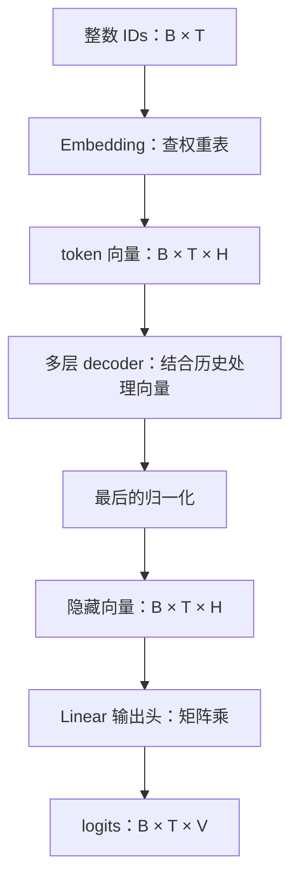
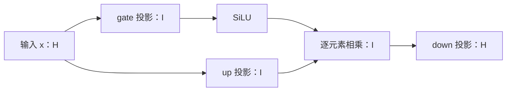

# 第二章：模型的基础计算块

[上一章](01-一次文本生成是怎么发生的.md) · [目录](README.md) · 代码版本：`tutorial-02-v2`（原 `tutorial-02` 保留）

上一章的生成循环调用 `model(input_ids)` 得到 logits。这一章自己写 Embedding、Linear、RMSNorm、SiLU、SwiGLU MLP 和残差分支。Attention、GDN 与完整模型的组合仍由 HF 执行。

完成后，你应该能读懂一层里的 `x + MLP(norm(x))`，并把它与输入端的查表、输出端的词表分数联系起来。

## 1. 先看整个模型的形状

设 B 为请求数、T 为输入长度、H 为隐藏维度、V 为词表大小：



本章的 0.8B 模型里，H=1024，V=248320。第一章的输入有 19 个 token，因此实际形状是：

```text
IDs          [1, 19]
Embedding    [1, 19, 1024]
输出头输入    [1, 19, 1024]
logits       [1, 19, 248320]
```

Embedding 输出和输出头输入的形状相同，但内容不同。中间的层已经让每个位置的向量结合了它能看到的上下文。

## 2. Embedding 是按 ID 取一行

假设词表只有 5 个 token，每个 token 用 3 个数表示，Embedding 权重表是：

| ID | 维度 1 | 维度 2 | 维度 3 |
|---|---:|---:|---:|
| 0 | 1 | 0 | 1 |
| 1 | 0 | 1 | 1 |
| 2 | 1 | 1 | 0 |
| 3 | -1 | 0 | 1 |
| 4 | 0 | -1 | 1 |

输入 IDs `[2,0]`，取第 2 行和第 0 行：

```text
输入      [2, 0]
输出      [[1, 1, 0],
           [1, 0, 1]]
```

因此 Embedding 的形状变换是 `[T] → [T,H]`。加上 batch 维度，就是 `[B,T] → [B,T,H]`。

[layers.py](../../tutorial_code/layers.py) 中完整的计算只有一行：

```python
return self.weight[token_ids]
```

这些向量来自已训练的权重。推理时读取它们，不在这里重新学习。整数 ID 的大小不表示语义距离；它只是表里的索引。

## 3. 中间的层负责处理上下文

相同的 ID 在输入端总会取到相同的 Embedding 行。在不同前缀中，它经过 decoder 层之后，隐藏向量可以不同。

```text
相同 token ID
    ↓ 查同一行
相同的初始向量
    ↓ 与不同的可见历史一起处理
不同的上下文向量
    ↓ 输出头
不同的下一 token 分数
```

这解释了为什么不能把刚查出的 Embedding 直接当成完整模型的输出。Attention、GDN、MLP 和归一化都发生在这段中间计算里。本章先完成 MLP 和归一化的基础计算。

验证时先捕获 HF 中间结果，给我们的组件相同输入，再检查各组件和残差分支的输出。

## 4. Linear 把向量变成分数

设输出头权重 W 的形状为 `[V,H]`，当前隐藏向量 h 的形状为 `[H]`。第 j 个 token 的分数是：

\[
\mathrm{logit}_j=\sum_{i=1}^{H}h_i W_{j,i}
\]

就是 h 与第 j 行权重做内积。所有行一起计算，得到 V 个分数。

用上面的 5×3 权重表作输出头，假设中间层产生了 `h=[1,2,0]`：

```text
ID 0：1×1  + 2×0  + 0×1 =  1
ID 1：1×0  + 2×1  + 0×1 =  2
ID 2：1×1  + 2×1  + 0×0 =  3
ID 3：1×-1 + 2×0  + 0×1 = -1
ID 4：1×0  + 2×-1 + 0×1 = -2
```

logits 为 `[1,2,3,-1,-2]`，greedy 选择 ID 2。

## 5. 为什么写成 x @ weight.T

矩阵乘的规则是：

```text
[T,H] @ [H,V] → [T,V]
```

权重通常存成 `[输出维度,输入维度]`，这里是 `[V,H]`，所以需要转置为 `[H,V]`：

```python
return x @ self.weight.T
```

这就是本章写的 Linear。它也能处理 `[B,T,H]` 输入，对每个 batch、每个位置做相同的映射。

这里使用没有 bias 的 Linear，与当前模型匹配。一般的 Linear 可以有偏置项 `xWᵀ+b`；后面不同投影的输入、输出维度会变，核心计算仍相同。

## 6. 两端为什么能共用权重

0.8B 模型设置了 `tie_word_embeddings=True`，Embedding 与输出头共享同一张 `[V,H]` 权重表：

```text
输入端：按 ID 取 W 的一行
输出端：隐藏向量与 W 的所有行做内积
```

两种操作用同一份权重，但做的计算不同。这样也少保存一份大矩阵。其他模型可以使用独立输出头；当前项目的 27B 目标模型就采用独立权重。

本章示例从 HF 读取真实权重后，在 MLX 中创建我们的 Embedding 和 Linear。`layers.py` 的计算只依赖 MLX；验证脚本使用 HF 作为对照。

## 7. RMSNorm 控制向量尺度

一层层变换会改变向量的数值大小。RMSNorm 先计算最后一个维度上的均方根，再用它缩放向量，最后乘可学习的逐维权重。

对 H 维向量 x：

\[
r=\sqrt{\frac{1}{H}\sum_{i=1}^{H}x_i^2+\epsilon},\qquad
y_i=\frac{x_i}{r}\,s_i
\]

例如 `x=[3,4]`，先取 `ε=0`、缩放权重 `s=[1,1]`：

```text
平方              [9, 16]
平方的平均         12.5
均方根            sqrt(12.5) ≈ 3.5355
除以均方根         [0.8485, 1.1314]
```

归一化后这两个数的平方平均值为 1。分母是同一个标量，所以这一步调整整体尺度；后面的逐维权重还可以分别调整各个维度。

实际计算加 `ε`，防止接近零的输入导致除零。它不减去均值，与 LayerNorm 的步骤不同。

当前 Qwen 模型使用零中心参数形式，存储的是 w，实际缩放系数是 `s=1+w`。所谓“零中心”说的是权重参数以零为初始值，初始化时实际缩放仍为 1。

`layers.py` 明确写出这几步，暂时不调用融合版 norm：

```python
mean_square = mx.mean(xf * xf, axis=-1, keepdims=True)
normalized = xf * mx.rsqrt(mean_square + self.eps)
scale = 1.0 + self.weight
return (normalized * scale).astype(x.dtype)
```

`xf` 是 x 转成 fp32 的结果。最后返回原输入 dtype。当前测试统一使用 fp32，先把数学和权重约定验证清楚。

## 8. SiLU 引入非线性

连续几个无 bias 的 Linear 可以合并成一个矩阵乘。模型需要非线性计算，才能超出一个线性映射的表达能力。

本模型的 MLP 使用 SiLU：

\[
\operatorname{SiLU}(x)=x\,\sigma(x),\qquad
\sigma(x)=\frac{1}{1+e^{-x}}
\]

它对每个元素分别计算：

| 输入 | sigmoid | SiLU |
|---|---:|---:|
| -2 | 约 0.1192 | 约 -0.2384 |
| 0 | 0.5 | 0 |
| 2 | 约 0.8808 | 约 1.7616 |

代码是：

```python
return x * mx.sigmoid(x)
```

sigmoid 的值在 0 与 1 之间，SiLU 的结果还乘了 x，因此可以为负，也可以大于 1。

## 9. 用三个 Linear 组成 SwiGLU MLP

这份模型的 MLP 同时计算两条分支：

\[
g=\operatorname{SiLU}(xW_{gate}^\top),\qquad
u=xW_{up}^\top,\qquad
\operatorname{MLP}(x)=(g\odot u)W_{down}^\top
\]

`⊙` 是逐元素乘法。gate 分支经过激活后调制 up 分支，然后 down 投影映射回原隐藏维度。



本模型的 H=1024、I=3584：

| 投影 | 权重形状 | 输入 → 输出 |
|---|---|---|
| gate_proj | `[3584,1024]` | 1024 → 3584 |
| up_proj | `[3584,1024]` | 1024 → 3584 |
| down_proj | `[1024,3584]` | 3584 → 1024 |

因此整个 MLP 保持输入与输出的形状 `[B,T,H]`。它在每个 token 位置分别执行，不会直接混合不同 token。历史信息的混合由 Attention 或 GDN 完成。

实现对应三个已经写好的 Linear：

```python
gate = silu(self.gate_proj(x))
value = self.up_proj(x)
return self.down_proj(gate * value)
```

小例子中，令三个投影都是 2×2 单位矩阵，输入 `[1,2]`：

```text
gate 投影后             [1, 2]
SiLU 后                 [0.7311, 1.7616]
up 分支                 [1, 2]
逐元素相乘              [0.7311, 3.5232]
down 是单位矩阵，输出    [0.7311, 3.5232]
```

测试用独立的 NumPy 公式检查这个结果，再对照真实模型第一层的 MLP。

## 10. 残差连接把改变量加回输入

MLP 输出仍是 H 维，因此可以与输入逐元素相加：

\[
y=x+\operatorname{MLP}(\operatorname{RMSNorm}(x))
\]

先保留一份原始 x，把归一化后的输入交给 MLP，再把 MLP 结果加回原始 x。这一结构叫 pre-norm 残差分支。


代码里的 `FeedForwardBlock` 就是：

```python
return x + self.mlp(self.norm(x))
```

如果 MLP 的改变量为零，输出就等于 x。测试把 down 投影设成零矩阵，检查这个性质，防止不小心加回了 norm 后的向量。

一层 decoder 总共有两个类似分支：

```python
x = x + mixer(norm1(x))
x = x + mlp(norm2(x))
```

本章完成第二段的独立实现。第一段的 mixer 是 Attention 或 GDN，后面继续拆。

## 11. 这一章替换了 HF 的哪些计算

这里的“替换”指：拿到同样输入和权重，用自己的 MLX 实现重算，并与 HF 比较。第一章的 `generate.py` 仍然调用 HF 完整模型，本章没有把所有基础组件接入生成循环。

| 组件 | 本章的独立实现 | 对照范围 |
|---|---|---|
| Embedding | 按 ID 查权重行 | 真实模型输入 |
| Linear | `x @ weight.T` | 输出头及 MLP 内的三个投影 |
| RMSNorm | 显式均方根缩放 | 第一层的两个 norm、最后一个 norm |
| SiLU | `x * sigmoid(x)` | 手算例子与真实 MLP 组合 |
| SwiGLU MLP | 三个投影＋激活＋逐元素乘 | 第一层 MLP |
| MLP 残差分支 | `x + mlp(norm(x))` | 第一层的完整第二分支 |
| 最后 norm＋输出头 | 两个手写组件串接 | 整个 prompt 的词表分数 |

HF 仍提供 Attention、GDN、其余层与完整前向。等这些实现齐全后，才把生成循环里的 `model(input_ids)` 整体替换掉。

## 12. 给两边同一份输入，逐项验证

[check_layers.py](../../tutorial_code/check_layers.py) 先检查小矩阵和手算例子，然后加载第一章相同 revision 的 0.8B 模型。输入直接使用第一章记录的 IDs，不再经过 tokenizer。

验证脚本用 HF 的 hook 捕获各组件输入与输出。给我们的组件相同输入，能够单独定位是哪段计算有差异。

此外还检查两段组合：第一层 `norm → MLP → 残差相加`，以及最后 `norm → 输出头`。最后一段预测的首 token 必须与第一章一致。

```bash
cd /Users/ryanli/code/minivllm-tutorial
/Users/ryanli/code/minivllm/.venv/bin/python tutorial_code/check_layers.py
```

已在教学目录独立安装环境时：

```bash
uv run python tutorial_code/check_layers.py
```

HF 在 MPS 上运行，手写算子用 MLX。数值检查使用 fp32、最大绝对误差 < 0.001；手算例子的阈值更小。输出头还比较各位置的 argmax 与第一章首 token。

本次实测全部检查通过，最大差约 `7.6e-6`；最后 norm 与输出头串接后，各位置 argmax 与 HF 一致，首 token 仍是 `79852`。

本地结果保存为 [chapter02-v2-checks.json](../../tutorial_code/examples/chapter02-v2-checks.json)。这是组件和组合分支的验证，覆盖当前 prompt 与第一层；它不证明所有输入、所有层或低精度路径都正确。

## 13. 用两个改动检查自己的理解

先把小例子的 norm 输入 `[3,4]` 改成 `[30,40]`，保留 `ε=0` 和相同权重。归一化结果相同，因为分子和均方根都增大了 10 倍。

再把 MLP 的 down 权重改成零矩阵，检查 `FeedForwardBlock` 的输出是否等于原输入。改变量变成零，残差仍然保留。

这两个性质都与真实代码的步骤直接对应。修改实验输入时，也要同步修改测试中的预期值。

## 14. 固定这次扩展的版本

初版 `tutorial-02` 继续保存 Embedding 和 Linear 的代码。扩展版固定为 `tutorial-02-v2`，查看本次新增计算：

```bash
git diff tutorial-02 tutorial-02-v2 -- tutorial_code/layers.py
```

下一章开始实现 Attention：先看 q/k/v、因果掩码和一次完整的注意力计算，再接回这一章已经写好的基础块。
