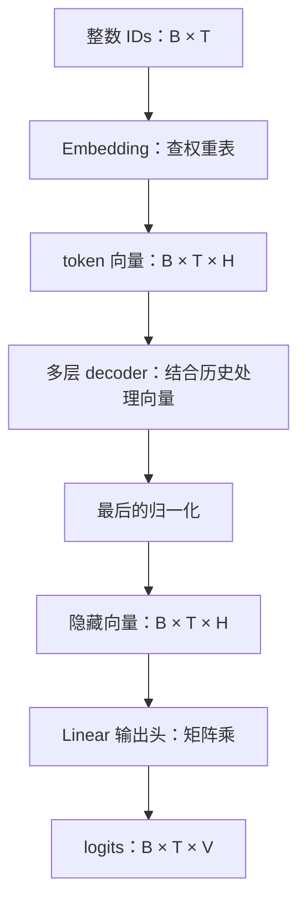
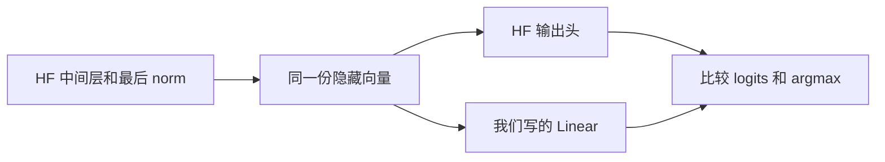

# 第二章：从 ID 到向量，再到分数

[上一章](01-一次文本生成是怎么发生的.md) · [目录](README.md) · 代码版本：`tutorial-02`

上一章的生成循环调用 `model(input_ids)` 得到 logits。这一章打开这个调用的两端，自己写 Embedding 和 Linear。中间的 decoder 层继续由 HF 执行。

完成后，你应该能解释 `[B,T] → [B,T,H] → [B,T,V]`，并知道为什么输出头需要一次矩阵乘。

## 1. 先看整个模型的形状

设 B 为请求数、T 为输入长度、H 为隐藏维度、V 为词表大小：



本章的 0.8B 模型里，H=1024，V=248320。第一章的输入有 19 个 token，因此实际形状是：

```text
IDs          [1, 19]
Embedding    [1, 19, 1024]
输出头输入    [1, 19, 1024]
logits       [1, 19, 248320]
```

Embedding 输出和输出头输入的形状相同，但内容不同。中间的层已经让每个位置的向量结合了它能看到的上下文。

## 2. Embedding 是按 ID 取一行

假设词表只有 5 个 token，每个 token 用 3 个数表示，Embedding 权重表是：

| ID | 维度 1 | 维度 2 | 维度 3 |
|---|---:|---:|---:|
| 0 | 1 | 0 | 1 |
| 1 | 0 | 1 | 1 |
| 2 | 1 | 1 | 0 |
| 3 | -1 | 0 | 1 |
| 4 | 0 | -1 | 1 |

输入 IDs `[2,0]`，取第 2 行和第 0 行：

```text
输入      [2, 0]
输出      [[1, 1, 0],
           [1, 0, 1]]
```

因此 Embedding 的形状变换是 `[T] → [T,H]`。加上 batch 维度，就是 `[B,T] → [B,T,H]`。

[layers.py](../../tutorial_code/layers.py) 中完整的计算只有一行：

```python
return self.weight[token_ids]
```

这些向量来自已训练的权重。推理时读取它们，不在这里重新学习。整数 ID 的大小不表示语义距离；它只是表里的索引。

## 3. 中间的层负责处理上下文

相同的 ID 在输入端总会取到相同的 Embedding 行。在不同前缀中，它经过 decoder 层之后，隐藏向量可以不同。

```text
相同 token ID
    ↓ 查同一行
相同的初始向量
    ↓ 与不同的可见历史一起处理
不同的上下文向量
    ↓ 输出头
不同的下一 token 分数
```

这解释了为什么不能把刚查出的 Embedding 直接当成完整模型的输出。后面要逐步实现的 Attention、GDN、MLP 和归一化，都发生在这段中间计算里。

这一章先用 HF 提供中间结果，把两端的实现单独验证。

## 4. Linear 把向量变成分数

设输出头权重 W 的形状为 `[V,H]`，当前隐藏向量 h 的形状为 `[H]`。第 j 个 token 的分数是：

\[
\mathrm{logit}_j=\sum_{i=1}^{H}h_i W_{j,i}
\]

就是 h 与第 j 行权重做内积。所有行一起计算，得到 V 个分数。

用上面的 5×3 权重表作输出头，假设中间层产生了 `h=[1,2,0]`：

```text
ID 0：1×1  + 2×0  + 0×1 =  1
ID 1：1×0  + 2×1  + 0×1 =  2
ID 2：1×1  + 2×1  + 0×0 =  3
ID 3：1×-1 + 2×0  + 0×1 = -1
ID 4：1×0  + 2×-1 + 0×1 = -2
```

logits 为 `[1,2,3,-1,-2]`，greedy 选择 ID 2。

## 5. 为什么写成 x @ weight.T

矩阵乘的规则是：

```text
[T,H] @ [H,V] → [T,V]
```

权重通常存成 `[输出维度,输入维度]`，这里是 `[V,H]`，所以需要转置为 `[H,V]`：

```python
return x @ self.weight.T
```

这就是本章写的 Linear。它也能处理 `[B,T,H]` 输入，对每个 batch、每个位置做相同的映射。

这里使用没有 bias 的 Linear，与当前模型匹配。一般的 Linear 可以有偏置项 `xWᵀ+b`；后面不同投影的输入、输出维度会变，核心计算仍相同。

## 6. 两端为什么能共用权重

0.8B 模型设置了 `tie_word_embeddings=True`，Embedding 与输出头共享同一张 `[V,H]` 权重表：

```text
输入端：按 ID 取 W 的一行
输出端：隐藏向量与 W 的所有行做内积
```

两种操作用同一份权重，但做的计算不同。这样也少保存一份大矩阵。其他模型可以使用独立输出头；当前项目的 27B 目标模型就采用独立权重。

本章示例从 HF 读取真实权重后，在 MLX 中创建我们的 Embedding 和 Linear。学习代码只依赖 MLX；验证脚本使用 HF 作为对照。

## 7. 验证时给两边相同的输入

完整代码在 [check_layers.py](../../tutorial_code/check_layers.py)。它做两组检查：

1. 上面的小矩阵：Embedding 行选择和 Linear 内积是否与手算相同。
2. 真实模型：使用相同权重，比较我们的 Embedding 与 HF；再捕获 HF 输出头的输入，用我们的 Linear 重算 logits。



这样检查的是这两个算子的实现。整模型仍有部分依赖 HF，不能把这一章的成功称为完整模型已经手写完成。

从教学目录运行，复用已经安装的环境：

```bash
cd /Users/ryanli/code/minivllm-tutorial
/Users/ryanli/code/minivllm/.venv/bin/python tutorial_code/check_layers.py
```

在教学目录独立安装了环境时，也可以运行：

```bash
uv run python tutorial_code/check_layers.py
```

脚本默认使用第一章相同的模型 revision、输入 IDs 和 fp32 精度，不再经过 tokenizer。HF 在 MPS 上运行，两个手写算子用 MLX；MPS 不可用时可以指定 `--device cpu` 运行 HF 参考。

运行记录见 [chapter02-checks.json](../../tutorial_code/examples/chapter02-checks.json)。判据是 Embedding 无差异、Linear 最大差 < 0.001、各位置 argmax 一致，最后一个位置预测的 ID 与第一章一致。跨后端浮点计算可能有小误差，比较时同时检查数值与结果。

## 8. 改一个数，再手算一次

把小例子中的 h 从 `[1,2,0]` 改成 `[0,0,1]`。新的 logits 是 `[1,1,0,1,1]`，最高分出现多次。这份实现的 argmax 会返回第一个最大值的位置，即 ID 0。

本章检查脚本还断言原例子的结果，因此修改实验输入时也要修改对应的预期值。真实模型的检查保留不变。

如果你能解释这三个问题，就可以进入下一章：

- Embedding 为什么给整数输入多加了一维？因为每个 ID 被替换成 H 个数。
- Linear 为什么转置权重？因为输入的 H 维需要与权重的 H 维相乘并求和。
- 两端形状相同的向量为什么不是同一个东西？因为中间层已经处理了上下文。

下一章先写归一化、MLP 与残差连接，继续把中间的 decoder 层拆小。
