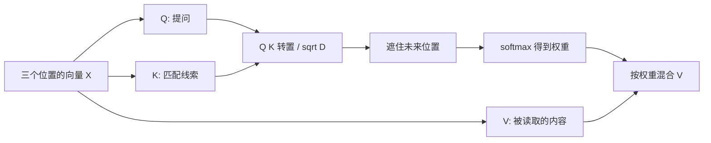

# 03：让一个 token 读到前面的 token——Attention

第二章的 Linear、RMSNorm 和 MLP 都主要处理一个位置内部的向量。本章补上完整的 Attention：让不同位置交换信息。

| 之前 | 本章之后 |
|---|---|
| HF 计算 Attention | 同样的真实输入与权重，可以交给我们写的 MLX Attention |
| 只会读基础计算块 | 能顺着 Q/K/V、RoPE、因果 mask 和输出门读完整 mixer |
| 完整生成调用 HF | **完整生成仍调用 HF；本章先核对组件** |

代码版本：`tutorial-03`；上一个版本是 `tutorial-02-v2`。实现参考原 [minivllm/model/attention.py](../../minivllm/model/attention.py)，整理到独立的 [教学 Attention](../../tutorial_code/miniengine/model/attention.py)。教学代码没有导入完成版引擎。

## 1. 为什么有 Q、K、V 三份向量

假设输入是三个 token：`小猫 / 吃 / 鱼`。Embedding 已经把它们变成三行向量，但第三行还需要知道前两行写了什么。

同一个位置经过三个投影：

- Q（query）：这个位置要找什么。
- K（key）：这个位置能被怎样找到。
- V（value）：找到这个位置后，取出什么信息。

这些名称只是帮助理解；Q/K/V 都是权重矩阵对向量做投影，没有额外的搜索数据库。



对位置 \(i\)，先算每个允许读取的位置 \(j\) 的分数：

先算匹配分数：

\[
s_{ij}=\frac{q_i\cdot k_j}{\sqrt D}
\]

再把分数转换为权重：

\[
p_{ij}=\operatorname{softmax}(s_i)_j
\]

最后按权重混合内容：

\[
o_i=\sum_j p_{ij}v_j
\]

举一个已经完成 softmax 的例子：第三个位置对三个位置的权重是 `[0.1, 0.2, 0.7]`，V 是 `[2, 4, 10]`。输出就是 `0.1×2 + 0.2×4 + 0.7×10 = 8`。真实 V 是向量，按每个分量做同样的加权。

这一步让第三个位置的输出包含前两个位置的信息。

## 2. 为什么要遮住未来

我们同时计算整个输入，只是为了并行。生成模型在位置 0 不能偷看位置 1、2。

三个 query 对三个 key 的允许关系是：

```text
              key 0  key 1  key 2
query 0         ✓      ×      ×
query 1         ✓      ✓      ×
query 2         ✓      ✓      ✓
```

把不允许的位置分数设为负无穷，softmax 后它们的权重为 0。这就是 causal mask（因果掩码）。“因果”在这里指只能用当前位置和过去的位置。

核对实现时有一个直接测试：只改最后一个输入 token，前面的输出应保持不变。只检查输出形状，发现不了偷看未来的问题。

## 3. 这个模型还有三个需要注意的细节

**按头拆 Q 和 gate。** Qwen3.5 的 `q_proj` 不只输出 Q，还输出一个门。先 reshape 成 `[T, Hq, 2D]`，再沿最后一维分成两份。不能先把整个输出平分成前后两半，再去分头：它们在权重中的排列不同。

**GQA：多个 query 头共用 key/value 头。** 例如 4 个 Q 头、2 个 K/V 头：Q 的头 0、1 读 K/V 头 0，Q 的头 2、3 读 K/V 头 1。这样减少 K/V 的存储。MLX 的 attention 算子处理这个分组关系，教学路径无需手动复制所有 K/V。

**RoPE：给 Q/K 加上位置信息。** 相同内容出现在不同位置，Q/K 也应该能区分。RoPE 用位置相关的角度旋转向量的成对维度。一个二维例子：`[1, 0]` 旋转 90° 后是 `[0, 1]`。实际角度随位置和维度变化。

本模型只旋转配置指定的 `rotary_dim` 个维度，剩余维度保持原值；采用非交错的配对布局。照搬另一个模型的“相邻两维一对”实现会把位置编码算错。完整实现看 [layers.py 的 apply_rope](../../tutorial_code/miniengine/model/layers.py)。

## 4. HF 调用内部原本做了什么

第一章的 `model(input_ids).logits` 最终会走到 [HF 参考源码](../../ref/modeling_qwen3_5.py) 的 `Qwen3_5Attention.forward`。这里摘出计算主线，省去接口参数：

```python
query_states, gate = torch.chunk(
    self.q_proj(hidden_states).view(*input_shape, -1, self.head_dim * 2),
    2, dim=-1,                                    # ← 关键① 每个头内拆 Q / gate
)
gate = gate.reshape(*input_shape, -1)
query_states = self.q_norm(query_states.view(hidden_shape)).transpose(1, 2)
key_states = self.k_norm(self.k_proj(hidden_states).view(hidden_shape)).transpose(1, 2)
value_states = self.v_proj(hidden_states).view(hidden_shape).transpose(1, 2)
query_states, key_states = apply_rotary_pos_emb(query_states, key_states, cos, sin)
attn_output, _ = attention_interface(             # ← 关键② 因果 attention / GQA
    self, query_states, key_states, value_states,
    attention_mask, scaling=self.scaling,
)
attn_output = attn_output.reshape(*input_shape, -1)
attn_output = attn_output * torch.sigmoid(gate)     # ← 关键③ 输出门
return self.o_proj(attn_output), attn_weights
```

`attention_interface` 的实现会随 HF 配置变化。我们复写的是它需要保证的计算含义：有因果约束的 scaled dot-product attention。

## 5. 我们怎样替换它

教学接口去掉外层的单请求 batch 维：输入 `x` 是 `[T, hidden_size]`。进入 attention 算子前，再整理成它需要的形状。

```python
qg = self.q_proj(x).reshape(T, self.n_heads, 2 * self.head_dim)
q, gate = mx.split(qg, 2, axis=-1)                # ← 关键① 与 HF 相同的头内布局
k = self.k_proj(x).reshape(T, self.n_kv_heads, self.head_dim)
v = self.v_proj(x).reshape(T, self.n_kv_heads, self.head_dim)
q, k = self.q_norm(q), self.k_norm(k)

q = apply_rope(q.transpose(1, 0, 2)[None], 0, self.rotary_dim, self.theta)
k = apply_rope(k.transpose(1, 0, 2)[None], 0, self.rotary_dim, self.theta)
v = v.transpose(1, 0, 2)[None]
o = mx.fast.scaled_dot_product_attention(         # ← 关键② 调用 MLX 的 GPU 算子
    q, k, v, scale=self.scale, mask="causal",
)
o = o[0].transpose(1, 0, 2).reshape(T, -1)
return self.o_proj(o * mx.sigmoid(gate.reshape(T, -1)))  # ← 关键③ 门 + 输出投影
```

这是无 cache 整段计算的阅读节选，完整代码处理 `T=1` 等边界。使用 MLX 的 GPU 算子是我们选择的基础设施；本章手写的是模型结构、布局与计算组合，并没有从零写矩阵乘或 GPU attention kernel。

把形状连起来看：

```text
x                 [T, hidden]
q / k / v         [T, Hq, D] / [T, Hkv, D] / [T, Hkv, D]
attention 输入    [1, Hq, T, D] / [1, Hkv, T, D] / [1, Hkv, T, D]
输出 o            [T, Hq×D]
o_proj(o×门)      [T, hidden]
```

第二章的教学层现在也整理成 `mlx.nn.Module`，方便后续注册参数和严格加载权重。这是装配接口的变化，RMSNorm 和 MLP 的数学沿用第二章。

## 6. 本章的代码 diff 与验证

```diff
- # Attention 的实现完全由 HF 内部负责
+ # 新增独立 Attention：投影 → q/k norm → partial RoPE
+ # → causal GQA → sigmoid gate → 输出投影
+ attention = Attention(cfg)
+ ours = attention(same_hidden_states)
```

```bash
git diff tutorial-02-v2 tutorial-03 -- tutorial_code/miniengine tutorial_code/check_attention.py
python -m tutorial_code.check_attention
```

检查脚本读取真实 HF attention 层的权重，捕获同一条 prompt 进入该层的 hidden states，再比较完整输出；同时检查改变未来输入不会影响过去输出。结果记录由检查脚本输出，误差判断对应相同权重与 fp32 条件。

此时 **没有修改第一章 `generate.py` 的完整前向调用**。我们已经有一个可单独运行、能与 HF 核对的 Attention，下一章补齐另一种 mixer——GDN。第五章才把它们接成完整模型。

[下一章：04 GDN](04-gdn.md)

## 本机验证记录

完整结果见 [chapter03-checks.json](../../tutorial_code/examples/chapter03-checks.json)。这是本章代码实际运行的结果：

```json
{
  "chapter": "03",
  "baseline": "HF float32 MPS",
  "layer": 3,
  "input_shape": [
    19,
    1024
  ],
  "output_shape": [
    19,
    1024
  ],
  "max_abs_error": 5.476176738739014e-07,
  "causal_future_change_error": 0.0,
  "integration": "component check; generation remains HF"
}
```
