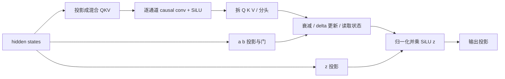

# 04：不用保存所有 K/V 的记忆——Gated DeltaNet

上一章的 Attention 读历史 K/V。本模型的很多层使用另一种 mixer：Gated DeltaNet，简称 GDN。它把过去压进一个矩阵状态，再用新 token 更新这个状态。

| 之前 | 本章之后 |
|---|---|
| HF 计算 GDN | 我们实现投影、因果卷积、门、状态递推和输出归一化 |
| 只有 Attention mixer | 两种 mixer 都能独立运行和核对 |
| 完整生成调用 HF | **完整生成仍调用 HF；第五章完成装配** |

代码版本：`tutorial-04`；上一个版本是 `tutorial-03`。本章参考原 [GDN 层](../../minivllm/model/gdn.py) 与 [递推实现](../../minivllm/kernels/gdn.py)，使用独立的 [教学 GDN](../../tutorial_code/miniengine/model/gdn.py) 和 [教学递推](../../tutorial_code/miniengine/kernels/gdn.py)。先写清楚递推。第六章接入通用 MLX 分块算法，第九章解释块内求解并用 Metal 优化。

## 1. Attention 保存记录，GDN 更新状态

```text
Attention：  K0 V0 | K1 V1 | K2 V2 | ...  后来的 Q 可以逐条读取
GDN：        S0 → S1 → S2 → S3 → ...     后来的 Q 读取当前矩阵 S
```

对一个头，状态 `S` 的形状是 `[Dk, Dv]`。可以把它理解为“输入一个 key 方向，返回一个 value 向量”的小型记忆表：

\[
\text{读记忆}(k)=k^\top S.
\]

它是有限容量的矩阵，并不保存每个 token 的独立条目。因此状态大小不随历史长度增长，也不能像普通 Attention 那样任意逐条读取完整过去。

## 2. Delta：写入还没记住的部分

先省略衰减。假设当前 key 是 \(k\)，希望它对应的内容是 \(v\)。状态已经给出预测 \(k^\top S\)，就只需要补上差额：

\[
\delta=\beta(v-k^\top S),\qquad S\leftarrow S+k\delta^\top.
\]

`β` 在 0 和 1 之间，控制写入强度。`k δᵀ` 是外积：`[Dk] × [Dv]` 得到 `[Dk, Dv]`，所以可以加到 S 上。

一个易算的例子，忽略归一化的 epsilon：

```text
k = [1, 0]，v = [4]，β = 0.5，S = [[0], [0]]
预测 = kᵀS = 0
差额 = 0.5×(4−0) = 2
新 S = [[2], [0]]
```

如果下一次仍想写入 `v=4`，不衰减且 β=0.5，预测已经是 2，就只再补 1，状态变成 3。它朝目标靠近，没有每次把完整的 4 叠上去。这就是 delta rule。

## 3. Gated：先衰减旧记忆，再计算差额

完整的一步有明确顺序：

\[
\bar S_t=e^{g_t}S_{t-1},
\]

\[
\delta_t=\beta_t(v_t-k_t^\top\bar S_t),
\]

\[
S_t=\bar S_t+k_t\delta_t^\top,\qquad o_t=q_t^\top S_t.
\]

**预测必须读衰减后的状态 \(\bar S_t\)。** 写成 `v − kᵀS_old` 再衰减，会得到另一套算法。

继续刚才的状态 `S=[[2],[0]]`，令衰减倍率 `exp(g)=0.5`：

```text
先衰减：  S_bar = [[1], [0]]
读预测：  kᵀS_bar = 1
补差额：  δ = 0.5×(4−1) = 1.5
更新：    S_new = [[2.5], [0]]
```

若归一化后的 Q 是 `[1,0]/sqrt(2)`，本步输出就是 `2.5/sqrt(2)`。Q 决定读哪个方向，K 决定写哪个方向，二者的任务不同。

真实模型从输入投影出 `a`、`b`，再产生门：

\[
\beta=\sigma(b),\qquad
g=-e^{A_{\log}}\operatorname{softplus}(a+dt_{bias}).
\]

`g≤0`，所以 `0<exp(g)≤1`。这里的 g 是**衰减倍率的对数**，不是已经可以直接乘状态的倍率。门参数和矩阵状态使用 fp32，降低长序列累积误差。

## 4. 进入递推前，还有一个因果卷积

GDN 不是把原始 hidden states 直接丢进上述公式：



卷积只读当前及过去的几个输入。假设一条通道的卷积核是 `[1,2,3]`，输入是 `[5,7]`，开头补零：

```text
t=0： [0,0,5]·[1,2,3] = 15
t=1： [0,5,7]·[1,2,3] = 31
```

不同通道用不同的卷积核，彼此不混合；这是 depthwise convolution。它在时间维读一个短窗口，通道间混合已经由 Linear 完成。后续增量计算只需保留 `K−1` 个**卷积前输入**，称为 conv state。

这里的 `causal_conv1d` 首先是一项数学计算。HF 可以调用同名加速包，也可以用纯 Torch fallback。我们在 MLX 中写出等价计算，不需要那个包。FLA 同样是可以提供加速 kernel 的库，GDN 公式不依赖必须安装 FLA。

## 5. HF baseline 内部的关键代码

[HF 参考源码](../../ref/modeling_qwen3_5.py) 的 `causal_conv1d_fn` 使用：

```python
out = F.conv1d(
    hidden_states, weight.unsqueeze(1),
    padding=weight.shape[-1] - 1,
    groups=hidden_size,                         # ← 关键① 每条通道独立
)[:, :, :seq_len]                              # ← 关键② 只取因果窗口
```

同文件的 `torch_recurrent_gated_delta_rule` 使用：

```python
last_recurrent_state = last_recurrent_state * decay_t  # ← 关键③ 先衰减
kv_mem = (last_recurrent_state * k_t.unsqueeze(-1)).sum(dim=-2)
delta = (v_t - kv_mem) * beta_t                        # ← 关键④ 再预测 / 修正
last_recurrent_state += k_t.unsqueeze(-1) * delta.unsqueeze(-2)
core_attn_out[:, :, i] = (last_recurrent_state * q_t.unsqueeze(-1)).sum(dim=-2)
```

实际 HF 的多 token 前向可能选择 chunk 公式，单步选择 recurrent 公式。这两种方法表达同一个状态更新；本章选择递推版，让计算顺序可见。

## 6. 手写代码：把同一计算搬到 MLX

因果卷积的核心：

```python
xp = mx.concatenate([previous_inputs, x])
y = sum(xp[j:j + T] * w[:, j] for j in range(K))  # ← 关键① 对齐时间窗口
new_conv_state = xp[T:]                          # ← 关键② 保留最近 K−1 行
```

递推的核心：

```python
q, k = l2norm(q), l2norm(k)                      # ← 关键③ L2 norm，不是 RMSNorm
q = q * Dk ** -0.5
for t in range(T):
    S = S * mx.exp(g[t])[:, None, None]          # ← 关键④ 衰减后的 S
    prediction = (S * k[t][:, :, None]).sum(axis=1)
    delta = (v[t] - prediction) * beta[t][:, None]
    S = S + k[t][:, :, None] * delta[:, None, :]
    outputs.append((S * q[t][:, :, None]).sum(axis=1))
```

形状对照：`q/k=[T,Hv,Dk]`、`v=[T,Hv,Dv]`、`g/β=[T,Hv]`、`S=[Hv,Dk,Dv]`。若 key 头数小于 value 头数，先按组重复 Q/K，让每个 value 头都有对应的 Q/K；每个头的状态独立。

递推输出之后，用普通 RMSNorm 归一化，再乘 `SiLU(z)`，最后输出投影。这个 norm 使用普通 scale `w`，与第二章 Qwen 零中心 RMSNorm 的 `1+w` 不同。两种门也不要混淆：β 控制写入，z 控制输出。

## 7. diff、验证与接入范围

```diff
- # GDN 全部由 HF 层内部执行
+ qkv, conv_state = causal_conv1d(projected_x, conv_weight)
+ output, S = gated_delta_rule_recurrent(q, k, v, g, beta)
+ output = out_proj(gated_norm(output, z))
```

```bash
git diff tutorial-03 tutorial-04 -- tutorial_code/miniengine tutorial_code/check_gdn.py
python -m tutorial_code.check_gdn
```

检查脚本核对短窗口卷积，并用真实 HF GDN 的相同输入、权重比较完整层输出。本章单独核对卷积与分段卷积，再比较完整 GDN 输出；第六章继续验证状态接续，第九章单独对照递推和优化 kernel。输出误差用于判断同精度数值实现，不用来宣称性能提升。

**本章有完整的 GDN 组件，但第一章的生成入口仍使用 HF。** 第二章的基础块、第三章的 Attention、这一章的 GDN 都齐了，下一章把它们装成真正独立的模型。

[下一章：05 完整模型](05-model.md)

## 本机验证记录

完整结果见 [chapter04-checks.json](../../tutorial_code/examples/chapter04-checks.json)。这是本章代码实际运行的结果：

```json
{
  "chapter": "04",
  "baseline": "HF float32 MPS + torch grouped conv1d",
  "layer": 0,
  "max_abs_error": 1.7285346984863281e-06,
  "conv_error": 4.76837158203125e-07,
  "conv_split_error": 4.76837158203125e-07,
  "integration": "component check; generation remains HF"
}
```
