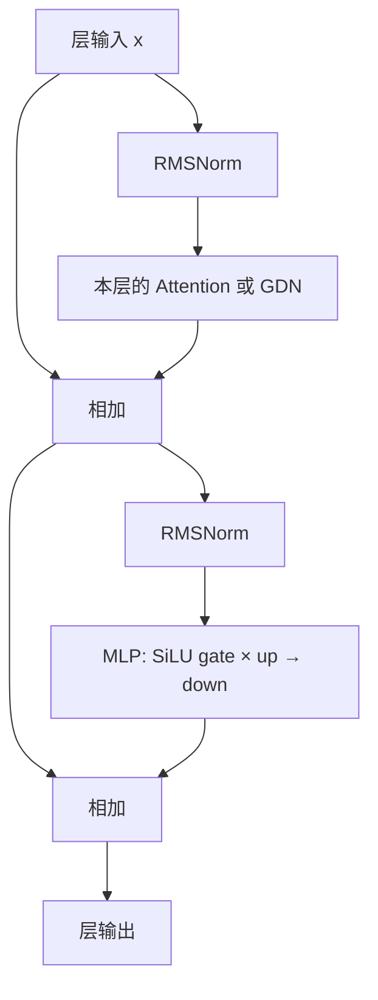

# 05：把零件装起来，第一次用自己的模型生成

本章是一个明确的交接点：**完整模型的 forward 从 HF 切换到我们写的 MLX 模型。** 前三章分别核对基础块、Attention、GDN，这一章把它们按 checkpoint 的配置装在一起。

| 之前 | 本章之后 |
|---|---|
| `generate.py` 调用 HF 的完整模型 | 新入口 `generate_mlx.py` 调用自己的完整模型 |
| 组件分别核对 | 从 token IDs 到 logits 的全链路核对 |
| 每轮重算整个前缀 | 本章继续重算，下一章再加 cache |

代码版本：`tutorial-05`；上一个版本是 `tutorial-04`。主要文件是 [qwen3_5.py](../../tutorial_code/miniengine/model/qwen3_5.py)、[loader.py](../../tutorial_code/miniengine/model/loader.py)、[generate_mlx.py](../../tutorial_code/generate_mlx.py)。结构参考原 [minivllm 完整模型](../../minivllm/model/qwen3_5.py)。

## 1. 一个 layer 究竟怎么算

一层只选择一种 mixer。选择由 `config.layer_types` 决定，不能把所有层都写成 Attention。



计算写成两行：

\[
x'=x+\operatorname{Mixer}(\operatorname{Norm}_1(x)),
\]

\[
x''=x'+\operatorname{MLP}(\operatorname{Norm}_2(x')).
\]

两次相加都是 residual（残差连接）。第二次 norm 的输入是**已经加过 mixer 输出的 \(x'\)**，不是最初的 x。

用标量玩具例子检查顺序：x=10，mixer 分支输出 2，MLP 分支对 x'=12 得到 3。最终输出是 15；如果误把第二次 residual 用成最初的 10，就会得到 13。

## 2. HF 原来在哪里完成这些计算

[HF 参考源码](../../ref/modeling_qwen3_5.py) 的 `Qwen3_5DecoderLayer.forward`：

```python
residual = hidden_states
hidden_states = self.input_layernorm(hidden_states)
if self.block_type == "linear_attention":
    hidden_states = self.linear_attn(hidden_states=hidden_states, ...)
elif self.block_type == "full_attention":
    hidden_states, _ = self.self_attn(hidden_states=hidden_states, ...)
hidden_states = residual + hidden_states          # ← 关键① mixer 残差
residual = hidden_states                          # ← 关键② 更新残差基准
hidden_states = self.post_attention_layernorm(hidden_states)
hidden_states = self.mlp(hidden_states)
hidden_states = residual + hidden_states          # ← 关键③ MLP 残差
```

省略号表示框架的 mask、位置、cache 参数，此段是阅读节选。我们的完整类无需训练、视觉输入和 HF 输出对象，因此接口较短，计算顺序相同。

```python
def __call__(self, x, ctx=None, layer_idx=0):
    h = self.input_layernorm(x)
    mixer = self.self_attn if self.is_attn else self.linear_attn
    x = x + mixer(h, ctx, layer_idx)              # ← 关键① 第一次 residual
    return x + self.mlp(self.post_attention_layernorm(x))  # ← 关键② 使用更新后的 x
```

## 3. 从一层装成整个模型

```text
input_ids [T]
  ↓ Embedding
hidden [T, hidden_size]
  ↓ layer 0：GDN 或 Attention + MLP
  ↓ layer 1：GDN 或 Attention + MLP
  ↓ ... 顺序由配置指定
  ↓ 最后 RMSNorm
  ↓ lm_head
logits [T, vocab_size]
```

手写前向的主线：

```python
x = self.embed_tokens(input_ids)
for i, layer in enumerate(self.layers):
    x = layer(x, ctx, i)                         # ← 关键③ 逐层经过自己的组件
x = self.norm(x[-1:] if last_only else x)
logits = self.embed_tokens.as_linear(x) if self.cfg.tie_word_embeddings else self.lm_head(x)
```

`tie_word_embeddings` 表示输入 Embedding 和输出词表投影共享同一份权重。这个配置必须遵守，不能随便另建一个随机 lm_head。

`last_only=True` 时仍然计算所有输入位置的各层 hidden states；只对最后一行做最终 norm 和词表投影。生成只取最后一行 logits，少算前面位置的词表分数不改变下一 token。

假设 `T=100`、词表有 10 万项：完整 logits 有 1000 万个数；只计算最后一行是 10 万个数。这个小优化减少输出头计算，还没有消除重算历史层的开销。

## 4. 结构正确，还需要装对权重

一个层里很多矩阵形状相同。仅靠 shape 加载权重，会把 gate/up 等矩阵装错而不报错。

loader 做三件事：

1. 从 checkpoint 配置构建真实层数、头数、维度与 `layer_types`。
2. 将 checkpoint 名字映射到教学类的参数名字；卷积 `[C,1,K]` 整理为 `[C,K]`。
3. 使用 `strict=True` 核对需要的全部参数，缺失、未知参数或错误形状会报错。

```text
checkpoint: model.language_model.layers.0.linear_attn.conv1d.weight
我们类中:   layers.0.linear_attn.conv1d_weight
形状:       [C,1,K] → [C,K]
```

本教程实现文本模型，所以显式过滤视觉塔和 MTP 的权重；这不表示它们原本在纯文本的普通 forward 中参与计算。

本章使用固定的原始 0.8B checkpoint，并把浮点权重装成 fp32，与 HF 的数学参照一致。第七章再接 MLX 量化文件格式。

## 5. 生成循环真正换了什么

第一章的完整入口保留为 HF baseline。现在新增独立入口，便于同时运行两个参照：

```diff
- model = AutoModelForCausalLM.from_pretrained(...).to("mps")
- logits = model(input_ids=input_ids, use_cache=False).logits
- next_id = torch.argmax(logits[0, -1]).item()
+ model, cfg = load_model(model_dir, dtype=mx.float32)
+ logits = model(mx.array(ids), last_only=True)       # ← 完整 forward 已替换
+ next_id = int(mx.argmax(logits[-1]).item())
  ids.append(next_id)
```

tokenizer 仍在 CLI 边界把文字转成 IDs、把输出 IDs 转回文字。`miniengine` 的模型不认识文字，不负责 OpenAI HTTP serving。继续使用 HF 的 tokenizer 不影响模型 forward 已经独立实现这一事实。

## 6. 跑起来，再检查完整结果

从教学仓库根目录运行，Python 使用已安装 MLX/Torch 的环境：

```bash
python -m tutorial_code.generate_mlx \
  --max-new-tokens 8 \
  --trace-json tutorial_code/examples/chapter05-trace.json
python -m tutorial_code.check_model --tokens 48
git diff tutorial-04 tutorial-05 -- tutorial_code/miniengine tutorial_code/generate_mlx.py
```

检查脚本用 [固定 HF 参考](../../tests/data/hf_0.8b.npz) 核对整段 logits，并逐轮核对 greedy 输出；结果记录在 [chapter05-checks.json](../../tutorial_code/examples/chapter05-checks.json)，实际生成路径和每轮输入长度见 [chapter05-trace.json](../../tutorial_code/examples/chapter05-trace.json)。组件误差会层层传播，因此完整模型是必须补上的验证。

本章交付的是**自己的模型 + 自己的 greedy 循环**。暂时每轮仍输入整个前缀，下一章才从“重新读全部历史”转成“保存历史计算，只读新 token”。

[下一章：06 Cache](06-cache.md)

## 本机验证记录

完整结果见 [chapter05-checks.json](../../tutorial_code/examples/chapter05-checks.json)。这是本章代码实际运行的结果：

```json
{
  "chapter": "05",
  "baseline": "fixed HF fp32 reference",
  "max_abs_error": 0.00010311603546142578,
  "greedy_tokens_checked": 48,
  "generated_ids": [
    79852,
    18887,
    220,
    98435,
    98618,
    103806,
    95779,
    103725,
    111892,
    95726,
    108777,
    111734,
    98853,
    3709,
    96540,
    96580,
    96468,
    100679,
    96547,
    96458,
    98818,
    95860,
    99580,
    103725,
    104234,
    98822,
    9616,
    1536,
    220,
    95793,
    4997,
    46662,
    99131,
    95772,
    21966,
    220,
    96547,
    96458,
    99140,
    95865,
    97318,
    2005,
    96547,
    96458,
    96646,
    108777,
    828,
    95726
  ],
  "integration": "complete model.forward and greedy loop now use miniengine"
}
```
