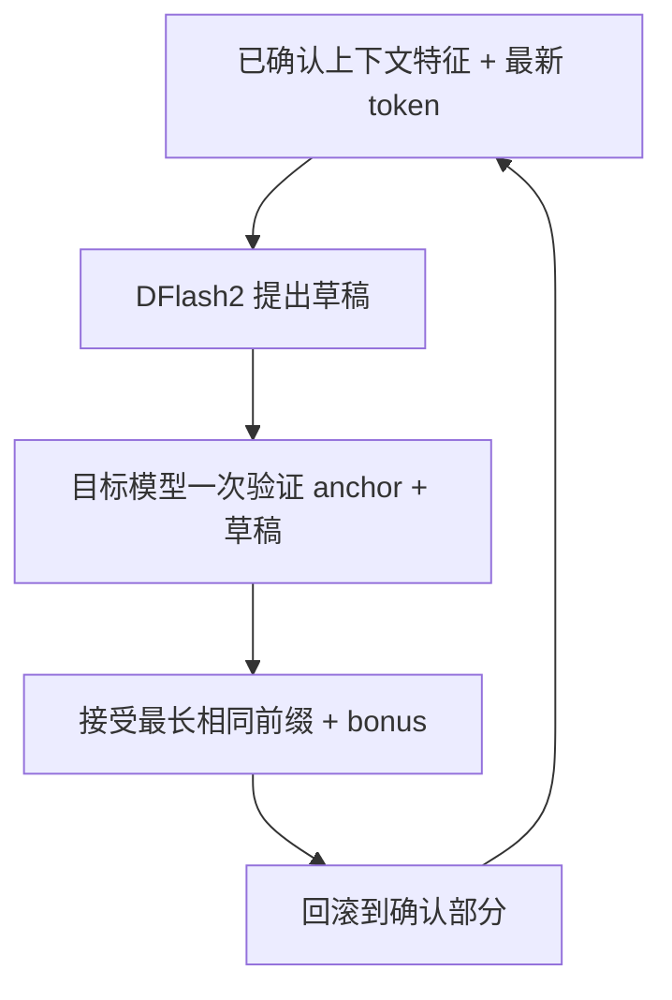

# 10：先写草稿，再让目标模型检查——投机解码

普通 decode 每次执行目标模型，通常只输出一个 token。投机解码让便宜的 drafter 先猜几个 token，再让目标模型一次检查它们。

| 之前 | 本章之后 |
|---|---|
| 目标模型每步预测一个 token | 草稿块经过目标模型验证，可一次交付多个 token |
| cache 只向前增长 | 验证失败后回滚到正确前缀 |
| 普通采样参数 | 投机路径显式只支持 greedy，非零 temperature 报错 |

代码版本：`tutorial-10`；上一个版本是 `tutorial-09`。核心是 [dflash2.py](../../tutorial_code/miniengine/spec/dflash2.py)、[spec_runner.py](../../tutorial_code/miniengine/engine/spec_runner.py) 与新增回滚能力的 [cache.py](../../tutorial_code/miniengine/cache.py)。实现整理移植自原 `minivllm/spec/` 和 `engine/spec_runner.py`。

## 1. 两个模型分别负责什么

目标模型是前面已经实现的完整模型。DFlash2 drafter 是匹配这个目标模型训练的小模型，读取目标模型若干层的上下文特征，提出一块候选 token。



drafter 不是随意换上的另一个小聊天模型。层特征维度、目标层编号和训练块长都需要匹配。教学代码检查配置，不能把 27B 的 drafter 接到 0.8B 目标模型上。

这里目标模型仍决定最终 token。drafter 预测得好时能省执行轮次，预测得差时只会增加工作。

## 2. 为什么要带一个 anchor

回忆第六章：最新生成的 token 还没有进 cache。它正是本轮的 anchor（锚点）。目标模型输入：

```text
cache 已含：    [已确认的过去]
本次输入：      [anchor, draft0, draft1, draft2]
各位置预测：    [post0,  post1,  post2,  post3]
```

anchor 位置的 logits 预测 draft0；draft0 位置的 logits 预测 draft1；最后一个位置的 logits 预测草稿之后的下一个 token。

这是因果模型的一次多 token 前向。只要前面的草稿已经与目标预测匹配，当前位置看到的前缀就与普通 greedy 完全相同。

这里相同的是因果前缀。多 token 验证与普通 M=1 decode 可能选择不同的量化矩阵乘法或归约路径，有限精度下不自动得到相同 logits、状态或 argmax；下面的接受算法不能替代真实模型对照。

## 3. 接受最长前缀，遇到错误就停

假设草稿是 `[10,11,12]`，目标模型各位置 argmax 是 `[10,11,90,91]`：

```text
draft0=10 == post0=10  接受
draft1=11 == post1=11  接受
draft2=12 != post2=90  停止
最终交付： [10,11,90]
```

90 是目标模型对第一个不匹配位置的正确预测，称为 bonus。后面的 91 是基于已经错了的草稿 12 算出来的，不能继续使用。

若一开始就不匹配，交付 `[post0]`；若全部匹配，则交付全部草稿加最后一个 `post`。因此每次至少产生一个目标 token，但不保证比普通 decode 快。

纯 greedy 接受代码：

```python
n = 0
while n < len(drafts) and drafts[n] == posterior[n]:
    n += 1                                       # ← 关键① 只接受连续正确前缀
produced = drafts[:n] + [posterior[n]]             # ← 关键② 总能补一个目标预测
```

随机采样的精确投机算法需要概率比和拒绝修正，不能把这里的 argmax 比较直接套过去。所以代码在入口拒绝非零 temperature，没有静默忽略采样参数。

## 4. 本轮缓存为什么必须回滚

上面的验证已经把 `[anchor,10,11,12]` 全部送进模型，cache 里也写了 12。但我们只确认 anchor、10、11；90 是刚采样出来的，下轮才会进 cache。

```text
验证前：     过去
验证后：     过去 | anchor | 10 | 11 | 12
回滚后：     过去 | anchor | 10 | 11
下轮输入：                                  90（新 anchor）
```

因此保留的验证输入数是 `n+1`：n 个接受草稿，加一个原 anchor。不是交付 token 数里最后的 bonus 也已进入状态。

Attention cache 可以把有效 offset 退回去，错误 K/V 留在无效容量中，下一轮覆盖。GDN 状态把很多 token 混合到同一个矩阵里，不能只改一个长度整数就恢复。

GDN 的做法是：

1. 验证前 snapshot 保存旧 S、conv state 和 offset。
2. 验证时记录输入与 Q/K/V、门的 tape。
3. 回到 snapshot，从它开始重放需要保留的 `n+1` 个输入。
4. 重新构建卷积尾巴，释放 snapshot 与 tape。

重放不是重跑整个模型，只是针对保留前缀重新计算 GDN 状态递推。目标模型提取的上下文特征也只保留 `n+1` 行，不能把错误草稿的特征喂给下一轮 drafter。

## 5. 本章替换了哪段代码

第九章 baseline 的单流 decode 是一次目标 forward + 一次 sample。本章让 runner 的单请求路径选择 `SpecRunner.step`；多个请求仍使用普通 batch decode。

```diff
- logits = target(latest_token, ctx)
- produced = [argmax(logits[-1])]
+ drafts = drafter.draft(features, anchor, ...)
+ for c in caches: c.snapshot()
+ logits, new_features = target([anchor] + drafts, ctx, capture=layers)
+ produced, n = accept_greedy_prefix(drafts, argmax(logits))
+ for c in caches: c.rollback(n + 1)
+ keep_features = new_features[:n + 1]
```

这是流程节选，完整代码将列表转换为 MLX array，并在读取 token IDs 前 `mx.eval`。不要把这个 diff 当成可以单独复制运行的完整类。

本章配置了固定验证块长时，会检查它在 drafter 训练支持的范围内。自适应模式参考旧引擎，按近期接受率选择小块；它是一项策略，不能从其他机器的结果推出本机最优块长。

## 6. 快慢取决于哪些成本

一轮接受 n 个草稿，加上 bonus，在没有 EOS 或输出预算截断时共交付 n+1 个 token。近似吞吐可以写成：

\[
\text{tok/s}\approx
\frac{\mathbb E[n+1]}{t_{draft}+t_{verify}+t_{rollback}+t_{other}}.
\]

块更大可能接受更多，也会提高验证与回滚成本。只报告接受率不足以说明速度；接受率很高但 drafter 很慢，也可能没有收益。

实际吞吐的分子仍须使用停止与截断后真正交付的数量，不能把未交付的 bonus 或草稿计入。

## 7. 先故意给错草稿，再测真实模型

```bash
python -m tutorial_code.check_chapter10 \
  --out tutorial_code/examples/chapter10-rollback-checks.json
```

[回滚报告](../../tutorial_code/examples/chapter10-rollback-checks.json) 包含首个草稿错误、中途错误、全接受三种情况；还检查 K/V 回退与覆盖，以及 GDN 保留 0/1/3/5 个输入后的状态、卷积尾巴和资源清理。

真实目标与 drafter 从**已经下载的本地 HF cache**定位，不触发下载：

```bash
TARGET_DIR="$(python -c 'from huggingface_hub import snapshot_download; print(snapshot_download("mlx-community/Qwen3.8-27B-nvfp4", local_files_only=True))')"
DRAFTER_DIR="$(python -c 'from huggingface_hub import snapshot_download; print(snapshot_download("z-lab/Qwen3.8-27B-DFlash2", local_files_only=True))')"
python -m tutorial_code.check_chapter10 \
  --model-dir "$TARGET_DIR" --drafter-dir "$DRAFTER_DIR" \
  --max-new-tokens 16 --block 5 \
  --out tutorial_code/examples/chapter10-spec-checks.json
git diff tutorial-09 tutorial-10 -- tutorial_code/miniengine
```

[真实模型报告](../../tutorial_code/examples/chapter10-spec-checks.json) 与回滚测试分开。该检查显式设置 `ignore_eos=True`，固定生成16个 token，以比较普通 greedy 与投机输出，并记录接受数和轮数；它没有验证正常 EOS 的完整停止行为。测试 prompt 上相等不等于所有有限精度路径永远相等，更不能用这个正确性记录宣称速度领先。下一章分别说明正常 EOS 与固定步数的测量。

[下一章：11 Baseline 与实验](11-benchmark.md)

## 本机验证记录

完整结果见 [chapter10-checks.json](../../tutorial_code/examples/chapter10-checks.json)。这是本章代码实际运行的结果：

```json
{
  "greedy_accept_cases_passed": 3,
  "attention_offset_and_overwrite_passed": true,
  "gdn_replay_checks": [
    {
      "kept_verify_tokens": 0,
      "state_max_abs": 0.0
    },
    {
      "kept_verify_tokens": 1,
      "state_max_abs": 2.9802322387695312e-08
    },
    {
      "kept_verify_tokens": 3,
      "state_max_abs": 5.960464477539063e-08
    },
    {
      "kept_verify_tokens": 5,
      "state_max_abs": 0.0
    }
  ],
  "real_model_greedy_equal": true,
  "temperature_guard": true,
  "finished_cache_released": true,
  "model_dir": "/Users/ryanli/.cache/huggingface/hub/models--mlx-community--Qwen3.8-27B-nvfp4/snapshots/5ff8ef173ad0d7c3aae92f0be43031a6ab8067c6",
  "drafter_dir": "/Users/ryanli/.cache/huggingface/hub/models--z-lab--Qwen3.8-27B-DFlash2/snapshots/50307d4c4cde6860d4eee73e2547cd786fe8e8a4",
  "max_new_tokens": 16,
  "plain_ids": [
    79852,
    18887,
    220,
    95761,
    60277,
    220,
    103725,
    95772,
    103910,
    109120,
    95865,
    3709,
    111734,
    96221,
    97792,
    100658
  ],
  "speculative_ids": [
    79852,
    18887,
    220,
    95761,
    60277,
    220,
    103725,
    95772,
    103910,
    109120,
    95865,
    3709,
    111734,
    96221,
    97792,
    100658
  ],
  "finished_stats": {
    "req-2": [
      7,
      8
    ]
  },
  "scope": "same target weights greedy parity on this prompt; no throughput claim"
}
```
