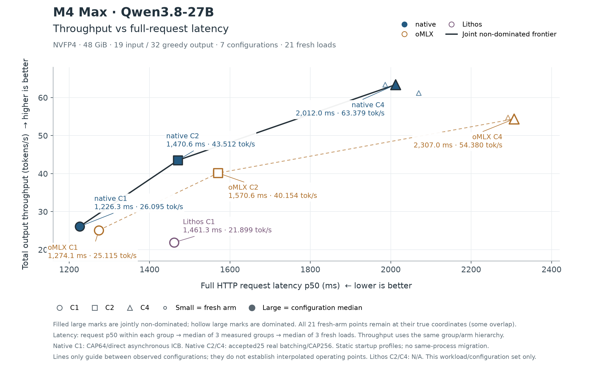

# F2：怎样读吞吐—延迟前沿

[六篇目录](README.md) · [上一节 F1](f1-http-measurement.md) · [下一节 F3](f3-queue-vs-batch.md)

[F1](f1-http-measurement.md)固定了计时方法。现在每个配置对应一个点：横轴是完整请求 p50，越小越好；纵轴是并发组总输出吞吐，越大越好。**正确性是进入比较的前提。**

假设 A 的延迟更低、吞吐更高，那么 A 支配 B；相等的轴也允许，但至少一轴必须严格更好。没有被其他已测点支配的点组成 Pareto 前沿。低延迟和高吞吐可能相互取舍，所以前沿通常不止一个点。



这是旧44章同一轮实验的原图：M4 Max 48 GiB、AC、Qwen3.8-27B NVFP4、每请求19输入/32输出。C1/C2/C4 是客户端同时发出几个请求。大点是配置中位数，小点保留 fresh 重复；连线帮助阅读，不证明线段上的每个位置都能实现。Lithos 在这张旧图只有 C1，下一节补官方排队入口。

**baseline → 新做法：** 不再只测一个 C1 服务，而是按预先选定的并发档位启动明确配置。旧44章实际入口的关键判断为：

```python
return 'direct_c1' if concurrency == 1 else 'legacy_batched'
```

完整入口还有参数检查和显式开关，见下方源码索引。C1 使用 CAP64 的原生单流反馈；C2/C4 使用 CAP256 的已有真实 batching。选择发生在进程启动时，**尚未实现同进程按负载自动迁移**。因此图表达的是可选择的配置集合，不能把整条线归功于某一个新 kernel。

本轮7个配置中，本方 C1/C2/C4 都是非支配点；相应吞吐约为26.09、43.51、63.38 token/s，延迟约1.23、1.47、2.01秒。C4 总吞吐高，但单个请求等得也更久。这就是保留两根轴的原因。

**结论范围保持不变：** 只覆盖这个模型、长度和已测配置。oMLX 的已选配置不代表穷尽所有参数；M5 长输出结果属于另一张图。读“前沿”时必须同时读它的比较集合。

**理解题：** 一个配置延迟1秒、吞吐20，另一个延迟2秒、吞吐40，谁支配谁？

原始记录：[44 同轮实验与启动前后对比](../../experiments/44-fresh-full-throughput-latency.md)；[固定源码、入口与复算方法](../../experiments/44-fresh-full-source/README.md)、[图的数值](../../experiments/44-fresh-full-source/plot-data.json)。下一节：[F3 排队与 batch](f3-queue-vs-batch.md)。
